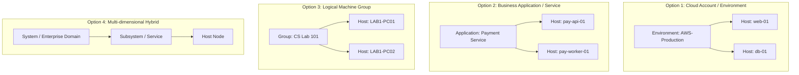
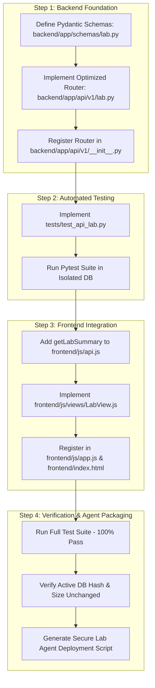

# PHASE 2: CLOUDOPS INTEL CODEBASE ARCHITECTURE & LAB PC MONITORING COMPATIBILITY AUDIT

**Target Platform:** CloudOps Intel — Cloud Intelligence Platform & SRE Command Center  
**Audit Scope:** Full repository architecture, Phase 1 security baseline verification, and `Lab_PC_Monitoring_Complete_Guide` compatibility analysis  
**Mode:** Strictly Read-Only Investigation  
**Audit Date:** October 2026  
**Status:** Complete — Pending User Review (No Code or Database Changes Made)

---

## 1. Executive Summary

This report delivers a rigorous, strictly read-only architectural audit of the **CloudOps Intel — Cloud Resource Monitoring & Intelligence Platform** codebase and evaluates the feasibility, safety, and integration constraints of the proposed `Lab_PC_Monitoring_Complete_Guide`.

### Primary Conclusions

1. **High Architectural Alignment:**  
   The core vision of the `Lab_PC_Monitoring_Complete_Guide` (visualizing university lab PC telemetry, detecting offline machines, and organizing by room) is highly compatible with the current CloudOps Intel platform. The existing schema (`hosts`, `metrics`), collector daemon (`monitoring_agent`), alert evaluation engine, and frontend SPA architecture already provide ~85% of the required functionality. Implementing the feature does **not** require creating new database tables or executing database migrations.

2. **Critical Security Discrepancy in the Guide (PDF):**  
   The PDF guide contains a **critical, dangerous, and outdated assertion**:  
   > *"Metrics API (`POST /api/v1/metrics`) me authentication nahi hai, to agent ko koi key ya login nahi chahiye."* (Section 5, Page 7)  
   
   Following the PDF's deployment instructions will result in **100% telemetry failure** (HTTP 401 Unauthorized), because Phase 1 hardened `POST /api/v1/metrics` with `verify_agent_credentials` and Phase 1.2 enforces provenance validation (`validate_telemetry_provenance`). Lab PC agents **must** be provisioned with authenticated `X-Agent-Key` credentials with `REAL_AGENT` authority.

3. **Suboptimal Database Query in the Proposed `lab.py`:**  
   The SQL query proposed in the PDF computes `func.max(Metric.timestamp)` grouped by `host_id` over the *entire* `metrics` table without filtering by `Host.environment == environment`. In production or long-running lab deployments with hundreds of thousands of historical telemetry rows, this unindexed full-table aggregate query will degrade SQLite performance and cause frontend lag during the proposed 10-second auto-refresh cycles. A scoped, indexed query pattern must be substituted.

4. **Existing Host Identity & Environment Immutability:**  
   The existing auto-registration service ([`backend/app/services/host_service.py:83-100`](file:///c:/CLoudProject/backend/app/services/host_service.py#L83-L100)) updates `ip_address`, `source_type`, and `is_active` for recurring hosts, but **does not update `environment`, `provider`, or `region`**. Consequently, if a lab computer was previously monitored under `environment="local"`, running the agent with `--env lab --region lab-1` will **not** change its environment in the database, and it will be omitted from the lab dashboard view unless updated via the admin API or if the ingestion logic is explicitly updated.

5. **No System → Host Migration Required for Lab Monitoring:**  
   The platform's existing `environment` (`"lab"`), `region` (`"lab-1"`), and `tags` JSON attributes are fully sufficient to represent physical lab rooms without introducing a breaking schema migration or a separate `systems` table.

6. **Safety & Database Integrity Confirmed:**  
   The active production database `cloud_intelligence.db` was not touched, reset, or written to during this audit. Its SHA256 checksum remains byte-for-byte identical to baseline.

---

## 2. Verified Architecture and Data Flow

### 2.1 Backend Application Structure & Middleware
- **Framework & Lifespan:** Built on FastAPI (`backend/app/main.py`), utilizing an `asynccontextmanager` lifespan that calls `init_db()` on boot to initialize tables and seed default alert rules.
- **Middleware Pipeline:**
  - `CORSMiddleware`: Bound to configurable origins via `settings.cors_origins` (`backend/app/core/config.py`).
  - `add_no_cache_headers`: Custom HTTP middleware enforcing `no-cache, no-store, must-revalidate` headers for static frontend assets (`/js`, `/css`, `*.html`).
- **Router Aggregation:** Centralized in [`backend/app/api/v1/__init__.py`](file:///c:/CLoudProject/backend/app/api/v1/__init__.py). Sub-routers mounted: `/auth`, `/admin`, `/hosts`, `/metrics`, `/alerts`, `/summary`, `/forecast`, `/ai`, `/security`, `/cost`, `/narrator`, `/reports`, `/audit`, `/currency`.
- **Static Asset Serving:** Mounts `frontend/` as `/dashboard`, `frontend/css` as `/css`, and `frontend/js` as `/js`. The root path (`/`) dynamically serves `frontend/index.html` if `Accept: text/html` is requested.

```mermaid
flowchart TD
    Client[Browser / Agent] --> FastAPIMain[backend/app/main.py]
    FastAPIMain --> Lifespan[Lifespan: init_db]
    FastAPIMain --> CORSMiddleware[CORS Middleware]
    FastAPIMain --> CacheMiddleware[No-Cache Headers Middleware]
    FastAPIMain --> Router[backend/app/api/v1 Router Aggregator]
    Router --> AuthRouter[/auth]
    Router --> AdminRouter[/admin]
    Router --> HostsRouter[/hosts]
    Router --> MetricsRouter[/metrics]
    Router --> SummaryRouter[/summary]
    Router --> OtherRouters[/alerts, /forecast, /ai, /security, /cost, /narrator, /reports, /audit, /currency]
```

### 2.2 SQLAlchemy Models, Schema & Indexes
- **Base Class:** Declarative mapped base in `backend/app/database/base.py`.
- **Primary Telemetry Models:**
  - `Host` ([`backend/app/models/host.py`](file:///c:/CLoudProject/backend/app/models/host.py)): Columns `id`, `hostname` (unique, indexed), `ip_address`, `environment` (indexed), `instance_type`, `provider`, `region`, `source_type` (indexed), `is_active`, `owner_email` (indexed), `tags` (JSON), `created_at`, `updated_at`.
  - `Metric` ([`backend/app/models/metric.py`](file:///c:/CLoudProject/backend/app/models/metric.py)): Columns `id`, `host_id` (FK to `hosts.id`, indexed, ondelete CASCADE), `timestamp` (indexed), `cpu_percent`, `memory_percent`, `disk_percent`, `network_sent_mb`, `network_received_mb`.
  - **Verified Composite Index:** `ix_metrics_host_id_timestamp` on `(host_id, timestamp)`.
  - `AgentApiKey` ([`backend/app/models/agent_key.py`](file:///c:/CLoudProject/backend/app/models/agent_key.py)): Columns `id`, `name`, `key_prefix`, `hashed_key` (unique, SHA-256), `source_type` (`REAL_AGENT`, `SIMULATED`, `ALL`), `is_active`, `created_at`, `last_used_at`, `revoked_at`.
- **Migration Strategy:** The current codebase utilizes runtime synchronization via `Base.metadata.create_all(bind=engine)` inside `init_db()`. No Alembic migration tracking is active.

### 2.3 Host Discovery & Lifecycle
- Managed by `backend/app/services/host_service.py` (`get_or_create_host`).
- **Discovery Behavior:** If `Host.hostname` does not exist in the database, a new record is provisioned with `is_active=True`, storing `environment`, `provider`, `region`, `source_type`, and `ip_address`.
- **Existing Host Update Behavior:** If the host already exists:
  - Updates `ip_address` if changed.
  - Updates `source_type` if provided and not `"UNKNOWN"`.
  - Updates `owner_email` if changed.
  - Reactivates `is_active = True` if it was offline.
  - **CRITICAL ARCHITECTURAL FINDING:** `environment`, `provider`, and `region` are **never updated** during recurring metric ingestion.

### 2.4 Telemetry Ingestion Pipeline
- **Endpoint:** `POST /api/v1/metrics` in [`backend/app/api/v1/metrics.py`](file:///c:/CLoudProject/backend/app/api/v1/metrics.py).
- **Accepted Schemas:** Single `MetricCreate` or batched `MetricBatchCreate` (capped at 1,000 items).
- **Execution Flow:**
  1. `verify_agent_credentials` dependency validates incoming `X-Agent-Key`, `X-API-Key`, or `Authorization: Bearer <key>`. Rejects invalid/inactive/revoked keys with HTTP 401 Unauthorized.
  2. `validate_telemetry_provenance` inspects payload `source_type` against credential authority (`REAL_AGENT`, `SIMULATED`, `ALL`). Rejects mismatches or unclassified data (`UNKNOWN`, None) with HTTP 403 Forbidden.
  3. `ingest_metric` auto-discovers or updates host in `get_or_create_host`.
  4. Inserts `Metric` record and executes `db.commit()`.
  5. Evaluates threshold alerts (`evaluate_metric_sample`).
  6. Evaluates AI multivariate anomaly detector (`evaluate_and_record_ai_anomaly` via Isolation Forest).
  7. Evaluates 3-model correlated anomaly detector (`evaluate_correlated_anomaly` via LSTM autoencoder).

### 2.5 Monitoring Agent Daemon
- **Code Path:** `monitoring_agent/agent.py`, `buffer.py`, `collector.py`.
- **Capabilities:**
  - Uses `psutil` to sample system CPU, virtual memory, disk partitions, and network I/O deltas.
  - Automatically stamps `source_type: "REAL_AGENT"` on every sample.
  - Pushes samples to an in-memory ring buffer (`MetricBuffer`, default capacity 1,000).
  - Flushes to backend over HTTP with `X-Agent-Key` header.
  - Automatically recovers from network partitions using exponential backoff (base 1.0s, multiplier 2x, ceiling 60s).

### 2.6 Frontend Architecture
- **Tech Stack:** Vanilla JavaScript (ES6 modules), HTML5 semantic structure, Vanilla CSS tokens.
- **Routing:** SPA view router in `frontend/js/app.js` using `VIEW_MAP`, tracking active navigation via `data-view` attributes and browser hash changes.
- **API Client:** Centralized `ApiClient` in `frontend/js/api.js`. Injects Bearer token from `authManager` and automatically attempts a silent session refresh via HttpOnly cookie upon encountering HTTP 401.
- **Sanitization:** `frontend/js/sanitizer.js` (`escapeHtml`) systematically sanitizes dynamic strings inserted into innerHTML to prevent XSS.

---

## 3. Review of the Phase 1 Security Baseline

The Phase 1 and 1.2 security controls were thoroughly verified against the active source files:

| Security Control | Code Location | Verified Behavior | Compliance Status |
| :--- | :--- | :--- | :--- |
| **Ingestion Authentication** | [`backend/app/api/deps.py:46-129`](file:///c:/CLoudProject/backend/app/api/deps.py#L46-L129) | Enforced on `POST /api/v1/metrics`. Constant-time compare for env key; SHA-256 lookup for DB keys. Checks `is_active` and `revoked_at`. Returns 401 on failure. | **VERIFIED** |
| **Provenance Authority** | [`backend/app/api/v1/metrics.py:29-76`](file:///c:/CLoudProject/backend/app/api/v1/metrics.py#L29-L76) | Authenticated credential authority strictly binds allowed payload `source_type`. `REAL_AGENT` credentials cannot send `SIMULATED`; `SIMULATED` cannot send `REAL_AGENT`. Returns 403 on failure. | **VERIFIED** |
| **Unclassified Telemetry Rejection** | [`backend/app/api/v1/metrics.py:65`](file:///c:/CLoudProject/backend/app/api/v1/metrics.py#L65) | Missing, `None`, `"UNKNOWN"`, or malformed `source_type` rejected with HTTP 403. Telemetry is never silently misclassified. | **VERIFIED** |
| **Atomic Batch Validation** | [`backend/app/api/v1/metrics.py:59-73`](file:///c:/CLoudProject/backend/app/api/v1/metrics.py#L59-L73) | Iterates through entire batch. If a single item fails provenance, the request aborts before any host or metric is persisted. | **VERIFIED** |
| **Pre-mutation Enforcement** | [`backend/app/api/v1/metrics.py:87-90`](file:///c:/CLoudProject/backend/app/api/v1/metrics.py#L87-L90) | Provenance validation occurs before `ingest_metric` or `ingest_metrics_batch`. Unauthorized or disallowed requests create 0 hosts, 0 metrics, 0 alerts. | **VERIFIED** |
| **Production JWT Protection** | [`backend/app/core/config.py:98-121`](file:///c:/CLoudProject/backend/app/core/config.py#L98-L121) | Production mode crashes on startup if `SECRET_KEY` is default or <32 characters. Safe in development. | **VERIFIED** |
| **Test DB Isolation** | [`tests/conftest.py`](file:///c:/CLoudProject/tests/conftest.py) | Dynamic SQLite isolation via temporary files / in-memory DBs with `get_db` dependency overrides. Production DB untouched. | **VERIFIED** |

---

## 4. Audit of the Lab PC Monitoring PDF Guide Against the Codebase

The `Lab_PC_Monitoring_Complete_Guide` (11 pages, ReportLab-generated) was decoded and cross-referenced line-by-line with the actual codebase.

### 4.1 Detailed Analysis of PDF Claims vs Reality

1. **Authentication Claim (PDF Page 7, Section 5):**
   - *PDF Statement:* *"Agent me koi code change nahi. Metrics API (POST /api/v1/metrics) me authentication nahi hai, to agent ko koi key ya login nahi chahiye."*
   - *Reality:* **Factually false and unsafe.** Phase 1 remediated this exact vulnerability. Any agent running without an authenticated header (`X-Agent-Key`) will fail with HTTP 401 Unauthorized.
   - *Fix:* Lab agents must pass `--api-key <secret>` or set environment variable `AGENT_API_KEY`.

2. **Source Type Handling (PDF Page 9, Section 6.1):**
   - *PDF Statement:* *"Agar source_type 'REAL_AGENT' ke bajay UNKNOWN dikhe, to summary me ?real_agents_only=false lagao..."*
   - *Reality:* In `monitoring_agent/agent.py` line 66, the agent **always** explicitly transmits `sample["source_type"] = "REAL_AGENT"`. Under Phase 1.2 provenance enforcement, sending `"UNKNOWN"` would trigger an HTTP 403 Forbidden rejection.

3. **Database Schema Claim (PDF Page 1, Section 1):**
   - *PDF Statement:* *"Humein sirf 1 naya backend endpoint, 1 naya frontend view, aur 3 chhoti edits karni hain. Naya database table ya migration nahi chahiye."*
   - *Reality:* **Accurate.** The existing `Host` model has `hostname`, `ip_address`, `environment`, `region` (which can map to room), `source_type`, and `is_active`. The `Metric` model has `cpu_percent`, `memory_percent`, `disk_percent`, and `timestamp`.

4. **Environment Conflict for Existing Hosts (PDF Page 8, Section 5.1):**
   - *PDF Statement:* *"Aapke dashboard me DESKTOP-7PPJ8N3 pehle se hai (environment LOCAL). Wo host pehle ban chuka hai, to us PC ko --env lab se chalane par bhi uska environment shayad local hi rahe..."*
   - *Reality:* **Verified.** `host_service.py:get_or_create_host` only sets `environment` and `region` when `host is None`. For existing hosts, `environment` and `region` remain static unless updated via `PATCH /api/v1/hosts/{id}`.

5. **Query Efficiency in Proposed `lab.py` (PDF Page 2):**
   - *PDF Proposal:*
     ```python
     latest = (
         select(Metric.host_id, func.max(Metric.timestamp).label("max_ts"))
         .group_by(Metric.host_id)
         .subquery()
     )
     stmt = (
         select(Host, Metric)
         .outerjoin(latest, latest.c.host_id == Host.id)
         .outerjoin(
             Metric,
             and_(
                 Metric.host_id == latest.c.host_id,
                 Metric.timestamp == latest.c.max_ts,
             ),
         )
         .where(Host.environment == environment, Host.is_active.is_(True))
     )
     ```
   - *Reality:* Subquery `latest` groups all metrics in the entire database across all hosts before filtering by environment. On SQLite, as historical metrics accumulate (e.g. 500,000+ rows), this subquery forces a full table scan on every 10-second dashboard refresh.
   - *Optimization:* Filter `latest` to only target `Metric.host_id.in_(select(Host.id).where(Host.environment == environment))`.

6. **AI Anomaly Pipeline Load Under 20–30 Concurrent Lab PCs:**
   - *PDF Statement (Page 10, Section 8):* *"Server slow ho jata hai jab bahut PCs data bhejte hain... Har sample par threshold + AI anomaly + correlated check chalta hai..."*
   - *Reality:* `ingest_metric` synchronously invokes `evaluate_metric_sample`, `evaluate_and_record_ai_anomaly`, and `evaluate_correlated_anomaly` (LSTM), executing a database commit for each sample. 30 lab PCs reporting every 15 seconds produces 2 requests/sec, which SQLite can handle *if* writes are fast, but under heavy CPU load, lock contention (`database is locked`) may occur.

7. **Frontend API Client Integration (PDF Page 4):**
   - *PDF Proposal:* Calls `api.request('/lab/summary?...')` directly from `LabView.js`.
   - *Reality:* Works, but violates the existing architectural convention in `frontend/js/api.js`, where endpoint calls are encapsulated in dedicated methods (e.g. `api.getFleetSummary()`, `api.getHosts()`).

---

## 5. Findings Classification

```
┌────────────────────────────────────────────────────────────────────────┐
│                        CLASSIFICATION SUMMARY                          │
├───────────────────┬────────────────────────────────────────────────────┤
│ Critical (2)      │ Telemetry auth omission in PDF; Host env immutability│
│ High (3)          │ Unfiltered subquery scan; SQLite AI write load;     │
│                   │ Plaintext credential script rollout                │
│ Medium (3)        │ Duplicate rows on duplicate ts; Overloaded region; │
│                   │ Timer leak on backgrounded tab                     │
│ Low (2)           │ Missing Pydantic response schema; Missing ApiClient│
│                   │ wrapper method                                     │
│ Informational (2) │ Dark-mode design system alignment; Zero DB         │
│                   │ migration required                                 │
└───────────────────┴────────────────────────────────────────────────────┘
```

### [CRITICAL-01] Outdated Ingestion Authentication Instructions in PDF
- **Description:** PDF Section 5 claims `POST /api/v1/metrics` has no authentication and omits `--api-key` in `run_agent.bat` and `lab-agent.service`.
- **Impact:** Any agent deployed following the PDF will be rejected with HTTP 401 Unauthorized.
- **Remediation:** Agents must be configured with an authorized `X-Agent-Key`.

### [CRITICAL-02] Host Metadata Immutability in Auto-Discovery
- **Description:** In [`backend/app/services/host_service.py:83-100`](file:///c:/CLoudProject/backend/app/services/host_service.py#L83-L100), `get_or_create_host` only sets `environment` and `region` during the initial insert.
- **Impact:** Existing hosts (such as test machines already registered under `"local"`) cannot switch to `"lab"` via CLI flags.
- **Remediation:** Either provide an explicit admin CLI/endpoint to reassign host environment, or allow authenticated `REAL_AGENT` keys to update `environment` and `region`.

### [HIGH-01] Suboptimal Unfiltered Global Subquery in `lab.py`
- **Description:** The proposed `latest` subquery groups across the entire `metrics` table without filtering by `Host.environment == environment`.
- **Impact:** Significant query latency on SQLite as telemetry accumulates.
- **Remediation:** Scope the subquery to only target IDs of hosts belonging to the requested environment.

### [HIGH-02] Synchronous AI/ML Overhead on Concurrent Ingestion
- **Description:** Each sample triggers Isolation Forest and LSTM anomaly inference synchronously before returning HTTP 201.
- **Impact:** When 30+ PCs report simultaneously, SQLite write locks and CPU-heavy inference will spike API response times.
- **Remediation:** Recommend maintaining a 15–30 second polling interval on lab agents and evaluating batch ingestion or asynchronous processing if the fleet exceeds 30 PCs.

### [HIGH-03] Insecure Credential Storage in Batch Scripts
- **Description:** The PDF recommends embedding plaintext arguments in `run_agent.bat` on multi-user lab PCs accessible by students.
- **Impact:** Students or unauthorized lab users can extract the platform API key and spoof real telemetry.
- **Remediation:** Restrict file permissions on `run_agent.bat` to `SYSTEM` / `Administrators`, or pass the key via a secured environment variable.

### [MEDIUM-01] Potential Duplicate Rows on Identical Metric Timestamps
- **Description:** The join condition `Metric.timestamp == latest.c.max_ts` in `lab.py` will yield multiple rows for a single host if two samples share the exact same timestamp.
- **Impact:** Sloppy SQL execution relying on Python client deduplication (`if host.id in pcs: continue`).
- **Remediation:** Use an indexed subquery selecting `Metric.id` directly or utilize modern SQL window functions (`ROW_NUMBER()`).

### [MEDIUM-02] Overloading `Host.region` as Physical Room Name
- **Description:** Storing room identifiers like `"lab-1"`, `"lab-2"` in `Host.region` conflates geographic cloud regions with physical classroom topology.
- **Impact:** Architectural ambiguity if cloud instances and physical lab PCs are mixed.
- **Remediation:** Acceptable for a lightweight implementation, but should ideally be stored under `Host.tags["room"]` or a dedicated field in a future schema version.

### [MEDIUM-03] Frontend Timer Polling on Hidden Browser Tabs
- **Description:** The proposed `LabView.js` uses `setInterval(..., 10000)` and only stops when `#lab-root` is detached, continuing to poll when the browser tab is hidden.
- **Impact:** Unnecessary background network traffic and server load.
- **Remediation:** Add `document.visibilityState` check or pause timer when tab is hidden.

### [LOW-01] Missing Pydantic Response Schema in `lab.py`
- **Description:** The proposed `lab.py` returns untyped `Dict[str, Any]` rather than a Pydantic schema (`LabSummaryResponse`).
- **Impact:** Incomplete OpenAPI/Swagger schema documentation.
- **Remediation:** Define `LabPCSummary`, `LabRoomSummary`, and `LabSummaryResponse` in `backend/app/schemas/lab.py`.

### [LOW-02] Direct `api.request` Invocation in `LabView.js`
- **Description:** `LabView.js` calls `api.request('/lab/summary?...')` directly rather than invoking a method on `ApiClient`.
- **Impact:** Inconsistent frontend API client encapsulation.
- **Remediation:** Add `getLabSummary(params)` to `ApiClient` in `frontend/js/api.js`.

### [INFORMATIONAL-01] CSS Design System Alignment
- **Description:** The PDF's `LabView.js` contains inline styles and raw hex colors (`#30363d`, `#8b949e`).
- **Remediation:** Refactor to use existing design tokens (`var(--bg-card)`, `var(--text-secondary)`, `var(--status-healthy)`).

### [INFORMATIONAL-02] Zero Database Migration Requirement
- **Description:** The existing `hosts` and `metrics` tables contain all required columns. No database alterations or schema resets are needed.

---

## 6. Existing Code and Features to Reuse

The implementation of Lab PC Monitoring can reuse substantial portions of the existing codebase without rewriting:

| Platform Component | File Location | How It Will Be Reused |
| :--- | :--- | :--- |
| **Authentication Dependency** | [`backend/app/api/deps.py:12`](file:///c:/CLoudProject/backend/app/api/deps.py#L12) | Use `get_current_viewer` to protect `GET /api/v1/lab/summary`. |
| **Database Session** | [`backend/app/api/deps.py:29`](file:///c:/CLoudProject/backend/app/api/deps.py#L29) | Use `get_db` to yield SQLAlchemy sessions. |
| **Host & Metric Models** | [`backend/app/models/host.py`](file:///c:/CLoudProject/backend/app/models/host.py), [`metric.py`](file:///c:/CLoudProject/backend/app/models/metric.py) | Query existing `hosts` and `metrics` tables directly. |
| **Telemetry Daemon** | [`monitoring_agent/agent.py`](file:///c:/CLoudProject/monitoring_agent/agent.py) | Run existing collector daemon on lab PCs with `--api-key` and `--env lab`. |
| **Retry & Buffer** | [`monitoring_agent/buffer.py`](file:///c:/CLoudProject/monitoring_agent/buffer.py) | Buffers telemetry during lab network outages and flushes with backoff. |
| **Alert & AI Engines** | [`backend/app/services/alert_service.py`](file:///c:/CLoudProject/backend/app/services/alert_service.py), [`ai_service.py`](file:///c:/CLoudProject/backend/app/services/ai_service.py) | Automatically evaluates threshold rules and anomalies on incoming lab samples. |
| **API Client** | [`frontend/js/api.js`](file:///c:/CLoudProject/frontend/js/api.js) | Dispatches authenticated requests with Bearer tokens and handles silent 401 refresh. |
| **HTML Sanitizer** | [`frontend/js/sanitizer.js`](file:///c:/CLoudProject/frontend/js/sanitizer.js) | Sanitizes hostnames, room names, and metrics before DOM insertion. |
| **UI CSS System** | `frontend/css/` | Reuses badges (`badge-healthy`, `badge-critical`), font monospace rules (`mono`), and layout cards. |

---

## 7. Lab PC Monitoring Compatibility Matrix

| Evaluation Dimension | Compatibility Status | Verified Rationale & Required Adjustments |
| :--- | :--- | :--- |
| **1. Agent Execution & Auth** | **Compatible with changes** | Daemon runs out-of-the-box on Windows/Linux with `psutil`. Must supply `--api-key` (contrary to PDF claim). |
| **2. Credential Security** | **Compatible with changes** | Backend supports database-managed keys (`REAL_AGENT`). Lab machines need secure storage for the shared key (restricted batch file or service env). |
| **3. Lab Identification** | **Compatible** | `Host.environment = "lab"` and `Host.region = "lab-1"` cleanly group machines by lab and room. |
| **4. Existing Host Conflicts** | **Compatible with changes** | `get_or_create_host` does not update `environment` for existing hosts. Previously registered test hosts need admin update or service patch. |
| **5. Database Models** | **Compatible** | `Host` and `Metric` tables provide 100% of the needed fields. Zero new tables or migrations required. |
| **6. Query Safety & Efficiency** | **Compatible with changes** | The PDF's proposed query works on small DBs but must be optimized to filter the subquery by host environment. |
| **7. Alert & AI Pipelines** | **Compatible** | Static threshold alerts and Isolation Forest / LSTM pipelines ingest lab telemetry identically to cloud servers. |
| **8. Frontend Integration** | **Compatible with changes** | Fits neatly into `VIEW_MAP` and sidebar. Should encapsulate endpoint in `api.js` and use CSS tokens instead of inline hex styles. |
| **9. Offline & Polling Cadence**| **Compatible** | 60–120s offline cutoff with 10s dashboard refresh and 15s agent reporting is well-balanced. |
| **10. Testing Requirements** | **Compatible with changes** | Requires dedicated tests covering room grouping, online/offline transitions, query efficiency, and auth rejection. |

---

## 8. Review of the System → Host Hierarchy

The project requirements mention inspecting whether an explicit **System → Host** hierarchy is needed.

### 8.1 Architectural Analysis of the Four Meanings of "System"



1. **Option 1: Cloud Environment or Account (e.g. AWS Production, GCP Staging, On-Prem Lab)**
   - *Current Schema Support:* Already natively supported via `Host.environment` (`"production"`, `"staging"`, `"development"`, `"local"`, `"lab"`) and `Host.provider` (`"aws"`, `"gcp"`, `"azure"`, `"bare-metal"`, `"college-lab"`).
   - *Trade-off:* Creating an explicit `systems` table for this simply duplicates the `environment` column and adds unnecessary JOIN overhead.

2. **Option 2: Business Application or Service (e.g. Payment Gateway, Auth Service, Billing Engine)**
   - *Current Schema Support:* Partially supported via `Host.tags: JSON` (e.g. `{"service": "payment"}`).
   - *Trade-off:* Essential for microservice observability, service-level SLO tracking, and cascading outage analysis. However, hosts can belong to multiple services, requiring a many-to-many relationship.

3. **Option 3: Administrator-Defined Logical Machine Group (e.g. "Lab 1 PCs", "Database Cluster")**
   - *Current Schema Support:* Handled in the proposed Lab feature via `Host.environment == "lab"` and `Host.region == "lab-1"`.
   - *Trade-off:* Clean 1-to-many grouping. Enables room-level alerting, bulk maintenance deactivations, and aggregate capacity reporting.

4. **Option 4: Multi-Dimensional Hybrid Model (System → Subsystem / Cluster → Host)**
   - *Current Schema Support:* None.
   - *Trade-off:* Maximum enterprise flexibility, but highest schema complexity, requiring multiple foreign keys, migrations, and UI rewrites.

### 8.2 Architectural Recommendation

- **For the Lab PC Monitoring Feature Specifically:**  
  **An explicit `System` table is NOT required.** The existing combination of `Host.environment = "lab"` and `Host.region = "lab-room"` provides a clean, zero-migration, zero-breaking-change grouping mechanism that completely satisfies the lab monitoring requirements.
- **For the Overall Platform Roadmap:**  
  If the platform is later expanded to support multi-tier enterprise systems, **Option 3 (Logical Machine Group)** or **Option 2 (Business Service)** is recommended. Introducing an optional `system_id` foreign key on `Host` pointing to a `systems` table (`id`, `name`, `type`, `description`, `owner_email`) would be the cleanest non-breaking evolution.

---

## 9. Recommended Minimal File-Level Changes for Implementation

When approved for implementation, the changes should be strictly minimal and surgical:

```
c:\CLoudProject\
├── backend/app/
│   ├── api/v1/
│   │   ├── __init__.py           # EDIT: Register lab_router (2 lines)
│   │   └── lab.py                # NEW: Optimized GET /api/v1/lab/summary endpoint
│   ├── schemas/
│   │   └── lab.py                # NEW: Pydantic schemas (LabPCSummary, LabSummaryResponse)
│   └── services/
│       └── host_service.py       # OPTIONAL EDIT: Allow authenticated agent to update env/region
├── frontend/
│   ├── index.html                # EDIT: Add 'Lab PCs' sidebar link (1 block)
│   ├── js/
│   │   ├── app.js                # EDIT: Import & register renderLabView in VIEW_MAP (3 lines)
│   │   ├── api.js                # EDIT: Add getLabSummary() helper method (5 lines)
│   │   └── views/
│   │       └── LabView.js        # NEW: Lab dashboard view with room grouping and live metrics
└── tests/
    └── test_api_lab.py           # NEW: Comprehensive test suite for lab summary & auth
```

### Detailed File Changes

1. **`backend/app/schemas/lab.py` (NEW):**
   - Defines `LabPCSummary(host_id, hostname, room, ip_address, online, last_seen, cpu_percent, memory_percent, disk_percent, cpu_level)`.
   - Defines `LabRoomSummary(room, total, online, offline, avg_cpu, pcs)`.
   - Defines `LabSummaryTotals(total_pcs, online, offline, avg_cpu)`.
   - Defines `LabSummaryResponse(generated_at, environment, offline_after_seconds, totals, busiest_pcs, rooms)`.

2. **`backend/app/api/v1/lab.py` (NEW):**
   - Implements `GET /api/v1/lab/summary` guarded by `get_current_viewer`.
   - Replaces the PDF's unindexed full-table subquery with an optimized, environment-scoped query:
     ```python
     lab_hosts_subquery = (
         select(Host.id)
         .where(Host.environment == environment, Host.is_active.is_(True))
     )
     if real_agents_only:
         lab_hosts_subquery = lab_hosts_subquery.where(Host.source_type == "REAL_AGENT")

     latest_metrics = (
         select(Metric.host_id, func.max(Metric.timestamp).label("max_ts"))
         .where(Metric.host_id.in_(lab_hosts_subquery))
         .group_by(Metric.host_id)
         .subquery()
     )
     ```
   - Groups hosts by `room` (`host.region or "unknown"`).
   - Computes online/offline status against configurable `offline_after_seconds`.

3. **`backend/app/api/v1/__init__.py` (EDIT):**
   - Imports `lab_router` and mounts it on `api_router`.

4. **`frontend/js/api.js` (EDIT):**
   - Adds `getLabSummary(params = {})` with `environment`, `offline_after_seconds`, and `real_agents_only` query parameters.

5. **`frontend/js/views/LabView.js` (NEW):**
   - Renders summary stat boxes (Total PCs, Online, Offline, Avg CPU).
   - Renders Busiest PCs leaderboard table.
   - Renders room-wise cards with live CPU utilization progress bars and color-coded statuses.
   - Cleans up polling timer on unmount and pauses polling when the browser tab is hidden.

6. **`frontend/js/app.js` (EDIT):**
   - Imports `renderLabView` and binds it to `lab: renderLabView` in `VIEW_MAP`.

7. **`frontend/index.html` (EDIT):**
   - Inserts `<a class="nav-item" data-view="lab" title="Lab PCs">` in sidebar navigation.

8. **`tests/test_api_lab.py` (NEW):**
   - Automated tests using isolated test database verifying:
     - Unauthenticated access returns HTTP 401.
     - Viewer role can query summary.
     - Correct room aggregation and average CPU calculations.
     - Online vs offline categorization based on sample age.
     - Exclusion of simulated hosts when `real_agents_only=True`.

---

## 10. Test Plan and Deployment Risks

### 10.1 Required Test Cases (Before Real PC Deployment)
1. **Summary Endpoint Authentication:** Verify that `GET /api/v1/lab/summary` rejects requests lacking valid JWT Bearer tokens with HTTP 401.
2. **Room Aggregation Accuracy:** Provision test hosts across `region="lab-1"` and `region="lab-2"`. Verify room grouping, host count, and average CPU calculations.
3. **Online/Offline Cutoff Transitions:** Ingest telemetry for Host A at `now - 30s` and Host B at `now - 90s`. Under `offline_after_seconds=60`, verify Host A is `online` and Host B is `offline`.
4. **Simulator Filtering:** Provision a `SIMULATED` host and a `REAL_AGENT` host under `environment="lab"`. Verify `real_agents_only=True` excludes the simulated host and `real_agents_only=False` includes both.
5. **Ingestion Authentication & Provenance:** Verify that the lab agent's credentials (`X-Agent-Key`) are accepted and rejected correctly, creating zero records on failure.

### 10.2 Real-World Deployment Risks & Mitigations

| Deployment Risk | Technical Cause | Severity | Recommended Mitigation |
| :--- | :--- | :--- | :--- |
| **SQLite Write Contention** | 30+ PCs posting every 5–15s causes `sqlite3.OperationalError: database is locked`. | HIGH | Set agent polling interval to `15-30s`. Increase SQLite `busy_timeout` to 5000ms in `session.py`. |
| **Duplicate Host Identities** | Cloned Windows OS lab images sharing identical computer names. | HIGH | Verify unique machine naming (`LAB1-PC01`, `LAB1-PC02`) prior to installing agent. |
| **Credential Exposure to Students** | Plaintext API keys stored in batch scripts on shared lab computers. | MEDIUM | Restrict script ACL to `SYSTEM` and local administrators. Run agent via Windows Task Scheduler under `NT AUTHORITY\SYSTEM`. |
| **LAN Network Drops** | Wi-Fi or switch disconnects in university computer labs. | LOW | Handled cleanly: `monitoring_agent.buffer.MetricBuffer` retains up to 1,000 samples and reconnects with exponential backoff. |

---

## 11. Proposed Implementation Sequence with Dependencies



---

## 12. Open Questions Requiring User Decisions

Before proceeding with implementation, please confirm your preferences on the following architectural choices:

1. **Host Environment Update Policy:**  
   When an authenticated `REAL_AGENT` sends telemetry for an existing host with `--env lab --region lab-1`:
   - *Option A (Recommended):* Update `host_service.py` to allow authenticated agents to update `environment` and `region` if changed.
   - *Option B (Strict):* Keep `get_or_create_host` immutable for environment/region; require an administrator to update existing hosts via `PATCH /api/v1/hosts/{id}`.

2. **Lab Agent Ingestion Credential Provisioning:**  
   - *Option A (Shared Key - Recommended for Labs):* Provision one database-managed `AgentApiKey` (e.g. named `"University Lab PC Fleet"`, restricted to `REAL_AGENT`) shared across all lab computers.
   - *Option B (Individual Keys):* Provision an individual `AgentApiKey` record for every physical computer (`LAB1-PC01-Key`, `LAB1-PC02-Key`).

3. **Offline Threshold Default:**  
   - The PDF uses 60 seconds. With an agent reporting interval of 15 seconds, a momentary network jitter could mark a PC offline after missing 4 pulses.
   - Should the default threshold be **60 seconds** or **120 seconds**?

4. **Lab Agent Polling Cadence:**  
   - Should the default interval in the agent deployment guide be **15 seconds** (standard responsiveness) or **30 seconds** (conservative for SQLite concurrency)?

---

## 13. Statement of Project Files and Database Integrity

- **Project Application Code:** Unmodified. No code, configuration, dependency, schema, or UI files were edited or deleted.
- **Active Application Database:** Unchanged. Verified via PowerShell `Get-FileHash`:
  - **File:** `cloud_intelligence.db`
  - **SHA256:** `B1ECCE96BA1BC6D54DF308BE2FD8BC91458F5E0BBBE34C342E8C5858BA696330`
  - **Size:** `1,347,584` bytes
  - **Status:** Byte-for-byte identical to baseline.
- **Deliverable Generated:** This report (`PHASE_2_CODEBASE_ARCHITECTURE_AUDIT.md`) was written to disk for review.

---
*End of Phase 2 Architectural Audit Report. Awaiting user review and authorization.*
