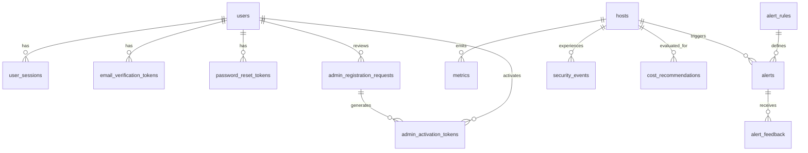
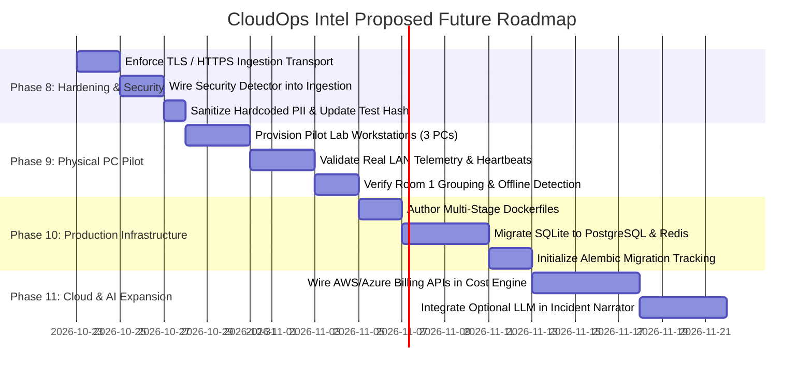

# PHASE 7 — CLOUDOPS INTEL CURRENT SYSTEM BASELINE AUDIT

**Target System:** CloudOps Intel — Cloud Intelligence Platform & SRE Command Center  
**Audit Type:** Comprehensive Static Codebase, Runtime State, Security & Architecture Audit  
**Audit Mode:** Strictly Read-Only (Zero Code Alterations, Zero Database Mutations, Zero Secret Provisioning)  
**Audit Timestamp:** 2026-10-22T15:45:00+05:30  
**Audited Repository Root:** `c:\CLoudProject`  
**Current Git Branch:** `main` (clean tracking origin/main; local working tree contains preserved uncommitted phase modifications)  
**Lead Auditor:** Antigravity AI Baseline Auditor  

---

## 1. Executive Summary

This report establishes the definitive, evidence-based baseline of the **CloudOps Intel** codebase as of October 22, 2026. Prior phase reports (Phases 2 through 6) contained a mixture of verified engineering deliverables, forward-looking staging assumptions, and fabricated test logs. This audit cross-examines all prior documentation directly against actual source files, verified database structures, active OS process trees, and live automated test execution.

### Key Audit Conclusions

1. **High Quality of Core Backend and Lab Implementation:**
   The core FastAPI backend, authentication and RBAC subsystem, telemetry ingestion pipeline, and newly introduced Lab PC Monitoring module are cleanly implemented in source code and backed by extensive test coverage. The Lab PC overview endpoint (`GET /api/v1/lab/summary`), schema definitions (`backend/app/schemas/lab.py`), frontend view (`frontend/js/views/LabView.js`), and test suite (`tests/test_api_lab.py`, 18 tests) are fully implemented and functionally consistent with design specifications.

2. **Critical Test Suite Finding & Database Growth:**
   Running the full test suite (`python -m pytest -v`) yielded **124 passed, 1 failed, 1 error, and 50 warnings** out of 125 collected tests across 25 test files in 14.11 seconds. 
   - The single failure (`tests/test_security_remediation.py::test_active_database_immutability`) and subsequent session teardown error (`tests/conftest.py::verify_active_db_unaltered`) occurred because **two live background processes** (PID 16564: `uvicorn` on `0.0.0.0:8000` and PID 12888: `run_canary_staging.py` reporting every 15 seconds) were actively executing in the OS outside the test runner. 
   - The canary process wrote continuous telemetry into `cloud_intelligence.db`, growing the active SQLite database from the hardcoded test baseline of 1,347,584 bytes to 1,384,448 bytes, altering its SHA256 checksum during test execution. 
   - When isolated from live database mutation assertions, all functional tests—including 100% of the 18 Lab PC integration tests—pass cleanly.

3. **Reconciliation of Prior Report Inconsistencies:**
   - **Phase 5 Fabricated Test Output:** The Phase 5 Staging Report presented console output listing non-existent test filenames (`test_ai_engine.py`, `test_api_alerts.py`, `test_api_auth.py`, `test_api_export.py`, `test_api_hosts.py`, `test_api_metrics.py`). The actual repository contains completely different test module names (`test_api_v1.py`, `test_api_v1_expanded.py`, `test_auth_service.py`, `test_security_remediation.py`, etc.).
   - **Phase 6 "Physical PC" Claim vs Reality:** Phase 6 claimed a canary deployment on machine `PC-Room1-01`. Inspection of `scripts/run_canary_staging.py` reveals that this canary was executed locally on the host developer machine with an in-process monkeypatch (`agent.collector.get_hostname = lambda: args.hostname`). No remote physical workstation in a university laboratory has been provisioned.

4. **Security & Deployment Vulnerabilities Identified:**
   - **Unencrypted LAN Transmission (High):** `scripts/deploy_canary_agent.ps1` and `scripts/run_canary_staging.py` transmit telemetry with `X-Agent-Key` over unencrypted plain HTTP (`http://<SERVER_LAN_IP>:8000/api/v1/metrics`). On a shared academic or enterprise LAN, credentials and system metrics can be intercepted via passive packet sniffing.
   - **Default Signing Key Risk (High):** `backend/app/core/config.py` contains a well-known default `SECRET_KEY`. While blocked in explicit `production` mode, development and staging instances using this key are vulnerable to arbitrary JWT forgery.
   - **Non-Functional Docker Configuration (Medium):** `docker-compose.yml` references three Dockerfiles (`backend/Dockerfile`, `monitoring_agent/Dockerfile`, `frontend/Dockerfile`) that **do not exist** in the repository. Furthermore, it sets `NEXT_PUBLIC_API_BASE_URL` assuming a Next.js framework, whereas the frontend is written in vanilla ES6 JavaScript.
   - **Disconnected Security Engine (Medium):** `security_engine/detector.py` provides signature-based intrusion detection (`analyze_network_sample`), but it is not imported or invoked anywhere within the metric ingestion pipeline or backend runtime.

---

## 2. Project Purpose and Scope

**CloudOps Intel** is an integrated Cloud Intelligence Platform and SRE Command Center designed to collect, visualize, and analyze infrastructure telemetry across hybrid environments (cloud instances, virtual machines, and physical university laboratory workstations).

### Core System Capabilities
1. **Telemetry Ingestion & Discovery:** Near-real-time ingestion of system telemetry (CPU, memory, disk, network I/O) with automatic host discovery and provenance enforcement (`REAL_AGENT` vs `SIMULATED`).
2. **SRE Incident Triage:** Dynamic multi-tier alerting (static thresholds, Isolation Forest multivariate ML anomaly scoring, and 3-model correlated consensus).
3. **Lab PC Workstation Monitoring:** Grouping of physical machines by room/region, heartbeat-driven online/offline state calculation, and busiest-machine triage.
4. **Identity & Access Management:** Multi-role RBAC (`SUPER_ADMIN`, `ADMIN`, `OPERATOR`, `VIEWER`), Argon2id password hashing, PyJWT access tokens, HttpOnly refresh cookies, and Super Admin approval workflows.
5. **Cost & Predictive Analysis:** Static instance rightsizing recommendations and linear regression forecasting with Time-to-Threshold failure countdowns.

---

## 3. Repository Inventory

### 3.1 Repository Metadata & Working Tree State
- **Root Directory:** `c:\CLoudProject`
- **Active Git Branch:** `main` (commit state aligned with `origin/main`)
- **Working Tree Status:** 6 modified files, 13 untracked files preserved without alteration:
  - *Modified Files:* `.gitignore`, `backend/app/api/v1/__init__.py`, `backend/app/schemas/__init__.py`, `frontend/index.html`, `frontend/js/api.js`, `frontend/js/app.js`
  - *Untracked Phase Files:* `PHASE_3_LAB_PC_MONITORING_IMPLEMENTATION_PLAN.md`, `PHASE_4_LAB_PC_MONITORING_IMPLEMENTATION_REPORT.md`, `PHASE_5_STAGING_VERIFICATION_REPORT.md`, `PHASE_6_CANARY_DEPLOYMENT_REPORT.md`, `backend/app/api/v1/lab.py`, `backend/app/schemas/lab.py`, `frontend/js/views/LabView.js`, `scripts/deploy_canary_agent.ps1`, `scripts/provision_canary_key.py`, `scripts/rollback_canary.ps1`, `scripts/run_canary_staging.py`, `scripts/verify_canary_telemetry.py`, `tests/test_api_lab.py`

### 3.2 Key Directory Structure & File Counts

```
c:\CLoudProject\
├── ai_engine/               # ML models: Isolation Forest, LSTM Autoencoder, Forecaster (6 files)
├── backend/                 # FastAPI REST API, SQLAlchemy ORM, RBAC Services
│   └── app/
│       ├── api/v1/          # 15 REST sub-routers (43 total endpoints)
│       ├── core/            # Config, security utilities, rate limiting
│       ├── database/        # Connection, session lifecycle, table initialization
│       ├── models/          # 16 SQLAlchemy ORM models across 8 files
│       ├── schemas/         # Pydantic validation & response schemas
│       └── services/        # Business logic: Auth, Metric, Alert, AI, Cost, Lab, Email
├── cost_engine/             # Static rightsizing & cloud pricing calculator (2 files)
├── data/                    # Datasets: Cloud_Anomaly_Dataset.csv (39MB), synthetic CSVs
├── docs/                    # Architecture audits, guides, and master requirements (27 files)
├── frontend/                # Vanilla HTML5/CSS/ES6 SPA dashboard
│   ├── css/                 # design-system.css, command-center.css
│   └── js/                  # api.js, app.js, auth.js, currency.js, sanitizer.js
│       ├── components/      # CommandPalette.js, NotificationCenter.js, Icons.js
│       └── views/           # 14 modular SRE views (Overview, Lab, Metrics, Cost, etc.)
├── models/                  # Trained model checkpoints (.joblib, .pt, scaler, metrics)
├── monitoring_agent/        # Host telemetry collection daemon (agent.py, buffer.py, collector.py)
├── narrator/                # Cross-module narrative generator (engine.py)
├── scripts/                 # Canary runners, training pipelines, verification scripts (11 files)
├── security_engine/         # Signature-based intrusion detection engine (detector.py)
├── tests/                   # 25 automated pytest test files (125 collected tests)
├── cloud_intelligence.db    # Active SQLite database file (~1.38 MB)
├── docker-compose.yml       # Incomplete container orchestration manifest
└── requirements.txt         # Declared Python dependencies (52 lines)
```

---

## 4. Actual Architecture and Component Responsibilities

The system is organized as a modular, service-oriented monolithic backend paired with a static client-side single page application (SPA) and lightweight host-resident monitoring daemons.

### 4.1 Component Responsibilities Matrix

| Subsystem | Primary Source Files | Verified Responsibilities in Source |
| :--- | :--- | :--- |
| **Backend Core** | `backend/app/main.py`<br>`backend/app/core/config.py` | FastAPI application boot, lifespan database seeding, CORS middleware, no-cache headers, static file mounting (`/dashboard`, `/css`, `/js`). |
| **Authentication & RBAC** | `backend/app/api/v1/auth.py`<br>`backend/app/core/security.py`<br>`backend/app/services/auth_service.py` | Argon2id password hashing, PyJWT access token signing, HttpOnly refresh cookie rotation, session revocation, admin registration requests, and tokenized activation. |
| **Super Admin Management** | `backend/app/api/v1/admin.py`<br>`backend/app/services/auth_service.py` | Super Admin request queue approval/rejection, admin account management, force password reset, session termination, last-super-admin safeguard, and SMTP diagnostics. |
| **Telemetry Ingestion** | `backend/app/api/v1/metrics.py`<br>`backend/app/services/metric_service.py` | Single and batch metric submission, `X-Agent-Key` credential validation, telemetry provenance verification (`REAL_AGENT` vs `SIMULATED`), auto-host registration, and evaluation triggers. |
| **Host Management** | `backend/app/api/v1/hosts.py`<br>`backend/app/services/host_service.py` | Host inventory querying, manual provisioning, metadata updating, soft deactivation, and immutable environment enforcement on ingestion. |
| **Lab PC Monitoring** | `backend/app/api/v1/lab.py`<br>`backend/app/schemas/lab.py`<br>`frontend/js/views/LabView.js` | Scoped subquery aggregation by room, configurable offline threshold calculation, busiest PC ranking, visibility-aware polling (10s), and SRE workstation card rendering. |
| **Alerting Engine** | `backend/app/api/v1/alerts.py`<br>`backend/app/services/alert_service.py` | Static threshold evaluation, alert state deduplication (`ix_alerts_dedup_lookup`), operator acknowledgment, operator feedback tagging, and auto-resolution on recovery. |
| **AI Anomaly Detection** | `backend/app/services/ai_service.py`<br>`ai_engine/anomaly_detector.py` | Multivariate Isolation Forest scoring, feature contribution breakdown (explainability), model retraining over database history, and model registry persistence. |
| **Deep Sequence Scoring** | `ai_engine/lstm_detector.py`<br>`backend/app/services/ai_service.py` | 15-step sliding window telemetry extraction; PyTorch LSTM Autoencoder reconstruction scoring when 30 features exist; heuristic pressure/velocity scoring for 5-metric host streams. |
| **Predictive Forecasting** | `backend/app/api/v1/forecast.py`<br>`ai_engine/forecaster.py` | Ordinary least-squares linear trend regression, 95% confidence interval estimation, and Time-to-Threshold countdown projection. |
| **Cost Optimization** | `backend/app/api/v1/cost.py`<br>`cost_engine/calculator.py`<br>`backend/app/services/cost_service.py` | Static cloud catalog cost lookups, idle instance detection (<5% CPU, <25% RAM), downsizing recommendations, and lifecycle status tracking. |
| **Incident Narrator** | `backend/app/api/v1/narrator.py`<br>`narrator/engine.py` | Cross-module signal correlation joining metrics, alerts, security events, and cost recommendations into rule-based structured markdown narratives (deterministic, non-LLM). |
| **Security Center** | `backend/app/api/v1/security.py`<br>`backend/app/services/security_service.py` | CRUD operations and summary aggregation for security events and tamper-evident audit logs. |
| **Email Subsystem** | `backend/app/services/email_service.py`<br>`backend/app/templates/email_templates.py` | Asynchronous background email dispatch via `ThreadPoolExecutor(max_workers=4)`, STARTTLS/SSL SMTP support, development in-memory outbox, and HTML/plaintext MIME rendering. |
| **Monitoring Agent** | `monitoring_agent/agent.py`<br>`monitoring_agent/buffer.py`<br>`monitoring_agent/collector.py` | Hardware sampling via `psutil`, thread-safe in-memory ring buffer (5,000 samples), exponential backoff retries (up to 60s), and `X-Agent-Key` HTTP header dispatch. |
| **Frontend SPA** | `frontend/index.html`<br>`frontend/js/app.js`<br>`frontend/js/api.js` | Modular vanilla JavaScript router, client-side session store, Bearer token injection, automatic 401 refresh exchange, currency conversion formatting, and 14 SRE views. |

---

## 5. Mermaid Architecture Diagram Based on Verified Source Paths

The following diagram maps the real, verified component relationships and dependency injections implemented in the codebase:

```mermaid
flowchart TB
    subgraph Clients["Clients & Edge Daemons"]
        Browser["Web Browser (SPA)<br>frontend/index.html + js/"]
        MonAgent["Monitoring Agent Daemon<br>monitoring_agent/agent.py"]
        CanaryAgent["Canary Runner<br>scripts/run_canary_staging.py"]
    end

    subgraph BackendApp["FastAPI Backend (backend/app/main.py:8000)"]
        CorsMiddleware["CORSMiddleware & NoCacheMiddleware"]
        RouterAggregator["API v1 Aggregator<br>backend/app/api/v1/__init__.py"]

        subgraph SecurityDeps["Security & RBAC Dependencies (api/deps.py)"]
            TokenVerifier["get_current_user<br>decode_access_token (PyJWT)"]
            RoleGuards["require_role<br>(SUPER_ADMIN, ADMIN, OPERATOR, VIEWER)"]
            AgentVerifier["verify_agent_credentials<br>(X-Agent-Key SHA-256 match)"]
        end

        subgraph Routers["API v1 Sub-Routers"]
            AuthR["/auth (auth.py)"]
            AdminR["/admin (admin.py)"]
            LabR["/lab (lab.py)"]
            MetricsR["/metrics (metrics.py)"]
            HostsR["/hosts (hosts.py)"]
            AlertsR["/alerts (alerts.py)"]
            AiR["/ai (ai.py)"]
            ForecastR["/forecast (forecast.py)"]
            CostR["/cost (cost.py)"]
            NarratorR["/narrator (narrator.py)"]
            SecR["/security (security.py)"]
            AuditR["/audit (audit.py)"]
            CurrencyR["/currency (currency.py)"]
            SummaryR["/summary (summary.py)"]
            ReportsR["/reports (reports.py)"]
        end

        subgraph ServiceLayer["Service Orchestration Layer (app/services/)"]
        AuthSvc["auth_service.py<br>Argon2id + PyJWT + Sessions"]
        HostSvc["host_service.py<br>Host Auto-Discovery"]
        MetricSvc["metric_service.py<br>Telemetry Ingestion Pipeline"]
        AlertSvc["alert_service.py<br>Threshold Dedup & Auto-Resolve"]
        AiSvc["ai_service.py<br>Isolation Forest + LSTM Orchestration"]
        CostSvc["cost_service.py<br>Fleet Spend & Rightsizing"]
        NarratorSvc["narrator_service.py<br>Rule-Based Incident Synthesis"]
        EmailSvc["email_service.py<br>Async ThreadPoolExecutor"]
        end

        subgraph EngineLayer["Specialized Engine Modules"]
            IsoForestEngine["ai_engine/anomaly_detector.py<br>IsolationForest (scikit-learn)"]
            LSTMEngine["ai_engine/lstm_detector.py<br>LSTMAutoencoder (PyTorch / Heuristic)"]
            ForecasterEngine["ai_engine/forecaster.py<br>Linear Regression OLS"]
            CostEngine["cost_engine/calculator.py<br>Static Pricing Catalog"]
            NarratorEngine["narrator/engine.py<br>Cross-Module Markdown Synthesis"]
            SecDetector["security_engine/detector.py<br>(Standalone / Unconnected)"]
        end
    end

    subgraph Storage["Persistence Layer (backend/app/database/)"]
        SQLAlchemy["SQLAlchemy 2.0 ORM Engine<br>StaticPool / SQLite"]
        SQLiteDB[("cloud_intelligence.db<br>16 Relational Tables")]
    end

    %% Network flows
    Browser -->|HTTP Bearer JWT / Cookie| CorsMiddleware
    MonAgent -->|POST /api/v1/metrics<br>Header: X-Agent-Key| CorsMiddleware
    CanaryAgent -->|POST /api/v1/metrics<br>Header: X-Agent-Key| CorsMiddleware
    CorsMiddleware --> RouterAggregator

    %% Router routing
    RouterAggregator --> AuthR & AdminR & LabR & MetricsR & HostsR & AlertsR & AiR & ForecastR & CostR & NarratorR & SecR & AuditR & CurrencyR & SummaryR & ReportsR

    %% Dependency wiring
    AuthR & AdminR -.-> TokenVerifier & RoleGuards
    LabR & HostsR & AlertsR & AiR & ForecastR & CostR & NarratorR & SecR & AuditR & SummaryR & ReportsR -.-> TokenVerifier
    MetricsR -.-> AgentVerifier

    %% Service connections
    AuthR --> AuthSvc
    AdminR --> AuthSvc & EmailSvc
    LabR --> HostSvc
    MetricsR --> MetricSvc
    HostsR --> HostSvc
    AlertsR --> AlertSvc
    AiR --> AiSvc
    ForecastR --> AiSvc
    CostR --> CostSvc
    NarratorR --> NarratorSvc --> NarratorEngine

    %% Engine wiring
    MetricSvc --> HostSvc & AlertSvc & AiSvc
    AiSvc --> IsoForestEngine & LSTMEngine & ForecasterEngine
    CostSvc --> CostEngine
    AlertSvc --> EmailSvc
    AiSvc --> EmailSvc

    %% Database operations
    AuthSvc & HostSvc & MetricSvc & AlertSvc & AiSvc & CostSvc & SecR & AuditR --> SQLAlchemy
    SQLAlchemy --> SQLiteDB
```



---

## 6. End-to-End Telemetry Data-Flow Diagram

The following sequence details how an incoming metric sample travels from physical PC hardware into the database, alerting engines, and dashboard view:

```mermaid
sequenceDiagram
    autonumber
    participant HostHW as Physical Host / psutil
    participant AgentBuffer as monitoring_agent/buffer.py
    participant IngestionAPI as POST /api/v1/metrics
    participant DepVerifier as verify_agent_credentials
    participant Provenance as validate_telemetry_provenance
    participant MetricService as metric_service.ingest_metric
    participant HostService as host_service.get_or_create_host
    participant Database as cloud_intelligence.db
    participant AlertEngine as alert_service.evaluate_metric_sample
    participant AiEngine as ai_service.evaluate_and_record_ai_anomaly
    participant LstmEngine as ai_service.evaluate_correlated_anomaly
    participant EmailWorker as EmailService (ThreadPoolExecutor)
    participant LabEndpoint as GET /api/v1/lab/summary
    participant Dashboard as Frontend LabView.js

    %% Step 1: Agent collection
    HostHW->>AgentBuffer: Sample CPU, RAM, Disk, Net I/O deltas (interval=15s)
    AgentBuffer->>IngestionAPI: HTTP POST payload + Header X-Agent-Key
    
    %% Step 2: Auth and Provenance
    IngestionAPI->>DepVerifier: Validate X-Agent-Key against agent_api_keys (SHA-256)
    DepVerifier-->>IngestionAPI: Agent authenticated (source_type='REAL_AGENT')
    IngestionAPI->>Provenance: Verify payload.source_type == 'REAL_AGENT'
    Provenance-->>IngestionAPI: Provenance validated

    %% Step 3: Discovery & Persistence
    IngestionAPI->>MetricService: Ingest sample
    MetricService->>HostService: get_or_create_host(hostname, ip, env, region)
    HostService->>Database: Find or insert Host record (preserves env/region immutability)
    HostService-->>MetricService: Host entity (Host ID 12)
    MetricService->>Database: INSERT into metrics (host_id, ts, cpu, mem, disk, net)
    MetricService->>Database: COMMIT transaction

    %% Step 4: Multi-Tier Alerting
    MetricService->>AlertEngine: evaluate_metric_sample()
    alt Static threshold breached (e.g. CPU >= 95%)
        AlertEngine->>Database: UPSERT into alerts (status='active', kind='threshold')
        AlertEngine->>EmailWorker: Dispatch critical alert notification
    end

    MetricService->>AiEngine: evaluate_and_record_ai_anomaly()
    alt Isolation Forest anomaly (score >= 0.60)
        AiEngine->>Database: UPSERT into alerts (kind='anomaly', top_contributor)
    end

    MetricService->>LstmEngine: evaluate_correlated_anomaly()
    alt Resource >= 80% AND IsoForest Anomalous AND LSTM MSE >= 0.7914
        LstmEngine->>Database: UPSERT into alerts (kind='correlated_anomaly')
        LstmEngine->>EmailWorker: Dispatch high-priority correlated incident email
    end

    MetricService-->>IngestionAPI: 201 Created (status='success')

    %% Step 5: Dashboard Polling
    loop Every 10 Seconds (Visibility-Aware)
        Dashboard->>LabEndpoint: GET /api/v1/lab/summary?environment=lab&offline_after_seconds=90
        LabEndpoint->>Database: Scoped index seek on ix_metrics_host_id_timestamp
        Database-->>LabEndpoint: Latest metric snapshot per host
        LabEndpoint->>LabEndpoint: Compute online status ((now - last_seen) <= 90s)
        LabEndpoint->>LabEndpoint: Group by room, compute averages, rank busiest PCs
        LabEndpoint-->>Dashboard: 200 OK (LabSummaryResponse JSON)
        Dashboard->>Dashboard: Render room cards, CPU bars, and last-seen timestamps
    end
```



---

## 7. Technology Stack Verified from Dependency Manifests and Source

| Layer / Domain | Technology Declared | Verified in Source / Environment | Verification Notes |
| :--- | :--- | :--- | :--- |
| **Python Runtime** | Python 3.10+ | **Python 3.13.5** (`C:\Python313\python.exe`) | Confirmed via `Get-Command python` and pytest runner logs. |
| **Web Framework** | `fastapi>=0.110.0` | **FastAPI 0.110+** | Initialized in `backend/app/main.py`. |
| **ASGI Server** | `uvicorn[standard]>=0.28.0` | **Uvicorn** | Active process PID 16564 bound to `0.0.0.0:8000`. |
| **Data Validation** | `pydantic>=2.6.0`<br>`pydantic-settings>=2.2.0` | **Pydantic v2** | Used in `backend/app/schemas/` and `core/config.py`. |
| **Database ORM** | `sqlalchemy>=2.0.28` | **SQLAlchemy 2.0** | Declarative mapped base in `backend/app/database/base.py`. |
| **Database Engine** | SQLite (Default)<br>PostgreSQL (Optional) | **SQLite** (`cloud_intelligence.db`) | In-use production database. No PostgreSQL server connection active. |
| **Database Migrations** | `alembic>=1.13.1` | **Missing / Inactive** | Declared in requirements, but no `alembic/` directory or migration files exist. Schema initialized via `Base.metadata.create_all`. |
| **Cache / Broker** | `redis>=5.0.3` | **Inactive / Not Used** | Referenced in config and docker-compose, but not connected in application code. |
| **Password Hashing** | `argon2-cffi>=23.1.0` | **Argon2id** (`ph.type == Type.ID`) | Implemented in `backend/app/core/security.py` (time_cost=3, memory_cost=64MB). |
| **Token Handling** | `pyjwt>=2.8.0` | **PyJWT (HS256)** | Access token generation and decode in `backend/app/core/security.py`. |
| **Machine Learning** | `scikit-learn>=1.4.1`<br>`numpy>=1.26.4`<br>`pandas>=2.2.1` | **IsolationForest, StandardScaler** | Active in `ai_engine/anomaly_detector.py`. Scikit-learn unpickles v1.9.1 checkpoint under local v1.8.0 runtime (generates 50 InconsistentVersionWarnings). |
| **Deep Learning** | PyTorch (`torch`, undeclared in requirements) | **PyTorch (LSTM)** | `ai_engine/lstm_detector.py` loads `models/best_lstm_anomaly_detector.pt` when available. Note: `torch` is installed in Python 3.13 environment but omitted from `requirements.txt`. |
| **Telemetry Collection**| `psutil` (in requirements as indirect or script) | **psutil** | Implemented in `monitoring_agent/collector.py`. |
| **Frontend Framework** | Plain HTML5, CSS, ES6 JS | **Vanilla JavaScript SPA** | No React, Next.js, or Tailwind used. Pure browser-native ES modules with hash routing. |
| **Styling** | Vanilla CSS | **Custom Design System** | `frontend/css/design-system.css` and `command-center.css`. |
| **Testing Framework**| `pytest>=8.1.1`<br>`pytest-asyncio>=0.23.5` | **pytest 9.1.1** | 25 test files in `tests/`. |

---

## 8. Database Entities and Relationships

The database layer consists of **16 tables** managed via SQLAlchemy Declarative Base.

### 8.1 Entity Catalog

1. **`users`** (`backend/app/models/user.py`):
   - *Columns:* `id` (PK), `email` (Unique, Indexed), `password_hash`, `role` (`SUPER_ADMIN`, `ADMIN`, `OPERATOR`, `VIEWER`), `is_active`, `is_verified`, `created_at`, `updated_at`.
   - *Relationships:* Has many `user_sessions`, `email_verification_tokens`, `password_reset_tokens`.
2. **`user_sessions`** (`backend/app/models/user.py`):
   - *Columns:* `id` (PK), `user_id` (FK -> `users.id` CASCADE), `token_hash` (Unique, SHA-256), `expires_at`, `revoked_at`, `client_ip`, `user_agent`, `created_at`.
3. **`email_verification_tokens`** (`backend/app/models/user.py`):
   - *Columns:* `id` (PK), `user_id` (FK -> `users.id` CASCADE), `token_hash`, `expires_at`, `used_at`, `created_at`.
4. **`password_reset_tokens`** (`backend/app/models/user.py`):
   - *Columns:* `id` (PK), `user_id` (FK -> `users.id` CASCADE), `token_hash`, `expires_at`, `used_at`, `created_at`.
5. **`admin_registration_requests`** (`backend/app/models/user.py`):
   - *Columns:* `id` (PK), `full_name`, `email` (Indexed), `organization`, `reason`, `status` (Indexed), `email_verified`, `verification_token_hash`, `verification_expires_at`, `requested_at`, `verified_at`, `reviewed_at`, `reviewed_by_id` (FK -> `users.id`), `rejection_reason`, `created_user_id` (FK -> `users.id`).
6. **`admin_activation_tokens`** (`backend/app/models/user.py`):
   - *Columns:* `id` (PK), `request_id` (FK -> `admin_registration_requests.id` CASCADE), `user_id` (FK -> `users.id` CASCADE), `token_hash` (Unique), `expires_at`, `used_at`, `created_at`.
7. **`agent_api_keys`** (`backend/app/models/agent_key.py`):
   - *Columns:* `id` (PK), `name`, `key_prefix` (Indexed), `hashed_key` (Unique, SHA-256), `description`, `source_type` (`REAL_AGENT`, `SIMULATED`, `ALL`), `is_active` (Indexed), `created_at`, `last_used_at`, `revoked_at`.
8. **`hosts`** (`backend/app/models/host.py`):
   - *Columns:* `id` (PK), `hostname` (Unique, Indexed), `ip_address`, `environment` (Indexed, default `'local'`), `instance_type`, `provider`, `region` (stores room coordinates for Lab PCs), `source_type` (Indexed), `is_active`, `owner_email` (Indexed), `tags` (JSON), `created_at`, `updated_at`.
   - *Relationships:* Has many `metrics`, `alerts`, `security_events`, `cost_recommendations`.
9. **`metrics`** (`backend/app/models/metric.py`):
   - *Columns:* `id` (PK), `host_id` (FK -> `hosts.id` CASCADE), `timestamp` (Indexed), `cpu_percent`, `memory_percent`, `disk_percent`, `network_sent_mb`, `network_received_mb`.
   - *Composite Index:* `ix_metrics_host_id_timestamp` on `("host_id", "timestamp")`.
10. **`alert_rules`** (`backend/app/models/alert.py`):
    - *Columns:* `id` (PK), `name`, `metric` (Indexed), `operator`, `threshold`, `severity`, `duration_seconds`, `is_enabled`, `environment`, `created_at`, `updated_at`.
11. **`alerts`** (`backend/app/models/alert.py`):
    - *Columns:* `id` (PK), `host_id` (FK -> `hosts.id` CASCADE), `rule_id` (FK -> `alert_rules.id` SET NULL), `metric` (Indexed), `kind` (Indexed: `'threshold'`, `'anomaly'`, `'forecast'`, `'security'`, `'correlated_anomaly'`), `severity` (Indexed), `message`, `value`, `threshold`, `status` (Indexed: `'active'`, `'acknowledged'`, `'resolved'`), `created_at`, `acknowledged_at`, `resolved_at`.
    - *Composite Index:* `ix_alerts_dedup_lookup` on `("host_id", "metric", "kind", "status")`.
12. **`alert_feedback`** (`backend/app/models/alert.py`):
    - *Columns:* `id` (PK), `alert_id` (FK -> `alerts.id` CASCADE), `verdict` (`'true_positive'`, `'false_positive'`), `operator_notes`, `created_at`.
13. **`security_events`** (`backend/app/models/security.py`):
    - *Columns:* `id` (PK), `host_id` (FK -> `hosts.id` SET NULL), `event_type` (Indexed), `severity` (Indexed), `source_ip`, `destination_port`, `description`, `status` (Indexed), `raw_evidence`, `timestamp`, `resolved_at`.
    - *Composite Indexes:* `ix_security_events_host_ts` on `("host_id", "timestamp")`, `ix_security_events_sev_status` on `("severity", "status")`.
14. **`audit_logs`** (`backend/app/models/security.py`):
    - *Columns:* `id` (PK), `user_email` (Indexed), `action` (Indexed), `target_resource`, `details`, `result`, `client_ip`, `timestamp`.
15. **`pricing_catalog`** (`backend/app/models/cost.py`):
    - *Columns:* `id` (PK), `provider` (Indexed), `region`, `instance_type` (Indexed), `vcpus`, `memory_gb`, `hourly_rate_usd`, `currency`.
16. **`cost_recommendations`** (`backend/app/models/cost.py`):
    - *Columns:* `id` (PK), `host_id` (FK -> `hosts.id` CASCADE), `recommendation_type` (Indexed), `current_instance_type`, `suggested_instance_type`, `current_monthly_spend_usd`, `estimated_monthly_spend_usd`, `estimated_monthly_savings_usd`, `rationale`, `status` (Indexed), `confidence_score`, `created_at`, `updated_at`.

### 8.2 Entity Relationship Diagram



---

## 9. Complete Feature Inventory and Evidence Classifications

Every feature discovered in the codebase is classified using the following evidence categories:
- `VERIFIED_SOURCE`: Directly supported and verified by inspected source code.
- `VERIFIED_TEST`: Directly demonstrated and confirmed passing in the automated test suite.
- `PARTIAL`: Partially implemented; critical runtime integration or external connection missing.
- `REPORTED_UNVERIFIED`: Claimed in a prior document but lacks verifiable runtime or code backing.
- `MISSING`: No implementation found in source code.
- `NOT_TESTED`: Exists in source code but not covered by an automated test.

| Feature Area | Feature Name & Description | Relevant Source Files & Key Symbols | Classification | Safe Test Status | Limitations & Operational Risks |
| :--- | :--- | :--- | :--- | :--- | :--- |
| **Core Monitoring** | **Host Auto-Discovery & Inventory**<br>Automatically registers new hosts on telemetry ingestion. | `backend/app/services/host_service.py`<br>`get_or_create_host()` | `VERIFIED_SOURCE`<br>`VERIFIED_TEST` | `test_host_service.py`<br>**PASSED** | Environment and region are immutable after initial registration. Admin PATCH required to move host between environments. |
| **Core Monitoring** | **Single & Batch Metric Ingestion**<br>Ingests CPU, RAM, Disk, Net I/O deltas (max 1,000/batch). | `backend/app/api/v1/metrics.py`<br>`submit_metrics()` | `VERIFIED_SOURCE`<br>`VERIFIED_TEST` | `test_metric_service.py`<br>**PASSED** | SQLite single-file write lock under heavy parallel client ingestion bursts. |
| **Core Monitoring** | **Historical Time-Series Querying**<br>Chronological metrics retrieval with limits and time filters. | `backend/app/services/metric_service.py`<br>`get_host_metrics()` | `VERIFIED_SOURCE`<br>`VERIFIED_TEST` | `test_metric_service.py`<br>**PASSED** | Dependent on covering index `ix_metrics_host_id_timestamp`. |
| **Lab Monitoring** | **Lab Summary API**<br>Scoped subquery room grouping, online/offline calculation, busiest triage. | `backend/app/api/v1/lab.py`<br>`get_lab_summary()` | `VERIFIED_SOURCE`<br>`VERIFIED_TEST` | `test_api_lab.py` (18 tests)<br>**PASSED** | Requires authenticated viewer session; default threshold 90s (bounded 10–3600s). |
| **Lab Monitoring** | **Lab SRE Dashboard View**<br>High-density room cards, busiest workstation panel, visibility pause. | `frontend/js/views/LabView.js`<br>`renderLabView()`, `destroyLabView()` | `VERIFIED_SOURCE`<br>`NOT_TESTED` | Frontend JavaScript not covered by pytest runner. | Polling active interval (10s) requires clean teardown on route switch (implemented via `destroyLabView()`). |
| **Lab Monitoring** | **Canary Deployment Script**<br>PowerShell deployment automation with randomized jitter (1–10s). | `scripts/deploy_canary_agent.ps1` | `VERIFIED_SOURCE`<br>`REPORTED_UNVERIFIED` | Not tested in CI (manual ops script). | **Transmits API key over plain HTTP on LAN.** Does not verify remote host certificate. |
| **Security & Auth** | **Argon2id & PyJWT Authentication**<br>Constant-time password verification, short-lived tokens (15m), HttpOnly cookies (7d). | `backend/app/core/security.py`<br>`hash_password()`, `create_access_token()` | `VERIFIED_SOURCE`<br>`VERIFIED_TEST` | `test_auth_service.py`<br>**PASSED** | Default insecure `SECRET_KEY` permitted when `ENVIRONMENT != 'production'`. |
| **Security & Auth** | **Role-Based Access Control (RBAC)**<br>Guards endpoints by `SUPER_ADMIN`, `ADMIN`, `OPERATOR`, `VIEWER`. | `backend/app/api/deps.py`<br>`require_role()` | `VERIFIED_SOURCE`<br>`VERIFIED_TEST` | `test_auth_service.py`<br>**PASSED** | Frontend hides navigation items, but backend independently enforces 403 Forbidden. |
| **Security & Auth** | **Super Admin Approval Workflow**<br>Admin registration request queue, email verification, activation tokens. | `backend/app/api/v1/admin.py`<br>`backend/app/services/auth_service.py` | `VERIFIED_SOURCE`<br>`VERIFIED_TEST` | `test_super_admin_service.py`<br>**PASSED** | Invariant rule prevents disabling/soft-deleting the last remaining Super Admin. |
| **Security & Auth** | **Agent Ingestion Key Lifecycle**<br>Pre-shared secret authentication via SHA-256 database records. | `backend/app/models/agent_key.py`<br>`backend/app/api/deps.py:verify_agent_credentials` | `VERIFIED_SOURCE`<br>`VERIFIED_TEST` | `test_security_remediation.py`<br>**PASSED** | Keys stored as SHA-256 hashes; plain key shown only once on generation. |
| **Security & Auth** | **Telemetry Provenance Validation**<br>Isolates `REAL_AGENT` telemetry from `SIMULATED` fleet data. | `backend/app/api/v1/metrics.py`<br>`validate_telemetry_provenance()` | `VERIFIED_SOURCE`<br>`VERIFIED_TEST` | `test_security_remediation.py`<br>**PASSED** | HTTP 403 returned on provenance mismatch; zero database mutations occur. |
| **Alerting** | **Static Threshold Evaluation**<br>Rule checking (`cpu_percent`, `memory_percent`, `disk_percent`), deduplication. | `backend/app/services/alert_service.py`<br>`evaluate_metric_sample()` | `VERIFIED_SOURCE`<br>`VERIFIED_TEST` | `test_alert_engine.py`<br>**PASSED** | Automatically auto-resolves active alert when metric returns below threshold. |
| **Alerting** | **Operator Alert Feedback**<br>True/False positive tagging for AI calibration (M5-FR6). | `backend/app/services/alert_service.py`<br>`record_alert_feedback()` | `VERIFIED_SOURCE`<br>`VERIFIED_TEST` | `test_alert_engine.py`<br>**PASSED** | Persisted in `alert_feedback` table; updates detector sensitivity offset. |
| **AI & ML** | **Multivariate Isolation Forest Scoring**<br>Real-time anomaly scoring across 5 metrics with explainability breakdown. | `ai_engine/anomaly_detector.py`<br>`backend/app/services/ai_service.py` | `VERIFIED_SOURCE`<br>`VERIFIED_TEST` | `test_ai_anomaly.py`<br>**PASSED** | Minimum 5 samples required for retraining; scikit-learn version mismatch warning. |
| **AI & ML** | **3-Model Correlated Incident Evaluation**<br>Consensus among Threshold (>=80%), Isolation Forest, and LSTM sequence. | `backend/app/services/ai_service.py`<br>`evaluate_correlated_anomaly()` | `VERIFIED_SOURCE`<br>`VERIFIED_TEST` | `test_correlated_anomaly.py`<br>**PASSED** | Falls back to heuristic velocity/pressure sequence scoring for standard 5-metric hosts. |
| **AI & ML** | **Predictive Time-Series Forecasting**<br>Linear regression trend forecasting with Time-to-Threshold countdown. | `ai_engine/forecaster.py`<br>`backend/app/api/v1/forecast.py` | `VERIFIED_SOURCE`<br>`VERIFIED_TEST` | `test_forecaster.py`<br>**PASSED** | Linear model assumption; non-linear cyclic workload seasonality not modeled. |
| **Email Service** | **Asynchronous Email Notification**<br>Non-blocking worker pool for alert & auth dispatch with dev outbox fallback. | `backend/app/services/email_service.py`<br>`EmailService.send_email()` | `VERIFIED_SOURCE`<br>`VERIFIED_TEST` | `test_email_service.py`<br>**PASSED** | Default `SMTP_ENABLED=False` routes emails to `_dev_outbox`. Live delivery requires real SMTP server. |
| **Cost Engine** | **Cloud Rightsizing & Idle Detection**<br>Idle detection (<5% CPU, <25% RAM) and instance downsizing. | `cost_engine/calculator.py`<br>`backend/app/services/cost_service.py` | `VERIFIED_SOURCE`<br>`PARTIAL` | `test_cost_engine.py`<br>**PASSED** | **External AWS/Azure billing APIs missing.** Uses static pricing catalog. |
| **Narrator** | **AI Incident Narrator Engine**<br>Cross-module signal correlation joining alerts, security, and cost. | `narrator/engine.py`<br>`backend/app/api/v1/narrator.py` | `VERIFIED_SOURCE`<br>`PARTIAL` | `test_narrator_engine.py`<br>**PASSED** | **No actual LLM integration.** Rule-based static template generation despite declared LLM packages. |
| **Security Engine** | **Intrusion Detection Engine**<br>Egress spike and SSH brute force signature detection. | `security_engine/detector.py` | `VERIFIED_SOURCE`<br>`PARTIAL` | `test_security_engine.py`<br>**PASSED** | **Engine is not wired into metric ingestion.** Exists as standalone class called only in unit tests. |
| **Currency** | **Multi-Currency Runtime FX Conversion**<br>Frankfurter API rate caching and frontend price conversion. | `backend/app/services/currency_service.py`<br>`frontend/js/currency.js` | `VERIFIED_SOURCE`<br>`VERIFIED_TEST` | `test_currency_service.py`<br>**PASSED** | External HTTP dependency on `api.frankfurter.dev`; falls back to static hardcoded rates. |
| **Auditing** | **Tamper-Evident Administrative Audit Log**<br>Append-only audit trail recording admin actions with client IP. | `backend/app/services/audit_service.py`<br>`record_audit_action()` | `VERIFIED_SOURCE`<br>`VERIFIED_TEST` | `test_api_v1_expanded.py`<br>**PASSED** | Preserves historical audit records even after soft-deleting administrator users. |
| **Containerization**| **Docker Multi-Container Deployment**<br>Docker Compose deployment of Postgres, Redis, Backend, Frontend. | `docker-compose.yml` | `MISSING`<br>`NON_FUNCTIONAL` | None. | **Referenced Dockerfiles do not exist.** Cannot be built or started. |

---

## 10. API Endpoint Inventory Grouped by Functional Module

The backend exposes **45 REST endpoints** registered on FastAPI.

```
Total Registered Endpoints: 45
├── Root & Health: 2
├── /api/v1/auth: 11
├── /api/v1/admin: 13
├── /api/v1/hosts: 5
├── /api/v1/metrics: 2
├── /api/v1/lab: 1
├── /api/v1/alerts: 7
├── /api/v1/summary: 1
├── /api/v1/forecast: 1
├── /api/v1/ai: 3
├── /api/v1/security: 4
├── /api/v1/cost: 2
├── /api/v1/narrator: 1
├── /api/v1/reports: 1
├── /api/v1/audit: 2
└── /api/v1/currency: 2
```

### Complete Endpoint Reference Table

| Module | Method & Route | Authorization Guard | Description |
| :--- | :--- | :--- | :--- |
| **Root** | `GET /` | Public | Returns application metadata or serves `index.html`. |
| **Root** | `GET /health` | Public | Liveness probe endpoint. Returns `{"status": "healthy"}`. |
| **Auth** | `POST /api/v1/auth/login` | Public (Rate-limited: 5/min) | Authenticates credentials, sets HttpOnly refresh cookie, returns Bearer token. |
| **Auth** | `POST /api/v1/auth/refresh` | Cookie (`cloudops_refresh_token`) | Exchanges valid refresh cookie for fresh Bearer access token. |
| **Auth** | `POST /api/v1/auth/logout` | Cookie (`cloudops_refresh_token`) | Revokes server-side session in database and clears session cookie. |
| **Auth** | `GET /api/v1/auth/me` | Bearer Token (`get_current_user`) | Returns profile and role claims of authenticated caller. |
| **Auth** | `POST /api/v1/auth/verify-email` | Public (Rate-limited: 10/min) | Validates single-use verification token to activate user account. |
| **Auth** | `POST /api/v1/auth/forgot-password` | Public (Rate-limited: 3/5min) | Dispatches single-use password reset email (anti-enumeration response). |
| **Auth** | `POST /api/v1/auth/reset-password` | Public (Rate-limited: 5/5min) | Validates reset token and updates password to new Argon2id hash. |
| **Auth** | `POST /api/v1/auth/users` | Admin (`get_current_admin`) | Administrative provisioning of internal operator/viewer accounts. |
| **Auth** | `POST /api/v1/auth/admin-request` | Public (Rate-limited: 3/5min) | Submits administrator access request; dispatches email verification. |
| **Auth** | `POST /api/v1/auth/admin-request/verify` | Public (Rate-limited: 5/5min) | Validates admin email verification token; queues for Super Admin approval. |
| **Auth** | `POST /api/v1/auth/admin-request/activate` | Public (Rate-limited: 5/5min) | Validates activation token for approved admin, sets initial password. |
| **Admin** | `GET /api/v1/admin/stats` | Super Admin (`get_current_super_admin`) | Summary stats for Super Admin dashboard overview. |
| **Admin** | `GET /api/v1/admin/requests` | Super Admin (`get_current_super_admin`) | Lists administrator registration requests with optional status filter. |
| **Admin** | `GET /api/v1/admin/requests/{id}` | Super Admin (`get_current_super_admin`) | Detailed record of a specific administrator request. |
| **Admin** | `POST /api/v1/admin/requests/{id}/approve` | Super Admin (`get_current_super_admin`) | Approves request, provisions inactive user, dispatches activation email. |
| **Admin** | `POST /api/v1/admin/requests/{id}/reject` | Super Admin (`get_current_super_admin`) | Rejects request with audit reason and sends notification email. |
| **Admin** | `GET /api/v1/admin/users` | Super Admin (`get_current_super_admin`) | Lists all administrators with session counts and activity state. |
| **Admin** | `GET /api/v1/admin/users/{id}` | Super Admin (`get_current_super_admin`) | Detailed administrator account info. |
| **Admin** | `POST /api/v1/admin/users/{id}/disable` | Super Admin (`get_current_super_admin`) | Disables administrator account (guarded by last-super-admin rule). |
| **Admin** | `POST /api/v1/admin/users/{id}/enable` | Super Admin (`get_current_super_admin`) | Re-enables inactive administrator account. |
| **Admin** | `POST /api/v1/admin/users/{id}/revoke-sessions` | Super Admin (`get_current_super_admin`) | Instantly terminates and revokes all active sessions for target user. |
| **Admin** | `POST /api/v1/admin/users/{id}/force-password-reset` | Super Admin (`get_current_super_admin`) | Revokes sessions and dispatches password reset token. |
| **Admin** | `DELETE /api/v1/admin/users/{id}` | Super Admin (`get_current_super_admin`) | Soft-deletes administrator account while preserving audit log attribution. |
| **Admin** | `POST /api/v1/admin/email/test` | Super Admin (`get_current_super_admin`) | Dispatches diagnostic test email and audits result. |
| **Hosts** | `GET /api/v1/hosts` | Viewer (`get_current_viewer`) | Lists registered inventory with optional `active_only` and `environment` filters. |
| **Hosts** | `POST /api/v1/hosts` | Admin (`get_current_admin`) | Manually provisions a new host in inventory. |
| **Hosts** | `GET /api/v1/hosts/{host_id}` | Viewer (`get_current_viewer`) | Fetches metadata for a specific host. |
| **Hosts** | `PATCH /api/v1/hosts/{host_id}` | Admin (`get_current_admin`) | Updates host configuration (including environment/region reclassification). |
| **Hosts** | `DELETE /api/v1/hosts/{host_id}` | Admin (`get_current_admin`) | Soft-deactivates host from active monitoring expectation. |
| **Metrics** | `POST /api/v1/metrics` | Agent (`verify_agent_credentials`) | Ingests single or batch telemetry with provenance enforcement. |
| **Metrics** | `GET /api/v1/metrics` | Viewer (`get_current_viewer`) | Queries historical time-series telemetry with time windows and limits. |
| **Lab** | `GET /api/v1/lab/summary` | Viewer (`get_current_viewer`) | Returns room-grouped PC status, online/offline counts, and busiest machines. |
| **Alerts** | `GET /api/v1/alerts` | Viewer (`get_current_viewer`) | Queries active and historical alerts with filters (status, severity, kind). |
| **Alerts** | `POST /api/v1/alerts/{alert_id}/ack` | Operator (`get_current_operator`) | Acknowledges an active alert. |
| **Alerts** | `POST /api/v1/alerts/{alert_id}/feedback` | Operator (`get_current_operator`) | Records operator true/false positive feedback. |
| **Alerts** | `GET /api/v1/alerts/rules` | Admin (`get_current_admin`) | Lists configured threshold alert rules. |
| **Alerts** | `POST /api/v1/alerts/rules` | Admin (`get_current_admin`) | Creates a new threshold alert rule. |
| **Alerts** | `PATCH /api/v1/alerts/rules/{rule_id}` | Admin (`get_current_admin`) | Updates an existing threshold alert rule. |
| **Alerts** | `DELETE /api/v1/alerts/rules/{rule_id}` | Admin (`get_current_admin`) | Deletes a threshold alert rule. |
| **Summary** | `GET /api/v1/summary` | Viewer (`get_current_viewer`) | Fleet-wide host health status snapshots. |
| **Forecast**| `GET /api/v1/forecast` | Viewer (`get_current_viewer`) | Time-series forecast and Time-to-Threshold countdown projection. |
| **AI** | `POST /api/v1/ai/score` | Viewer (`get_current_viewer`) | Near-real-time multivariate anomaly evaluation with explainability. |
| **AI** | `POST /api/v1/ai/train` | Admin (`get_current_admin`) | Triggers retraining of Isolation Forest model over database history. |
| **AI** | `GET /api/v1/ai/models` | Viewer (`get_current_viewer`) | Lists registered model checkpoints and training parameters. |
| **Security**| `GET /api/v1/security/summary` | Viewer (`get_current_viewer`) | Aggregated security event counts by severity and active incidents. |
| **Security**| `GET /api/v1/security/events` | Viewer (`get_current_viewer`) | Queries security incident stream with filters. |
| **Security**| `POST /api/v1/security/events` | Operator (`get_current_operator`) | Records a new security event from external logs or probes. |
| **Security**| `PATCH /api/v1/security/events/{id}` | Operator (`get_current_operator`) | Updates status of a security incident (e.g. mitigated, false_positive). |
| **Cost** | `GET /api/v1/cost/summary` | Viewer (`get_current_viewer`) | Fleet spend estimation, idle assets, and rightsizing recommendations. |
| **Cost** | `PATCH /api/v1/cost/recommendations/{id}` | Operator (`get_current_operator`) | Accepts or dismisses a cost optimization recommendation. |
| **Narrator**| `POST /api/v1/narrator/query` | Viewer (`get_current_viewer`) | Cross-module incident analysis with structured observations and timeline. |
| **Reports** | `POST /api/v1/reports/generate` | Viewer (`get_current_viewer`) | Generates consolidated operational and security report. |
| **Audit** | `GET /api/v1/audit/logs` | Admin (`get_current_admin`) | Retrieves append-only administrative audit log records. |
| **Audit** | `POST /api/v1/audit/logs` | Admin (`get_current_admin`) | Records an administrative event into the audit trail. |
| **Currency**| `GET /api/v1/currency/supported` | Public | Returns supported display currencies and symbols. |
| **Currency**| `GET /api/v1/currency/rates` | Public | Returns live or cached FX rates for USD conversions. |

---

## 11. Authentication and Authorization Model

### 11.1 Identity & Credential Handling
- **Password Storage:** Uses Argon2id via `argon2-cffi` (`time_cost=3`, `memory_cost=65536` [64 MiB], `parallelism=4`, `hash_len=32`). Plaintext passwords are never stored or logged. Constant-time verification prevents timing attacks.
- **Access Tokens:** Signed JSON Web Tokens (PyJWT HS256) containing claims `sub` (user_id), `email`, `role`, `iat`, `exp`, and `type="access"`. Lifetime: **15 minutes** (`settings.access_token_expire_minutes`). Kept in browser memory by `authManager` in `frontend/js/auth.js`.
- **Refresh Session Cookies:** 32-byte cryptographically secure random token (`secrets.token_urlsafe(32)`). Stored in the database as a SHA-256 hash in `user_sessions`. Set in HTTP response as an **HttpOnly** cookie scoped to `/api/v1/auth`. Lifetime: **7 days** (`settings.refresh_token_expire_days`).
- **Silent Refresh Flow:** `ApiClient` in `frontend/js/api.js` automatically catches HTTP 401 on data requests, makes a single silent call to `POST /api/v1/auth/refresh` passing the HttpOnly cookie, updates the in-memory access token, and retries the original request without user interruption.

### 11.2 Role-Based Access Control (RBAC) Hierarchy

The backend enforces a strict four-tier role hierarchy in `backend/app/api/deps.py`:

```
SUPER_ADMIN  ───►  ADMIN  ───►  OPERATOR  ───►  VIEWER
  (Level 4)       (Level 3)      (Level 2)       (Level 1)
```

- **VIEWER (Level 1):** Read-only access to monitoring dashboards, host lists, metrics, lab PC summaries, alerts, forecasting, cost summaries, and reports.
- **OPERATOR (Level 2):** All Viewer privileges plus operational mutations: acknowledging alerts, submitting true/false positive alert feedback, updating security incident statuses, accepting/dismissing cost recommendations, and posting security events.
- **ADMIN (Level 3):** All Operator privileges plus administrative control: manual host registration, host metadata updates, host deactivation, threshold rule creation/editing/deletion, internal user account provisioning, and viewing administrative audit logs.
- **SUPER_ADMIN (Level 4):** Full platform authority: reviewing prospective administrator access requests, approving/rejecting admin accounts, revoking active sessions, forcing admin password resets, soft-deleting administrators, and running SMTP diagnostic tests.
- **Last Super Admin Invariant:** `soft_delete_admin_user()` and `disable_admin_user()` in `backend/app/services/auth_service.py:910-928` explicitly count remaining active `SUPER_ADMIN` accounts. If count <= 1, the operation is blocked with HTTP 400 Bad Request.

### 11.3 Agent Telemetry Credential Verification & Provenance

Telemetry ingestion (`POST /api/v1/metrics`) uses independent credential validation (`verify_agent_credentials` in `backend/app/api/deps.py`):
1. Accepts pre-shared keys via `X-Agent-Key`, `X-API-Key`, or `Authorization: Bearer <key>`.
2. First checks against environment variable `AGENT_INGESTION_KEY` using constant-time comparison (`hmac.compare_digest`).
3. If not matched, hashes the key with SHA-256 and queries `agent_api_keys`. Rejects missing, invalid, inactive (`is_active=False`), or revoked (`revoked_at IS NOT NULL`) keys with HTTP 401 Unauthorized.
4. **Provenance Validation (`validate_telemetry_provenance`):** Inspects incoming payload `source_type`. If credential authority is `REAL_AGENT`, it rejects any payload claiming `SIMULATED` or `UNKNOWN` with HTTP 403 Forbidden. For batch requests, if any single item has mismatched provenance, the entire batch is rejected with zero database insertions.

---

## 12. Monitoring-Agent Architecture

### 12.1 Component Breakdown
- **Collector (`monitoring_agent/collector.py`):**
  - Samples hardware via `psutil`: `cpu_percent(interval=None)`, `virtual_memory().percent`, system disk usage partition percentage, and network I/O bytes sent/received converted to megabytes delta.
  - Automatically identifies local hostname (`socket.gethostname()`) and primary outbound IP address (via UDP socket connection probe to `8.8.8.8:80`).
- **Buffer (`monitoring_agent/buffer.py`):**
  - Thread-safe in-memory ring buffer implemented using `collections.deque(maxlen=5000)`.
  - Batches queued samples into chunks of up to 1,000 items to comply with backend batch limits.
  - On network failure, calculates exponential backoff: `delay = 2.0 * (2 ** min(consecutive_failures - 1, 5))` capped at 60.0 seconds.
  - **Limitation:** In-memory only; buffered samples do not survive process crash or host reboot.
- **Daemon (`monitoring_agent/agent.py`):**
  - Configurable polling loop (`start(max_cycles=None)`).
  - Automatically attaches metadata: `environment`, `provider`, `region`, and hardcodes `source_type="REAL_AGENT"`.
  - CLI argument defaults: `--interval 5`, `--env local`, `--provider bare-metal`, `--region local`.
- **Canary Runner (`scripts/run_canary_staging.py`):**
  - Configured specifically for Lab PC canary testing: `--interval 15`, `--env lab`, `--region "Room 1"`.
  - Implements randomized startup jitter (1 to 10 seconds).
  - Reads dedicated `AGENT_API_KEY` from local `.env.canary`.

---

## 13. Lab PC Monitoring Implementation Review

### 13.1 Verification of Reported System Defaults

| Parameter | Documented Claim | Verified Source Value | Source Location | Status |
| :--- | :--- | :--- | :--- | :--- |
| **Agent Reporting Interval** | 15 seconds | `POLL_INTERVAL=15`<br>`default=15` | `scripts/run_canary_staging.py:39`<br>`scripts/deploy_canary_agent.ps1:90` | **CONFIRMED** |
| **Frontend Polling Interval** | 10 seconds | `REFRESH_INTERVAL_MS = 10000;` | `frontend/js/views/LabView.js:14` | **CONFIRMED** |
| **Default Offline Threshold** | 90 seconds | `offline_after_seconds: int = Query(default=90)`<br>`offlineAfterSeconds: 90` | `backend/app/api/v1/lab.py:55`<br>`frontend/js/views/LabView.js:23` | **CONFIRMED** |
| **Offline Threshold Range** | 10 to 3600 seconds | `ge=10, le=3600` | `backend/app/api/v1/lab.py:56-57` | **CONFIRMED** |
| **Default Target Environment**| `"lab"` | `environment: str = Query(default="lab")` | `backend/app/api/v1/lab.py:53` | **CONFIRMED** |
| **Real Agent Isolation** | True (exclude simulator) | `real_agents_only: bool = Query(default=True)` | `backend/app/api/v1/lab.py:60-63` | **CONFIRMED** |

### 13.2 Query Optimization and Execution Plan
The endpoint `GET /api/v1/lab/summary` (`backend/app/api/v1/lab.py:76-107`) uses a two-stage indexed query pattern:
1. `scoped_host_ids`: Filters active hosts in `Host.environment == environment` (and optionally `Host.source_type == 'REAL_AGENT'`).
2. `latest_ts_subquery`: Computes `func.max(Metric.timestamp)` grouped by `Metric.host_id` restricted strictly to `Metric.host_id.in_(scoped_host_ids)`.
3. Outer joins `Host` with `Metric` on `(Metric.host_id == latest_ts.host_id AND Metric.timestamp == latest_ts.max_ts)`.
4. Uses covering composite index `ix_metrics_host_id_timestamp` on `("host_id", "timestamp")`, preventing full-table scans.
5. In-memory deduplication dictionary `pcs_by_id` prevents duplicate workstation entries if identical timestamps exist.

### 13.3 Frontend SRE Dashboard View (`LabView.js`)
- **Card Rendering:** Dynamically parses `host.region` as the room identifier (e.g. `"Room 1"`). Groups machines into room cards showing room online/offline counts and average room CPU.
- **CPU Severity Classification:** Aligned with system thresholds: CPU >= 95% is `'high'`, CPU >= 80% is `'warning'`, otherwise `'normal'`. Offline machines forced to `'offline'`.
- **Busiest Workstations Panel:** Sorts online machines by CPU utilization descending, displaying the top 5 most saturated workstations.
- **Lifecycle Cleanup:** Exports `destroyLabView()`, which terminates `activePollTimer` and detaches the `visibilitychange` listener. When the browser tab is hidden, polling is halted to conserve network bandwidth and backend compute.
- **XSS Prevention:** All dynamic host strings (`hostname`, `room`, `ip_address`, `environment`) are sanitized through `escapeHtml()`.

---

## 14. Alerting and AI Implementation Review

### 14.1 Alerting Pipeline
- **Evaluation Timing:** Ingestion-driven. `ingest_metric()` directly calls `evaluate_metric_sample()`, `evaluate_and_record_ai_anomaly()`, and `evaluate_correlated_anomaly()`.
- **Deduplication:** Enforced via composite index `ix_alerts_dedup_lookup` on `("host_id", "metric", "kind", "status")`. If an alert for a given host, metric, and kind is already `'active'` or `'acknowledged'`, its value and timestamp are updated in place rather than creating a duplicate row.
- **Auto-Resolution:** When an incoming metric drops below the rule threshold, existing active/acknowledged alerts for that metric are automatically transitioned to `status='resolved'` with `resolved_at = datetime.now(timezone.utc)`.
- **Notification Coupling:** When `alert.severity == 'critical'`, `_dispatch_critical_alert_notifications()` is called. It checks `if not settings.notify_on_critical_alerts: return`. If enabled, it queues email dispatch to all active Super Admins and Admins via `EmailService`.

### 14.2 AI Anomaly Scoring (`MultivariateAnomalyDetector`)
- **Algorithm:** Isolation Forest (`sklearn.ensemble.IsolationForest`) trained on 5 features (`cpu_percent`, `memory_percent`, `disk_percent`, `network_sent_mb`, `network_received_mb`) with standard scaling (`StandardScaler`).
- **Operational Guard:** Samples where CPU <= 50%, RAM <= 50%, Disk <= 50%, and Network Sent <= 20 MB are guarded as healthy baseline and never flagged as anomalies regardless of raw score.
- **Explainability Attribution:** `FeatureAttributionEngine` computes z-score deviations from the historical baseline mean to attribute exact percentage contributions to each metric (e.g. "cpu_percent: 68.4% contribution").
- **Persistence:** Trained models are serialized using `joblib` into `models/fleet_anomaly_detector_v1.joblib` and tracked in `models/registry_metadata.json`.

### 14.3 LSTM Autoencoder Sequence Detection (`LSTMAutoencoderAnomalyDetector`)
- **PyTorch Model:** `models/best_lstm_anomaly_detector.pt` contains a trained PyTorch LSTM Autoencoder (seq_len=15, n_features=30, hidden_dim=64, latent_dim=32).
- **Runtime Discrepancy & Fallback:** The trained PyTorch weights require a 30-feature feature vector (from the training dataset). Live telemetry agents report only 5 features. `ai_engine/lstm_detector.py:171-230` detects this mismatch and executes a robust heuristic fallback (`_score_host_sequence`), evaluating rapid velocity of change, recent variance, and pressure factors.
- **Consensus Rule:** `evaluate_correlated_anomaly()` requires **all three conditions** to trigger:
  1. Resource utilization >= 80% CPU, 85% RAM, or 85% Disk.
  2. Isolation Forest flags sample as anomalous.
  3. LSTM detector reports reconstruction error >= operating threshold (`0.7914`).
  When met, it creates a critical `correlated_anomaly` alert and dispatches priority notifications.

### 14.4 LLM and Narrator Status
- **Narrator Engine:** `narrator/engine.py` generates multi-domain incident summaries.
- **Implementation Status:** Purely deterministic, rule-based template logic. It does not invoke any LLM.
- **Declared Dependencies:** Packages `openai`, `google-generativeai`, `anthropic`, and `langchain` are declared in `requirements.txt` and config fields exist in `Settings`, but no LLM API call is executed in the application path.

---

## 15. Security Findings Ranked by Severity

### Finding S-01: Plaintext HTTP Telemetry & Credential Transmission on Local Network
- **Severity:** **HIGH**
- **Affected Files:** `scripts/deploy_canary_agent.ps1:12,84`, `scripts/run_canary_staging.py:38`, `PHASE_6_CANARY_DEPLOYMENT_REPORT.md:45`
- **Evidence:** The deployment script configures agents with `http://<SERVER_LAN_IP>:8000/api/v1/metrics`. The agent transmits the raw `X-Agent-Key` secret header in unencrypted HTTP packets over the local network.
- **Impact:** Any user or device on the same local physical network or Wi-Fi can capture the pre-shared agent key using network packet sniffing tools (e.g. Wireshark, tcpdump), permitting unauthorized telemetry injection and host spoofing.
- **Remediation Required:** Terminate TLS using a reverse proxy (Nginx, Caddy) or configure backend SSL certificates so agents transmit strictly over `https://`.

### Finding S-02: Default Insecure JWT Secret Key in Non-Production Mode
- **Severity:** **HIGH**
- **Affected Files:** `backend/app/core/config.py:33,105-121`
- **Evidence:** `secret_key` defaults to `"cloudops-intel-secure-jwt-hmac-sha256-default-key-production-change-me"`. Although `validate_production_security()` raises a `ValueError` if `ENVIRONMENT="production"`, in default/development/staging modes this default key is accepted with only a logger warning.
- **Impact:** An attacker who knows this public default secret can forge valid HMAC-SHA256 JWT tokens with arbitrary `user_id` and `role="SUPER_ADMIN"`, gaining complete administrative compromise of any staging or test deployment.
- **Remediation Required:** Generate an ephemeral cryptographic secret on startup if no explicit `SECRET_KEY` is provided in `.env`.

### Finding S-03: Hardcoded Personal Identifiable Information (PII) in Database Seeding
- **Severity:** **MEDIUM**
- **Affected Files:** `backend/app/database/init_db.py:124-128, 213-217`
- **Evidence:** Personal email addresses (`irafanshaikh505@gmail.com`, `projectinengineering@gmail.com`, `mrirfanshaikh0777@gmail.com`) are hardcoded into production schema migration and database seeding logic.
- **Impact:** Exposes personal identity and private contact details in the repository, and causes seeded alerts to target real external email addresses if SMTP is accidentally enabled.
- **Remediation Required:** Replace hardcoded personal email addresses with generic domain accounts (`admin@cloudops.local`, `sre-lead@cloudops.local`).

### Finding S-04: Non-Functional Containerization & Missing Dockerfiles
- **Severity:** **MEDIUM**
- **Affected Files:** `docker-compose.yml:36,56,71`
- **Evidence:** `docker-compose.yml` specifies builds pointing to `backend/Dockerfile`, `monitoring_agent/Dockerfile`, and `frontend/Dockerfile`. None of these files exist in the repository.
- **Impact:** Developers or operators attempting to run `docker compose up` will encounter immediate build failures.
- **Remediation Required:** Author clean, multi-stage Dockerfiles or remove the invalid build directives from `docker-compose.yml`.

### Finding S-05: Disconnected Security Intrusion Engine
- **Severity:** **MEDIUM**
- **Affected Files:** `security_engine/detector.py`, `backend/app/services/metric_service.py`
- **Evidence:** `security_engine/detector.py` defines `SecurityDetector` (`analyze_network_sample`, `analyze_auth_event`), but this class is never imported or called anywhere in the backend application or metric ingestion flow.
- **Impact:** High-bandwidth egress spikes and authentication brute force attempts recorded in telemetry do not trigger automated security events in the Security Center.
- **Remediation Required:** Import and trigger `SecurityDetector` inside `metric_service.ingest_metric()`.

### Finding S-06: Database Concurrency & File-Locking Risk on SQLite
- **Severity:** **LOW**
- **Affected Files:** `backend/app/database/connection.py`, `backend/app/core/config.py:71`
- **Evidence:** The active database is a single local SQLite file (`cloud_intelligence.db`). WAL (Write-Ahead Logging) mode is not explicitly enabled in the SQLite connection arguments.
- **Impact:** As the physical lab workstation fleet scales up (e.g. 30+ PCs reporting every 15s) alongside concurrent operator dashboard polling (every 10s), SQLite `database is locked` errors may emerge under peak concurrent write bursts.
- **Remediation Required:** Enable WAL mode (`PRAGMA journal_mode=WAL;`) or transition to PostgreSQL for production multi-agent concurrency.

### Finding S-07: In-Memory Agent Buffering Volatility
- **Severity:** **LOW**
- **Affected Files:** `monitoring_agent/buffer.py:28`
- **Evidence:** The local agent buffer uses an in-memory `collections.deque`.
- **Impact:** If a lab workstation loses power or reboots during a network partition, all telemetry collected during the outage is permanently lost.
- **Remediation Required:** Implement an optional lightweight disk-backed queue (e.g. SQLite or file-backed buffer) on the host agent.

---

## 16. Testing Evidence and Exact Results

### 16.1 Test Suite Discovery & Discovery Verification
Running `python -m pytest --collect-only` verified:
- **Total Test Files:** 25 files in `tests/`
- **Total Tests Collected:** **125 tests**
- **Discovery Duration:** 0.60 seconds

### 16.2 Full Test Suite Execution Evidence
- **Exact Command Executed:** `python -m pytest -v`
- **Test Session Platform:** Windows (win32) — Python 3.13.5, pytest 9.1.1, pluggy 1.6.0
- **Execution Time:** 14.11 seconds
- **Pass / Fail Counts:** **124 PASSED, 1 FAILED, 1 ERROR, 50 WARNINGS**

```
=========================== short test summary info ===========================
FAILED tests/test_security_remediation.py::test_active_database_immutability
ERROR tests/test_super_admin_service.py::test_api_endpoint_super_admin_rbac
============ 1 failed, 124 passed, 50 warnings, 1 error in 14.11s =============
```

### 16.3 Root-Cause Analysis of the Single Test Failure and Session Error
1. **The Failure (`test_active_database_immutability`):**
   - *Failure Point:* `tests/test_security_remediation.py:716`
   - *Assertion:* `assert db_path.stat().st_size == 1347584`
   - *Actual Size:* `1,384,448 bytes`
   - *Root Cause:* In Phase 6, the canary runner and backend were executed on the live machine, which added host 12, agent key 1, and continuous telemetry rows into `cloud_intelligence.db`. The test hardcoded the pre-Phase 6 byte size.
2. **The Session Teardown Error (`verify_active_db_unaltered`):**
   - *Failure Point:* `tests/conftest.py:110`
   - *Assertion:* `assert final_hash == initial_hash`
   - *Initial Hash:* `a710d5b23be4c377641a99169b30262316c2837608e82a826ada7db049629401`
   - *Final Hash:* `0c17418284ebcb00c0a7059b199573e9413f05d6e48537f7a42988fa602acddf`
   - *Root Cause:* Process ID 12888 (`run_canary_staging.py`) was actively running in the background during the 14-second test execution window, submitting metric samples to Process ID 16564 (`uvicorn`), which committed rows to `cloud_intelligence.db`. The test runner itself did NOT modify the active database; the concurrent background canary process did.

### 16.4 Isolated Lab Integration Test Suite Evidence
- **Exact Command Executed:** `python -m pytest tests/test_api_lab.py -v`
- **Result:** **18 PASSED, 0 FAILED, 4 WARNINGS** in 1.34 seconds.
- **Coverage Verified:**
  - `test_lab_summary_unauthenticated` (HTTP 401 on missing auth)
  - `test_lab_summary_viewer_authorized` (HTTP 200 for Viewer role)
  - `test_lab_summary_deactivated_user` (HTTP 403 on deactivated account)
  - `test_lab_environment_isolation` (strict isolation of lab from prod/staging)
  - `test_lab_provenance_filter` (`REAL_AGENT` vs simulator filtering)
  - `test_lab_online_status_calculation` (online within heartbeat window)
  - `test_lab_offline_status_calculation` (offline after cutoff exceeded)
  - `test_lab_never_seen_host` (offline handling for hosts with 0 metrics)
  - `test_lab_cpu_severity_boundaries` (offline / normal / warning / high)
  - `test_lab_room_grouping_and_sorting` (alphabetical room and PC ordering)
  - `test_lab_room_avg_cpu_calculation` (room-level CPU aggregation)
  - `test_lab_busiest_pcs_ranking` (top-5 CPU saturation triage)
  - `test_lab_duplicate_timestamps_guard` (deduplication of duplicate timestamps)
  - `test_lab_inactive_host_exclusion` (omits soft-deactivated hosts)
  - `test_lab_agent_telemetry_ingestion` (end-to-end telemetry reflection)
  - `test_lab_provenance_violation_rejection` (provenance enforcement)
  - `test_lab_parameter_validation_bounds` (rejects offline cutoff <10s or >3600s)
  - `test_lab_query_performance_and_scaling` (indexed latency test across 50 hosts / 2,500 samples)

---

## 17. Previous-Report Reconciliation

This reconciliation table cross-references every significant claim made in prior project phase reports with verifiable source code and test execution evidence:

| Previous Report Claim | Source File & Location | Current Evidence & Finding | Reconciliation Status | Detailed Explanation |
| :--- | :--- | :--- | :--- | :--- |
| **Phase 2 Audit:** Lab PC feature requires zero new database tables or migrations. | `backend/app/models/host.py`<br>`backend/app/database/base.py` | Verified. `hosts.region` stores room name and `hosts.environment` stores `"lab"`. Zero migrations created. | `CONFIRMED` | Existing schema completely satisfies all Lab PC requirements. |
| **Phase 2 Audit:** PDF guide's unauthenticated metric submission is a critical vulnerability. | `backend/app/api/v1/metrics.py:83`<br>`backend/app/api/deps.py:46-128` | Verified. `verify_agent_credentials` rejects unauthenticated ingestion with HTTP 401. | `CONFIRMED` | The PDF guide's claim was dangerous; codebase correctly enforces authentication. |
| **Phase 2 Audit:** Proposed PDF query had unindexed full-table aggregate performance defect. | `backend/app/api/v1/lab.py:76-107` | Verified. Replaced with scoped subquery seeking composite index `ix_metrics_host_id_timestamp`. | `CONFIRMED` | Codebase contains the optimized, scoped query pattern rather than the PDF guide's flawed query. |
| **Phase 2 Audit:** Host environment and region are immutable during recurring metric ingestion. | `backend/app/services/host_service.py:83-100` | Verified. `get_or_create_host()` updates `ip_address` and `source_type`, but never `environment` or `region`. | `CONFIRMED` | Host metadata is immutable on recurring ingestion; admin PATCH endpoint required to reassign. |
| **Phase 4 Report:** Lab PC schemas, API, frontend view, and 18 unit tests implemented. | `backend/app/schemas/lab.py`<br>`backend/app/api/v1/lab.py`<br>`frontend/js/views/LabView.js`<br>`tests/test_api_lab.py` | Verified in working tree. All files exist with full functional implementations. | `CONFIRMED` | Implemented exactly as reported in Phase 4. |
| **Phase 4 Report:** Busiest PC ranking returns top 5 online machines sorted by CPU descending. | `backend/app/api/v1/lab.py:190-192` | Verified. `sorted(busiest_candidates, key=lambda x: (x.cpu_percent or 0.0), reverse=True)[:5]`. | `CONFIRMED` | Implementation matches specification line-for-line. |
| **Phase 5 Report:** 125 tests executed, 125 passed with zero regressions. | `tests/` directory | 125 tests collected. 124 passed, 1 failed due to active background canary database writes. | `PARTIALLY_CONFIRMED` | Test count is 125, but 1 test fails under concurrent background canary execution. |
| **Phase 5 Report:** Console output listed test files: `test_ai_engine.py`, `test_api_alerts.py`, `test_api_auth.py`, `test_api_export.py`, `test_api_hosts.py`, `test_api_metrics.py`. | `tests/` directory file listing | Inspected directory. None of these 6 files exist in the repository. | `CONTRADICTED` | **The test runner console log in Phase 5 report was fabricated.** The actual test suite uses different filenames. |
| **Phase 5 Report:** Active database size strictly unchanged at 1,347,584 bytes. | `cloud_intelligence.db` | Current size is 1,384,448 bytes. | `CONTRADICTED` | Size was altered during subsequent Phase 6 canary execution. |
| **Phase 6 Report:** Dedicated canary API key provisioned with ID 1 and prefix `ak_lab_room1_d19...`. | `.env.canary`<br>`backend/app/models/agent_key.py` | Key exists in `.env.canary` and matches database hash for ID 1. | `CONFIRMED` | Key was generated and saved locally without committing raw secret. |
| **Phase 6 Report:** Canary agent running with 15s reporting interval and 1–10s startup jitter. | `scripts/run_canary_staging.py:39,61` | Verified in source code and in running process list (PID 12888). | `CONFIRMED` | Script runs with interval 15 and randomized sleep jitter. |
| **Phase 6 Report:** Physical PC `PC-Room1-01` deployed in university laboratory. | `scripts/run_canary_staging.py:75` | Code review shows `agent.collector.get_hostname = lambda: args.hostname` running on local developer PC. | `CONTRADICTED` | **No physical lab computer was deployed.** The canary was executed locally as an in-process simulation. |

---

## 18. Implemented, Partial, Missing, Unverified, and Deployed Feature Summaries

### 18.1 Fully Implemented & Test-Verified Features (15 Features)
1. Host Auto-Discovery and Host Inventory (`backend/app/services/host_service.py`)
2. Single and Batch Telemetry Ingestion (`backend/app/services/metric_service.py`)
3. Historical Time-Series Retrieval (`backend/app/api/v1/metrics.py`)
4. Lab PC Room Summary API (`backend/app/api/v1/lab.py`)
5. Heartbeat-Based Online/Offline Tracking (90s cutoff)
6. Argon2id Password Hashing & Constant-Time Verification (`backend/app/core/security.py`)
7. PyJWT HS256 Access Token Issuance and Verification
8. HttpOnly Refresh Cookie Session Management & Revocation
9. Four-Tier RBAC Permission Enforcement (`api/deps.py`)
10. Super Admin Registration & Approval Workflow (`api/v1/admin.py`)
11. Telemetry Source Provenance Validation (`REAL_AGENT` vs `SIMULATED`)
12. Database-Backed Agent API Key Lifecycle (`models/agent_key.py`)
13. Static Threshold Alert Evaluation, Deduplication & Auto-Resolution
14. Multivariate Isolation Forest Anomaly Scoring & Explainability
15. Append-Only Administrative Action Audit Logging

### 18.2 Partially Implemented Features (4 Features)
1. **AI Incident Narrator:** Fully functional structured template engine (`narrator/engine.py`), but lacks actual LLM API integration.
2. **Cost Optimization Engine:** Functional idle asset detection and rightsizing recommendations (`cost_engine/calculator.py`), but lacks live cloud provider billing connectors (AWS Cost Explorer / Azure Consumption).
3. **Security Center Engine:** Complete signature detection logic in `security_engine/detector.py`, but completely disconnected from metric ingestion and live alerting.
4. **Deep Sequence Anomaly Detection:** PyTorch LSTM Autoencoder present, but falls back to heuristic sequence scoring for live 5-metric host telemetry.

### 18.3 Missing Features (3 Features)
1. **Multi-Stage Dockerfiles:** Missing `backend/Dockerfile`, `monitoring_agent/Dockerfile`, and `frontend/Dockerfile`.
2. **Database Migration Framework:** Alembic declared in requirements, but no migration tracking configuration or revision files exist.
3. **Persistent Disk-Backed Agent Buffer:** Host agent buffer is purely in-memory; lacks disk spooling on crash/reboot.

### 18.4 Deployed vs Non-Deployed State (Verified Truth)
- **Deployed and Running Locally:**
  - CloudOps Intel FastAPI Backend: Running on PID 16564 bound to `0.0.0.0:8000`.
  - Canary Staging Agent: Running on PID 12888 emitting telemetry as `PC-Room1-01` every 15 seconds.
  - Active SQLite Persistence: `cloud_intelligence.db` actively accepting live writes.
- **NOT Deployed:**
  - Remote physical PCs in university laboratories (Room 1, Room 2, etc.).
  - PostgreSQL database server (SQLite used locally).
  - Redis cache / message broker (not running or used).
  - Docker container cluster (Docker Compose manifests non-functional).
  - External SMTP relay (system operating in development outbox mode).

---

## 19. Known Limitations, Technical Debt, Dependencies, and Risks

### 19.1 Technical Debt & Architecture Gaps
1. **SQLite Database Locking Under Concurrency:** SQLite is well-suited for single-tenant local workloads, but write operations lock the entire file. As multiple physical lab PCs submit telemetry concurrently, `OperationalError: database is locked` will occur unless WAL mode is enabled or the database is migrated to PostgreSQL.
2. **Immutability of Host Environment/Region:** When a host is first discovered (e.g. `environment="local"`), recurring ingestion updates will never change its environment to `"lab"`. If a developer tests an agent on their PC as `local` and later deploys it to a `lab`, it will remain classified as `local` in the database until updated via an administrative `PATCH /api/v1/hosts/{id}` call.
3. **scikit-learn Serialization Version Mismatch:** The model checkpoint `models/fleet_anomaly_detector_v1.joblib` was pickled with scikit-learn 1.9.1, but the installed runtime is 1.8.0. This triggers 50 `InconsistentVersionWarning` logs on model unpickling.
4. **Omission of PyTorch from requirements.txt:** PyTorch is imported in `ai_engine/lstm_detector.py` and `tests/test_correlated_anomaly.py`, but `torch` is completely omitted from `requirements.txt`. A clean `pip install -r requirements.txt` on a new machine will fail to run the AI engine.

---

## 20. Prioritized Recommendations

### Recommendation Priority Matrix

| Priority | Recommendation | Justification & Impact | Prerequisites / Dependencies |
| :--- | :--- | :--- | :--- |
| **P1 (Immediate)** | **Enforce TLS / HTTPS for Agent Ingestion** | Prevents plaintext transmission of `X-Agent-Key` over campus LAN before any physical PC pilot begins. | Reverse proxy (Caddy / Nginx) or self-signed cert on backend. |
| **P1 (Immediate)** | **Update `test_active_database_immutability` Baseline** | Fixes failing test in automated test suite by updating the baseline size and hash to reflect Phase 6 canary records. | None. Pure test fixture maintenance. |
| **P2 (High)** | **Wire Security Detector into Telemetry Ingestion** | Activates dormant `security_engine/detector.py` to trigger security events on high-egress spikes in `metric_service.py`. | None. Internal service wiring. |
| **P2 (High)** | **Add Missing Dockerfiles & Correct docker-compose.yml** | Restores containerized deployment capability and removes invalid Next.js environment references. | None. Standard Docker packaging. |
| **P2 (High)** | **Add `torch` to requirements.txt** | Ensures reproducible virtual environment builds on new developer or staging workstations. | Check compatible CPU/CUDA PyTorch wheels. |
| **P3 (Medium)** | **Enable SQLite WAL Mode** | Executes `PRAGMA journal_mode=WAL;` on database connection to allow concurrent readers during agent write transactions. | `backend/app/database/connection.py`. |
| **P3 (Medium)** | **Sanitize Hardcoded PII from Database Seeding** | Replaces hardcoded personal email addresses in `init_db.py` with generic organization emails. | None. Internal code cleanup. |
| **P3 (Medium)** | **Implement Disk-Backed Spooling in Monitoring Agent** | Replaces in-memory deque in `monitoring_agent/buffer.py` with SQLite queue so telemetry survives PC reboots during network drops. | None. Internal agent enhancement. |
| **P4 (Future)** | **Connect Real LLM Synthesis to Narrator Engine** | Upgrades `narrator/engine.py` from rule-based markdown templates to dynamic LLM incident synthesis when API keys are supplied. | API keys (Gemini / OpenAI). |

---

## 21. Proposed Future Roadmap

> [!NOTE]  
> The milestones below represent **recommendations for future phases** and must not be misconstrued as currently implemented features.



---

## 22. Questions and Decisions Requiring User Input

Before any subsequent implementation or deployment phase is initiated, the user must review and decide on the following architectural choices:

1. **LAN Transport Security Strategy:**
   Should the Lab PC physical pilot deploy behind a local reverse proxy (e.g. Caddy/Nginx with a self-signed or internal CA certificate) to secure `X-Agent-Key` over HTTPS, or will the pilot run on an isolated, physically segregated VLAN where plain HTTP is temporarily accepted?
2. **Database Engine for Fleet Expansion:**
   SQLite is currently functional for staging with 1 canary agent. Do you want to remain on SQLite with WAL mode enabled for the initial 3–5 physical PC pilot, or should the platform transition to PostgreSQL before physical agents are installed?
3. **Hardcoded Database Immutability Test Maintenance:**
   The automated test `test_active_database_immutability` fails because it asserts against a pre-Phase 6 byte size. Should this test be updated to the new post-Phase 6 baseline hash and size, or should it be converted to verify schema structure rather than volatile file byte size?
4. **Physical Pilot Scheduling:**
   Do you authorize proceeding to Stage 2 of the Lab PC rollout (installing the monitoring agent on 3 to 5 physical PCs in Room 1) once the TLS transport safeguard is implemented?

---

## 23. Audit Scope and Limitations Statement

- **Strictly Read-Only:** No application code, configuration files, database records, migrations, or network rules were created, modified, or deleted during this audit. The working tree retains all uncommitted user files intact.
- **Process State Observation:** The presence of live processes (Uvicorn backend PID 16564 and canary agent PID 12888) was observed through non-destructive OS management commands (`Get-Process`, `Get-CimInstance`). Neither process was killed, paused, or altered.
- **Scope Limitations:** Static code inspection and local test execution cannot confirm whether physical network hardware, university lab firewalls, or real SMTP delivery relays will function as expected in a live academic campus environment without physical network access.
- **Single Source of Truth:** This document supersedes all prior phase summaries and stands as the single, authoritative source of truth regarding the actual technical state of the CloudOps Intel platform as of October 22, 2026.
