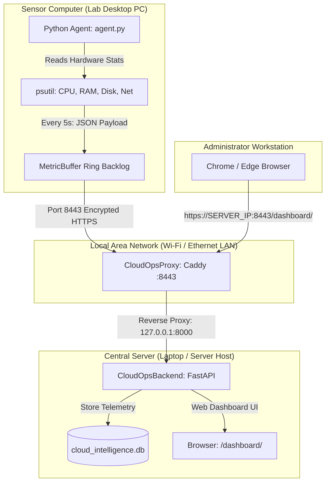

# 🌐 Cloud Intelligence Platform & SRE Command Center

An intelligent, multi-cloud observability, AI-driven anomaly detection, multi-currency cost optimization, role-based access control (RBAC), production SMTP notification, and narrative synthesis platform.

---

## 📋 Table of Contents
- [✨ Key Features](#-key-features)
- [🧩 Architecture & Implemented Modules](#-architecture--implemented-modules)
  - [Module 1: SVG Vector Design System](#module-1-svg-vector-design-system)
  - [Module 2: Multi-Currency Conversion Engine](#module-2-multi-currency-conversion-engine)
  - [Module 3: RBAC & Super Admin Lifecycle](#module-3-rbac--super-admin-lifecycle)
  - [Module 4: Production SMTP & Email Notification System](#module-4-production-smtp--email-notification-system)
- [📁 Repository Structure](#-repository-structure)
- [🚀 Quick Start Guide](#-quick-start-guide)
- [🪟 Windows Services & Production Persistence (Phase 8B)](#-windows-services--production-persistence-phase-8b)
- [🖥️ Step-by-Step Lab PC & Sensor Deployment Guide](#️-step-by-step-lab-pc--sensor-deployment-guide)
- [🌐 Accessing Services & Dashboard](#-accessing-services--dashboard)
- [🔒 Network Security & Agent Transport Architecture](#-network-security--agent-transport-architecture)
- [📧 Email & SMTP Configuration Guide](#-email--smtp-configuration-guide)
- [🧪 Running Tests & Regression Suite (149 Tests)](#-running-tests--regression-suite-149-tests)
- [🐳 Running with Docker](#-running-with-docker)
- [📄 License](#-license)

---

## ✨ Key Features

- **⚡ Real-Time Telemetry & Health Monitoring**: Multi-cloud resource metric collection (CPU, Memory, Disk, Network) with automated anomaly ingestion.
- **🤖 AI & Deep Learning Anomaly Detection**: Multivariate Isolation Forest and LSTM Autoencoder for predictive incident detection.
- **📈 Predictive Forecasting**: Time-series regression forecasting with time-to-threshold countdowns and confidence intervals.
- **🛡️ Enterprise RBAC & Super Admin Management**: Role-based access hierarchy (`SUPER_ADMIN`, `ADMIN`, `OPERATOR`, `VIEWER`), prospective admin registration, verification, approval/rejection workflows, and audit logging.
- **📧 Production SMTP & Email Notification Engine**: STARTTLS/SSL delivery, responsive HTML + plaintext templates, anti-storm alert deduplication, and Super Admin live diagnostics.
- **💱 Multi-Currency Cost Intelligence**: Real-time currency conversion (USD, EUR, GBP, JPY, CAD, AUD, INR, CHF) with base USD storage integrity and spend optimization.
- **🎨 Vectorized Design System**: High-density dark SRE theme built exclusively with crisp SVG Lucide icons and responsive layout components.
- **📝 Incident Synthesis & Narrator**: Auto-generated executive summaries and natural-language incident analysis.

---

## 🧩 Architecture & Implemented Modules

### Module 1: SVG Vector Design System
- **Lucide Vector Icons**: Replaced all informal emojis and legacy assets with high-precision, scalable inline SVG icons (`frontend/js/components/Icons.js`).
- **Responsive SRE UI**: Fixed sidebar layout transitions, responsive table overflow, mobile drawer state preservation, and glassmorphism styling.

### Module 2: Multi-Currency Conversion Engine
- **Base USD Accounting**: Backend stores all metrics and financial projections strictly in USD (`backend/app/services/cost_service.py`).
- **Client-Side Currency Converter**: Centralized `currency_service.py` and UI currency selector supporting 8 major global currencies (`USD`, `EUR`, `GBP`, `JPY`, `CAD`, `AUD`, `INR`, `CHF`) with live symbol and formatting conversion across all charts, tables, and cost breakdowns.

### Module 3: RBAC & Super Admin Lifecycle
- **Hierarchical Role Model**:
  - `SUPER_ADMIN`: Full system control, Super Admin / Admin role promotions, admin request approval/rejection, and SMTP diagnostic tools.
  - `ADMIN`: Infrastructure rule configurations, incident management, and user provisioning.
  - `OPERATOR`: Alert triage, host telemetry monitoring, and feedback classification.
  - `VIEWER`: Read-only telemetry access.
- **Admin Registration & Approval Workflow**:
  1. Prospective Admin submits request via public portal.
  2. Verification email sent with secure token.
  3. Super Admins receive notification upon email verification.
  4. Super Admin approves or rejects the request.
  5. On approval, an inactive account is created and an activation link with a 24-hour expiration token is sent to the applicant.
- **Single-Use Password Reset**: Secure token hash verification preventing token reuse or leakage.

### Module 4: Production SMTP & Email Notification System
- **Dual-Mode Transport**:
  - **Development Mode (`SMTP_ENABLED=false`)**: Captures all outgoing emails to an in-memory test outbox (`_dev_outbox`) for deterministic, zero-network testing.
  - **Production Mode (`SMTP_ENABLED=true`)**: Dispatches RFC 5322 multipart emails over STARTTLS (port 587) or direct SSL (port 465).
- **Anti-Storm Incident Deduplication**: Rules evaluated by metric with highest severity prioritization; newly created critical alerts dispatch **one** email, while ongoing evaluations update snapshots without duplicate email storms.
- **7 Responsive Templates**:
  - Admin Email Verification
  - Super Admin New-Request Notification
  - Admin Approval & Account Activation
  - Admin Request Rejection
  - Single-Use Password Reset
  - Critical SRE Incident Alert
  - SMTP Relay Diagnostic Test
- **Super Admin SMTP Diagnostic Modal**: UI modal in Admin Management for real-time live connection tests with sanitized error reporting.

---

## 📁 Repository Structure

```text
Cloud-Intelligence-Platform/
│
├── backend/                # FastAPI Core REST API, DB models, services, & lifespan
│   └── app/
│       ├── api/v1/         # REST API route handlers (auth, admin, metrics, alerts, etc.)
│       ├── cli/            # Administrative CLI tools (bootstrap_admin.py)
│       ├── core/           # Config, database, security, and rate-limiting
│       ├── database/       # SQLite / PostgreSQL ORM schemas & init seeders
│       ├── models/         # SQLAlchemy DB models (User, Host, Metric, Alert, Audit, etc.)
│       ├── schemas/        # Pydantic request/response schemas
│       ├── services/       # Core business logic (auth, email, alerts, AI, currency, cost)
│       └── templates/      # Responsive HTML + plaintext email templates
│
├── frontend/               # Single-page SRE / SOC monitoring web dashboard
│   ├── css/                # CSS design system & dark-mode tokens
│   ├── js/                 # Views (Overview, Metrics, AdminManagement, Auth, etc.)
│   │   ├── components/     # Reusable SVG Icons, StatusBadges, and modals
│   │   ├── services/       # Client-side currency conversion & state
│   │   ├── api.js          # Centralized API client
│   │   ├── auth.js         # JWT token management & RBAC route guards
│   │   └── app.js          # Core routing and view lifecycle orchestration
│   └── index.html          # Main web application entry point
│
├── monitoring_agent/       # Telemetry collection & sliding window metric buffers
├── ai_engine/              # Isolation Forest, LSTM Autoencoders & forecasters
├── cost_engine/            # Cloud cost analysis, forecasting & anomaly detection
├── security_engine/        # Security posture, compliance checks & vulnerability scanning
├── narrator/               # Executive summaries & incident reporting engine
│
├── data/                   # Datasets (raw, processed, benchmarks & ground truth)
├── models/                 # Pretrained serialized ML models (.joblib, .pt)
├── tests/                  # 81 comprehensive unit & integration test suites
├── scripts/                # Data generators, fleet simulators & verification scripts
├── docs/                   # Architecture, API specifications & design tokens
│
├── .env.example            # Environment variables template with documentation
├── requirements.txt        # Python dependency manifest
├── README.md               # Project documentation
└── docker-compose.yml      # Multi-container orchestration
```

---

## 🚀 Quick Start Guide

### Prerequisites
- **Python 3.10+** (Python 3.10 – 3.13 fully supported)
- **Git**

---

### 1. Clone Repository

```bash
git clone https://github.com/Shaikh921/Major-Project-Phase-1.git
cd Major-Project-Phase-1
```

---

### 2. Set Up Virtual Environment

#### On Windows (PowerShell):
```powershell
python -m venv .venv
.\.venv\Scripts\Activate.ps1
```

#### On Linux / macOS:
```bash
python3 -m venv .venv
source .venv/bin/activate
```

---

### 3. Install Dependencies

```bash
python -m pip install --upgrade pip
pip install -r requirements.txt
```

---

### 4. Environment Variables Configuration

Copy `.env.example` to `.env`:

```bash
# Windows PowerShell:
Copy-Item .env.example .env

# Linux / macOS:
cp .env.example .env
```

---

### 5. Bootstrap Initial Super Admin

Before logging in for the first time, create the initial `SUPER_ADMIN` user via the CLI utility:

```bash
python -m backend.app.cli.bootstrap_admin
```

Follow the prompts or supply environment defaults to create your administrator credentials.

---

### 6. Run the Application Manually (Development Mode)

If testing or developing locally in the foreground:

#### Step A: Start Uvicorn Backend (Loopback Only)
Start the FastAPI server listening strictly on `127.0.0.1`:
```bash
python -m uvicorn backend.app.main:app --host 127.0.0.1 --port 8000
```
> [!IMPORTANT]
> Never bind the backend to `0.0.0.0:8000`. Direct plaintext HTTP on port 8000 is intentionally restricted to loopback (`127.0.0.1`) to ensure all network traffic passes through the authenticated HTTPS reverse proxy.

#### Step B: Start Caddy HTTPS Reverse Proxy
In a separate terminal, launch Caddy:
```powershell
.\tools\caddy.exe run --config Caddyfile
```
Caddy will automatically generate internal ECC certificates covering `localhost`, `127.0.0.1`, and your LAN IP, listening securely on port `8443`.

---

## 🪟 Windows Services & Production Persistence (Phase 8B)

For staging and enterprise production environments on Windows Server / Windows 10/11, CloudOps Intel runs as resilient background Windows Services managed by the Windows Service Control Manager (SCM) via NSSM, protected by native NTFS Access Control Lists (ACLs).

### 1. Architectural Highlights
- **Service Isolation**:
  - `CloudOpsBackend`: Runs Uvicorn under isolated Virtual Service Account `NT SERVICE\CloudOpsBackend`. Bound strictly to `127.0.0.1:8000`.
  - `CloudOpsProxy`: Runs Caddy under isolated Virtual Service Account `NT SERVICE\CloudOpsProxy`. Listens on public/LAN HTTPS port `8443`.
- **Hardened Least-Privilege NTFS DACLs**:
  - `Authenticated Users Modify` permissions stripped across the entire project root.
  - Cross-service read/write boundaries enforced: `CloudOpsProxy` has zero access to `.env`, SQLite database, or backend source code. `CloudOpsBackend` has zero access to Caddy private keys or proxy logs.
  - Sidecar write permissions: Targeted `(WD,AD,DC)` and `CREATOR OWNER:(OI)(CI)(IO)(M)` rights allow the backend to create, truncate, checkpoint, and delete SQLite WAL (`-wal`) and shared memory (`-shm`) sidecars without granting broad directory Modify access.
- **SQLite WAL Mode**:
  - Write-Ahead Logging (`PRAGMA journal_mode=WAL`) enabled with a 30-second busy timeout (`PRAGMA busy_timeout=30000`) for high concurrency between reader threads, analytical background jobs, and real-time ingestion streams.

### 2. Elevated Installation & Management

#### Install and Harden Services (Run in PowerShell as Administrator):
```powershell
powershell -ExecutionPolicy Bypass -File .\scripts\install_windows_services.ps1 -StartAfterInstall
```

#### Service Control Commands:
```powershell
# Check status of both services
sc.exe query CloudOpsBackend
sc.exe query CloudOpsProxy

# Start services
net start CloudOpsBackend
net start CloudOpsProxy

# Stop services
net stop CloudOpsProxy
net stop CloudOpsBackend
```

#### Run Security & ACL Verification Suite:
```powershell
python scripts\verify_service_acls.py
```

#### Safe Uninstallation / Rollback:
```powershell
powershell -ExecutionPolicy Bypass -File .\scripts\uninstall_windows_services.ps1
```

---

## 🖥️ Step-by-Step Lab PC & Sensor Deployment Guide

CloudOps Intel uses a **Hub-and-Spoke** architecture where a Central Server (e.g. Laptop or Server machine) hosts the backend, database, and dashboard, while client computers (e.g. Lab Desktop PCs) run a lightweight sensor daemon that streams live hardware telemetry over your local network.



### Step 1: Configure Central Server Firewall & Identify IP

1. **Find your Server LAN IP:**
   Open Command Prompt or PowerShell on the Server machine and run `ipconfig`. Look for your active adapter IPv4 address (for example: `10.227.136.246`).
2. **Allow Inbound Port 8443 in Windows Firewall:**
   Open **PowerShell as Administrator** on the Server machine and run:
   ```powershell
   netsh advfirewall firewall add rule name="CloudOps 8443" dir=in action=allow protocol=TCP localport=8443
   ```

### Step 2: Access & Log In to the Central Dashboard

1. From any browser on your network, open:
   👉 **`https://<SERVER_IP>:8443/dashboard/`** (e.g., `https://10.227.136.246:8443/dashboard/`)
2. **Bypass Self-Signed Certificate Warning:**
   Because Caddy issues internal local CA certificates (`tls internal`), your browser will display *"Your connection isn't private"*. Click **Advanced** ➔ **Proceed to \<SERVER_IP\> (unsafe)**.
3. **Log in with Administrator Credentials:**
   - **Email:** `s23_shaikh_irafan@mgmcen.ac.in` (or your configured Super Admin email)
   - **Password:** Your configured password (e.g., `@Shaikh921`)

### Step 3: Prepare the Sensor Computer (Lab PC)

The sensor machine only requires Python and two lightweight libraries — **no database, Node.js, or FastAPI needed**.

1. **Install Python 3.9+** on the sensor computer.
2. **Install Required Packages:**
   ```bash
   pip install psutil requests
   ```
3. **Copy Files to Sensor Computer:**
   Create a folder on the sensor computer (e.g. `Desktop/SensorAgent`) and copy:
   - The [`monitoring_agent/`](monitoring_agent/) folder from the repository.
   - The root certificate file [`root.crt`](data/caddy/pki/authorities/local/root.crt) from `C:\CLoudProject\data\caddy\pki\authorities\local\root.crt`.

Folder layout on the sensor computer:
```text
Desktop/SensorAgent/
   ├── monitoring_agent/
   │     ├── __init__.py
   │     ├── agent.py
   │     ├── buffer.py
   │     └── collector.py
   └── root.crt
```

### Step 4: Launch the Sensor Agent

On the sensor computer, open a terminal in the `SensorAgent` folder and run:

```bash
python -m monitoring_agent.agent --url https://<SERVER_IP>:8443/api/v1/metrics --ca-bundle root.crt --api-key "<YOUR_AGENT_INGESTION_KEY>"
```

*Example with verified parameters:*
```bash
python -m monitoring_agent.agent --url https://10.227.136.246:8443/api/v1/metrics --ca-bundle root.crt --api-key "a7d2e4f8c9b1035e821a4f7d6e3c5b9a1f4d8e2c7b0a3f6e9d1c4b8a2f5e7d3c"
```

The terminal will begin streaming telemetry every 5 seconds:
```text
[*] Starting Monitoring Agent -> Target: https://10.227.136.246:8443/api/v1/metrics | Polling: 5s
[+] [DESKTOP-OGTK5SI] CPU: 14.2% | MEM: 48.1% | DISK: 55.0% -> Ingested
```

### Step 5: Verify Live Telemetry in the Dashboard

In your browser at `https://<SERVER_IP>:8443/dashboard/`:
- **Lab PCs View:** Click **Lab PCs** in the sidebar. The newly connected PC will immediately appear as an active host card showing its real IP address, green **ONLINE** heartbeat status, and live CPU/RAM/Disk gauges.
- **Infrastructure View:** Click **Infrastructure** to see the host listed with the **REAL_AGENT** provenance badge.
- **Telemetry Stream View:** Click **Telemetry Stream** to view real-time time-series graphs plotting metric deltas as they arrive from the sensor PC.

### Step 6: Troubleshooting & Common Pitfalls

| Symptom | Root Cause | Resolution |
| :--- | :--- | :--- |
| **`400 Bad Request: Client sent an HTTP request to an HTTPS server`** | User typed `http://` instead of `https://` | Always include the `https://` scheme: `https://<SERVER_IP>:8443/dashboard/` |
| **`Connection Refused` on port 8000** | Attempting to access backend directly from remote PC | Port 8000 is intentionally loopback-only. Connect via port `8443` through Caddy. |
| **`401 Unauthorized: Missing agent ingestion credentials`** | Agent started without `--api-key` | Supply the valid API key using `--api-key "<KEY>"` or `AGENT_API_KEY` env var. |
| **`SSLError: certificate verify failed`** | Agent cannot verify Caddy's internal CA | Provide `--ca-bundle root.crt` copied from the server. |
| **`Request timed out` on ping / connection** | Campus or public Wi-Fi AP Isolation | Public/campus Wi-Fi often blocks device-to-device traffic. Connect both machines to a mobile hotspot or private LAN switch. |

---

## 📧 Email & SMTP Configuration Guide

### 1. Configure `.env`
To enable live email delivery (e.g. Gmail, Outlook, or corporate SMTP relay):

```ini
SMTP_ENABLED=true
SMTP_HOST=smtp.gmail.com
SMTP_PORT=587
SMTP_USER=your-email@gmail.com
SMTP_PASSWORD=your-16-char-app-password
SMTP_TLS=true
SMTP_SSL=false
SMTP_FROM_EMAIL=your-email@gmail.com
SMTP_FROM_NAME="CloudOps Intel Command Center"
SMTP_TIMEOUT_SECONDS=10

NOTIFY_SUPER_ADMINS_ON_NEW_REQUEST=true
NOTIFY_ON_CRITICAL_ALERTS=true
```

*(For Gmail: Generate a 16-character **App Password** under Google Account -> Security -> 2-Step Verification -> App Passwords).*

### 2. Test SMTP Delivery
- **From Dashboard UI**: Log in as `SUPER_ADMIN` -> Go to **Admin Management** -> Click **"Test Email / SMTP"** -> Enter recipient -> Click **"Dispatch Test Email"**.
- **From CLI**:
  ```bash
  python -c "from backend.app.services.email_service import EmailService; ok, msg = EmailService.send_test_email('your-email@example.com'); print(ok, msg)"
  ```

---

## 🧪 Running Tests & Regression Suite (149 Tests)

Run the complete test suite covering all modules:

```bash
pytest
```

### Test Coverage Highlights:
- **`tests/test_agent_transport_security.py`**: Enforces remote HTTPS requirement, rejection of cleartext HTTP credentials, loopback exceptions, custom CA bundle propagation, fail-closed TLS error handling, and Caddyfile validation.
- **`tests/test_config.py`**: JWT secret entropy and production rejection of weak/default credentials across all deployment environments.
- **`tests/test_sqlite_wal.py`**: SQLite WAL mode persistence and busy timeout handling under concurrent load.
- **`tests/test_security_remediation.py`**: In-memory test isolation, API key authentication, and batch ingestion bounds.
- **`tests/test_api_lab.py`**: Lab PC monitoring endpoints, room aggregations, provenance filtering, and offline calculation.
- **`tests/test_email_service.py`**: SMTP dispatch, STARTTLS, SSL, timeout handling, sanitization, anti-storm alert deduplication, and template rendering.
- **`tests/test_auth_service.py`**: Admin verification, approval, rejection, password reset, and rate limiting.
- **`tests/test_super_admin_service.py`**: Super Admin RBAC, role promotion, demotion protections, and audit logging.
- **`tests/test_currency_service.py`**: Multi-currency conversion accuracy and base USD accounting.
- **`tests/test_alert_engine.py` & `tests/test_ai_anomaly.py`**: Isolation Forest, anomaly thresholds, and alert state management.

```text
============================ 149 passed in 14.32s =============================
```

---

## 🐳 Running with Docker

To spin up the containerized stack:

```bash
docker-compose up -d --build
```

To stop all services:
```bash
docker-compose down
```

---

## 📄 License
This project is developed for educational and enterprise cloud intelligence research.
