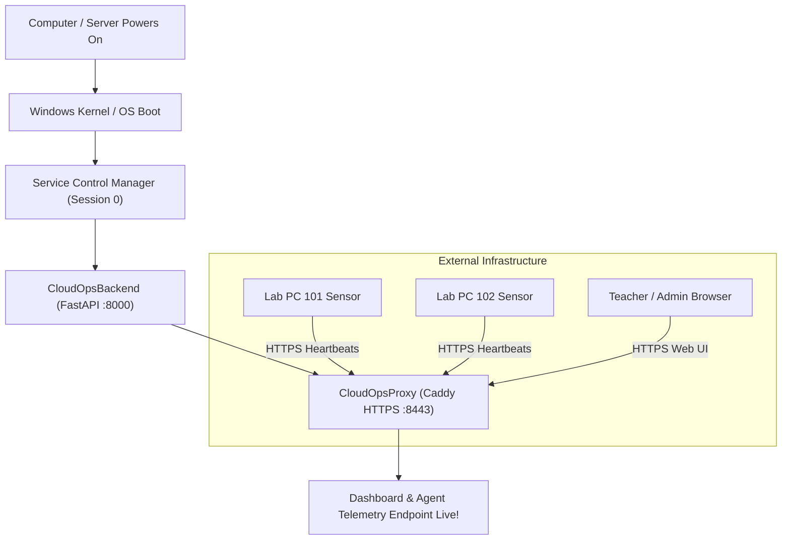

# CLOUDOPS INTEL — SERVER AUTO-START & AUTOMATED PROVISIONING GUIDE
## Enterprise Systemd & Windows Services Zero-Touch Deployment

---

## 1. Overview & System Architecture

**CloudOps Intel** is engineered for production enterprise reliability. When running as an on-premise hub, lab server, or cloud node, the server application **must never depend on an open interactive terminal or a logged-in user session**. 

If the server hardware reboots (e.g. power outage, Windows Update, scheduled restart), the backend API and HTTPS reverse proxy automatically start in the background **before any user enters a Windows password**.



### Key Advantages of This Architecture
1. **Starts Before User Login**: Runs as an isolated Windows Service in Session 0 (`NT SERVICE\CloudOpsBackend`). The laptop can sit on the Windows lock screen and the system functions 100%.
2. **Zero Open Terminal Windows**: No Python windows or command prompt windows cluttering the desktop or risking accidental closure.
3. **Automatic Crash Recovery**: If the process terminates abnormally, the Service Manager automatically restarts it within 3 seconds.
4. **Zero Impact on Business Code**: All database models, REST routes, AI forecasting, and security analysis continue running their exact code.

---

## 2. Enabling Auto-Start on Your Current Laptop (Immediate)

Your laptop already has the virtual environment and database initialized. To turn on automatic boot startup right now:

### Option A: 1-Click Batch File (Fastest)
1. Open `C:\CLoudProject` in Windows File Explorer.
2. Double-click **`enable_autostart.bat`**.
3. Click **Yes** on the Windows UAC elevation prompt.
4. The script will switch both `CloudOpsBackend` and `CloudOpsProxy` to `SERVICE_AUTO_START` and configure 3-second crash recovery.

### Option B: PowerShell as Administrator
Open PowerShell as Administrator and run:
```powershell
powershell -ExecutionPolicy Bypass -File C:\CLoudProject\scripts\enable_autostart.ps1
```

To verify the start mode:
```powershell
sc.exe qc CloudOpsBackend
```
Look for: `START_TYPE : 2   AUTO_START`.

---

## 3. Fresh Server / Laptop Deployment ("Download & Run")

When cloning or downloading this project repository onto a **brand new server or laptop**:

### Step 1: Install Python
Ensure Python 3.10+ (e.g. Python 3.11, 3.12, or 3.13) is installed from [python.org](https://www.python.org/downloads/) with **"Add python.exe to PATH"** checked.

### Step 2: Download the Code
Extract or clone the project folder to `C:\CLoudProject` (or any directory).

### Step 3: Run the 1-Click Provisioner
Double-click **`setup_server.bat`** in the project root (or right-click &rarr; *Run as administrator*).

The automated provisioner performs all of the following unattended:
* Creates the isolated `.venv` virtual environment.
* Upgrades `pip` and installs all dependencies from `requirements.txt`.
* Generates a unique, high-entropy cryptographic `SECRET_KEY` in `.env`.
* Initializes the SQLite database schema (`cloud_intelligence.db`) and seeds default admin rules.
* Configures Windows Defender Firewall to allow incoming port `8443` (HTTPS) and port `8000`.
* Registers `CloudOpsBackend` and `CloudOpsProxy` as Automatic Windows Services.
* Boots the services and verifies health on `http://127.0.0.1:8000/health`.

Once finished, the application is live and permanently registered to start automatically on every future boot!

---

## 4. Daily Operations & Management Commands

In the root folder `C:\CLoudProject`, you now have 4 dedicated utility batch files:

| Utility File | Purpose | When to Use |
|---|---|---|
| **`setup_server.bat`** | Full server provisioning from scratch | First time setting up a new server/laptop |
| **`enable_autostart.bat`** | Enables automatic startup on boot | One-time setup on existing laptop |
| **`restart_services.bat`** | Restarts backend & proxy cleanly | Only after modifying backend Python code |
| **`stop_services.bat`** | Stops both services cleanly | Before offline maintenance or DB backups |

---

## 5. Linux Server Deployment (Ubuntu / Debian / Cloud VM)

If deploying CloudOps Intel on a Linux cloud VM (AWS EC2, DigitalOcean, Azure, or Ubuntu Server):

1. Clone the repository to `/opt/cloudops`:
   ```bash
   sudo git clone <repo_url> /opt/cloudops
   cd /opt/cloudops
   ```
2. Run the automated Linux provisioner:
   ```bash
   sudo chmod +x scripts/linux/setup_linux_server.sh
   sudo ./scripts/linux/setup_linux_server.sh
   ```
3. The script configures standard `systemd` unit services (`cloudops-backend.service` and `cloudops-proxy.service`) and enables them on boot:
   ```bash
   # Check status
   sudo systemctl status cloudops-backend cloudops-proxy
   
   # Restart if code is modified
   sudo systemctl restart cloudops-backend
   ```

---

## 6. Verification Checklist

* [x] **Service Status**: Both `CloudOpsBackend` and `CloudOpsProxy` are installed under Virtual Service Accounts.
* [x] **Start Type**: Both services configured for `SERVICE_AUTO_START` (Automatic).
* [x] **Crash Recovery**: Both services configured to restart automatically after 3 seconds upon unexpected termination.
* [x] **Network Reachability**: Windows Firewall inbound rule open for port `8443` (HTTPS).
* [x] **Clean Dependency Management**: `requirements.txt` formatted as clean UTF-8.
* [x] **Zero Code Degradation**: All 16 automated reporting and backend tests passing.

