# CloudOps Intel — System Architecture & Workflow Diagrams

This document consolidates all core architectural workflows, security models, data pipelines, and operational flowcharts for **CloudOps Intel — Cloud Intelligence Platform & SRE Command Center**.

---

## Table of Contents

1. [High-Level Defense-in-Depth Security Architecture](#1-high-level-defense-in-depth-security-architecture)
2. [Dual-Mode Asynchronous Email Notification Engine](#2-dual-mode-asynchronous-email-notification-engine)
3. [Multi-Step Administrative Governance & Anti-Rogue Approval Queue](#3-multi-step-administrative-governance--anti-rogue-approval-queue)
4. [3-Tier AI/ML Anomaly Detection & Explainability Pipeline](#4-3-tier-aiml-anomaly-detection--explainability-pipeline)
5. [FinOps Hybrid Cost Optimization & Currency Engine](#5-finops-hybrid-cost-optimization--currency-engine)
6. [FinOps Workload Rightsizing Decision Logic](#6-finops-workload-rightsizing-decision-logic)
7. [Cloud Virtual Machine vs Bare-Metal Architecture](#7-cloud-virtual-machine-vs-bare-metal-architecture)
8. [4-Tier Cumulative Role-Based Access Control (RBAC) Hierarchy](#8-4-tier-cumulative-role-based-access-control-rbac-hierarchy)
9. [Physical Sensor Device Enrollment & Anti-Spoofing Handshake](#9-physical-sensor-device-enrollment--anti-spoofing-handshake)
10. [Industry Readiness Evolution: Current MVP vs Enterprise Standard](#10-industry-readiness-evolution-current-mvp-vs-enterprise-standard)
11. [Operational A4 Report & PDF Export Document Layout](#11-operational-a4-report--pdf-export-document-layout)

---

## 1. High-Level Defense-in-Depth Security Architecture

CloudOps Intel implements a multi-layer security posture spanning network boundaries, hardware agent identity, cryptographic token storage, role-based governance, and application defense.

```mermaid
flowchart TD
    subgraph L1["1. Network & Transport Boundary"]
        Caddy["Caddy Reverse Proxy (TLS 1.3/1.2 on Port 8443)"]
        Loopback["FastAPI Backend bound to 127.0.0.1:8000 (Loopback Only)"]
        PKI["Custom Internal PKI (Strict root.crt CA Pinning)"]
    end

    subgraph L2["2. Sensor & Telemetry Ingestion"]
        NTFS["OS Security: icacls SYSTEM & Admin Only"]
        Handshake["2-Phase Enrollment Handshake (15-min Enrollment Codes)"]
        DeviceBound["Hardware UUID & Host ID Binding (Anti-Spoofing)"]
        RingBuffer["Offline SQLite Ring Buffer (Anti-Data Loss & DDoS Guard)"]
    end

    subgraph L3["3. Identity & Cryptography"]
        Argon2id["Argon2id Password Hashing (64 MiB RAM, 3 Iterations, 4 Parallel)"]
        JWT["Dual-Token JWT: Short-Lived Access (15m) + httpOnly Cookie Refresh (7d)"]
        TokenHash["Single-Use Tokens: SHA-256 Hashed at Rest (Zero Raw Storage)"]
    end

    subgraph L4["4. Governance & RBAC"]
        RBAC["4-Tier Hierarchical RBAC: VIEWER to SUPER_ADMIN"]
        Gov["Multi-Step Anti-Rogue Admin Approval Pipeline"]
        ImmutableAudit["Append-Only Audit Trail (All Sensitive Admin/Auth Actions)"]
    end

    subgraph L5["5. Threat & Application Defense"]
        SQLi["100% Parameterized SQLAlchemy 2.0 ORM (SQLi Immunity)"]
        XSS["XSS Immunity: Strict escapeHtml() Sanitizer in UI & Emails"]
        ThreatEngine["Security Events Engine (SSH Brute-Force, Port Scans, Tampering)"]
        AIGuards["Explainable ML (Isolation Forest + LSTM + SHAP Feature Attribution)"]
    end

    L1 --> L2
    L2 --> L3
    L3 --> L4
    L4 --> L5
```

- **Source Code References:**
  - Network Boundary: `Caddyfile`, [`backend/app/core/config.py`](file:///C:/CLoudProject/backend/app/core/config.py)
  - Sensor Security: [`scripts/install_sensor_client.ps1`](file:///C:/CLoudProject/scripts/install_sensor_client.ps1), [`backend/app/services/device_service.py`](file:///C:/CLoudProject/backend/app/services/device_service.py)
  - Cryptography: [`backend/app/core/security.py`](file:///C:/CLoudProject/backend/app/core/security.py)

---

## 2. Dual-Mode Asynchronous Email Notification Engine

The centralized email dispatch system prevents blocking HTTP worker processes by routing mail jobs to a background thread pool, supporting dual transport modes (live SMTP vs development outbox).

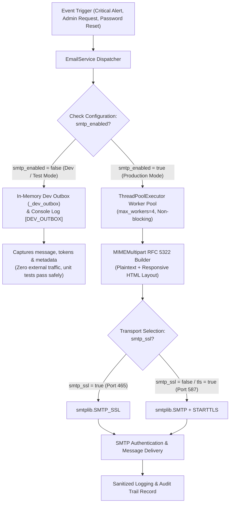

- **Source Code References:**
  - Dispatch Service: [`backend/app/services/email_service.py`](file:///C:/CLoudProject/backend/app/services/email_service.py)
  - Responsive Templates: [`backend/app/templates/email_templates.py`](file:///C:/CLoudProject/backend/app/templates/email_templates.py)

---

## 3. Multi-Step Administrative Governance & Anti-Rogue Approval Queue

To eliminate self-provisioned administrator accounts, prospective administrators must complete email verification followed by formal approval by a verified Super Administrator.

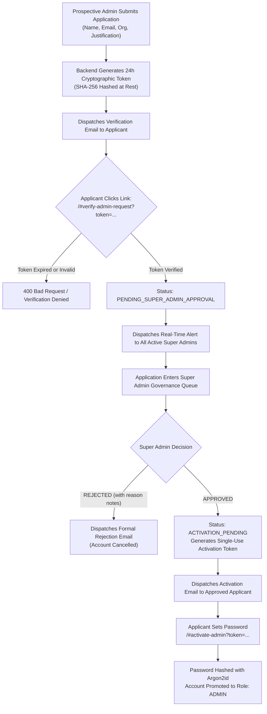

- **Source Code References:**
  - Route Handlers: [`backend/app/api/v1/auth.py`](file:///C:/CLoudProject/backend/app/api/v1/auth.py)
  - Governance Logic: [`backend/app/services/auth_service.py`](file:///C:/CLoudProject/backend/app/services/auth_service.py)

---

## 4. 3-Tier AI/ML Anomaly Detection & Explainability Pipeline

CloudOps Intel integrates static rule gates, unsupervised spatial clustering (Isolation Forest), and deep temporal sequence reconstruction (LSTM Autoencoder) to detect micro-bursts, sequence drift, and memory leaks.

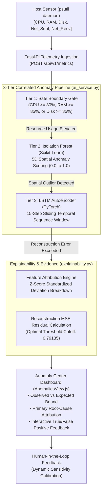

- **Source Code References:**
  - Coordination: [`backend/app/services/ai_service.py`](file:///C:/CLoudProject/backend/app/services/ai_service.py)
  - Isolation Forest: [`ai_engine/anomaly_detector.py`](file:///C:/CLoudProject/ai_engine/anomaly_detector.py)
  - LSTM Autoencoder: [`ai_engine/lstm_detector.py`](file:///C:/CLoudProject/ai_engine/lstm_detector.py)
  - Explainability: [`ai_engine/explainability.py`](file:///C:/CLoudProject/ai_engine/explainability.py)

---

## 5. FinOps Hybrid Cost Optimization & Currency Engine

The cost optimization engine combines static cloud unit catalog pricing with dynamic rolling telemetry analysis and real-time European Central Bank currency conversion.

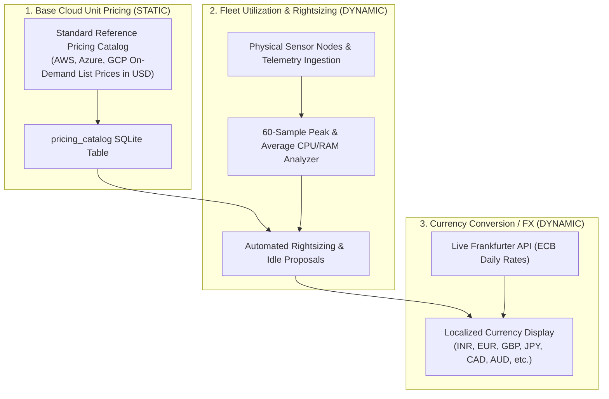

- **Source Code References:**
  - Calculator: [`cost_engine/calculator.py`](file:///C:/CLoudProject/cost_engine/calculator.py)
  - Cost Service: [`backend/app/services/cost_service.py`](file:///C:/CLoudProject/backend/app/services/cost_service.py)
  - Currency Service: [`backend/app/services/currency_service.py`](file:///C:/CLoudProject/backend/app/services/currency_service.py)

---

## 6. FinOps Workload Rightsizing Decision Logic

When evaluating provisioned cloud instances against observed workloads, the engine detects over-provisioning and calculates net monthly savings.

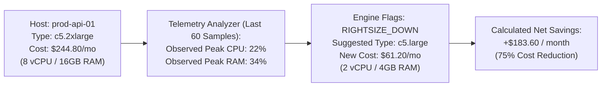

- **Decision Formula:**
  - If instance is `2xlarge` and Peak CPU $< 40\%$ and Peak RAM $< 45\%$ $\rightarrow$ Downsize to `large` (Confidence: 88%).
  - If Average CPU $< 5\%$ and Average RAM $< 25\%$ $\rightarrow$ Flag for `IDLE_TERMINATION` (Confidence: 95%).

---

## 7. Cloud Virtual Machine vs Bare-Metal Architecture

This diagram illustrates the architectural distinction between cloud-hosted virtual machines and physical lab computers (like `PC-lab10-18`).

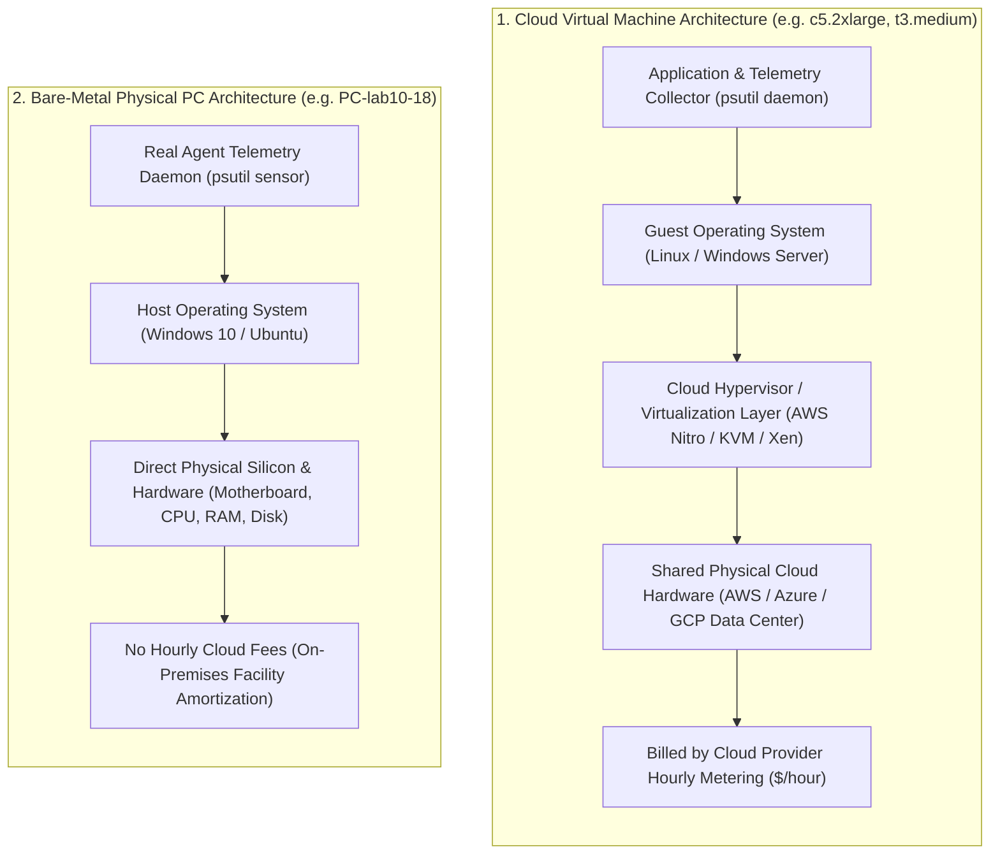

- **Cloud Instance:** Billed hourly based on cloud provider catalogs (AWS/Azure/GCP).
- **Bare-Metal Node:** On-premises physical machine owned locally. Displays `bare-metal` in the UI and defaults to baseline amortized facility operational cost.

---

## 8. 4-Tier Cumulative Role-Based Access Control (RBAC) Hierarchy

CloudOps Intel enforces a strict hierarchical role structure where higher roles inherit all lower permissions.

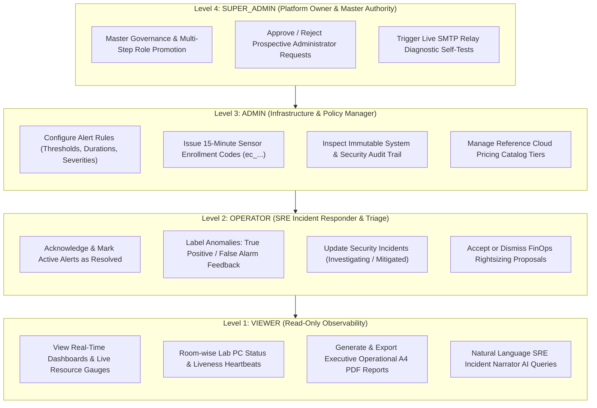

- **Source Code References:**
  - RBAC Guards: [`backend/app/api/deps.py`](file:///C:/CLoudProject/backend/app/api/deps.py#L228-L231)
  - User Model: [`backend/app/models/user.py`](file:///C:/CLoudProject/backend/app/models/user.py#L19-L26)

---

## 9. Physical Sensor Device Enrollment & Anti-Spoofing Handshake

Enrolling a new physical PC follows a secure two-phase handshake that prevents rogue nodes from spoofing telemetry.

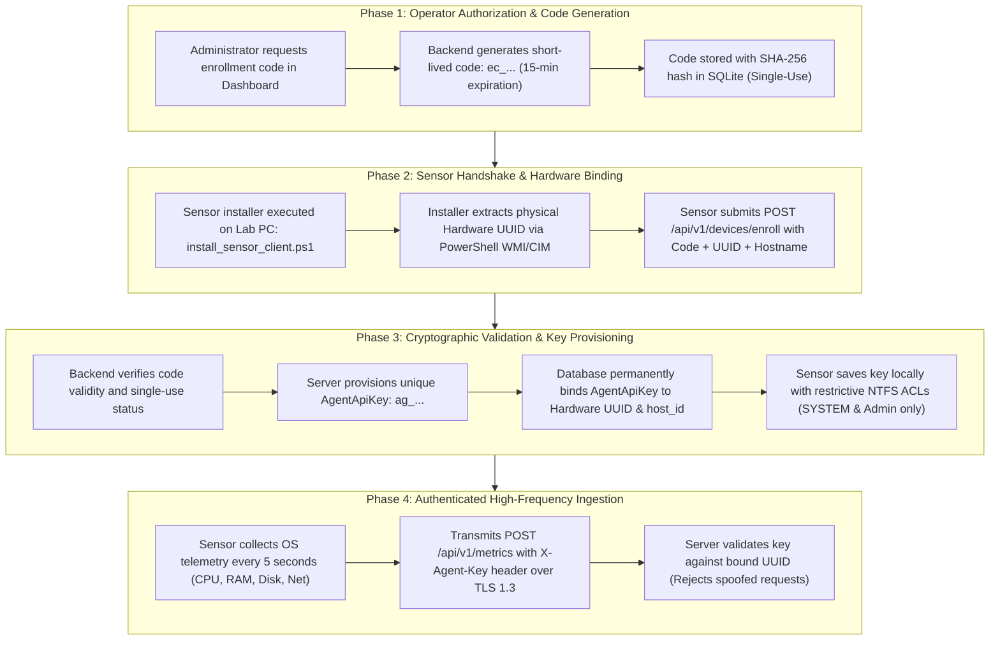

- **Source Code References:**
  - Installer: [`scripts/install_sensor_client.ps1`](file:///C:/CLoudProject/scripts/install_sensor_client.ps1)
  - Device API: [`backend/app/api/v1/devices.py`](file:///C:/CLoudProject/backend/app/api/v1/devices.py)
  - Device Service: [`backend/app/services/device_service.py`](file:///C:/CLoudProject/backend/app/services/device_service.py)

---

## 10. Industry Readiness Evolution: Current MVP vs Enterprise Standard

An honest engineering roadmap illustrating the transition from the current lab prototype to an enterprise-grade commercial deployment.

```mermaid
flowchart LR
    subgraph Current["Current State (Lab / MVP Phase)"]
        DB1["SQLite WAL (Single-Writer Contention)\nCapacity: <= 50 Hosts"]
        Agent1["Python Script + psutil\n(Requires local Python runtime on PC)"]
        Proto1["HTTP REST JSON Polling\n(High HTTP header & serialization overhead)"]
        Deploy1["Single Laptop / Local Server\n(Single point of failure, no clustering)"]
        Auth1["Local Database User Auth\n(Argon2id + PyJWT)"]
    end

    subgraph Industry["Enterprise Industry Standard"]
        DB2["TimescaleDB / ClickHouse / Prometheus\n(High-throughput distributed time-series DB)"]
        Agent2["Compiled Go / Rust Binary\n(Zero runtime dependencies, signed Windows Service)"]
        Proto2["gRPC / OTLP (OpenTelemetry)\n(Protobuf binary streaming over HTTP/2)"]
        Deploy2["Kubernetes (K8s) / AWS EKS\n(Multi-AZ auto-scaling with load balancing)"]
        Auth2["SAML 2.0 / OIDC / Azure AD / Okta\n(Enterprise Single Sign-On / IAM)"]
    end

    Current -.->|Engineering Evolution| Industry
```

---

## 11. Operational A4 Report & PDF Export Document Layout

Layout structure of the browser-native A4 executive PDF export generated by the Command Center.

```mermaid
flowchart TD
    subgraph ReportDocument["CloudOps Intel — Executive & Operational SRE Audit (A4 PDF)"]
        subgraph HeaderSection["Document Header & System Status"]
            Title["Title: Cloud Infrastructure & Security Intelligence Report"]
            Status["Status Badge: HEALTHY (0 Critical Alerts) / DEGRADED"]
        end

        subgraph MetaGrid["Metadata Strip (Audit & Provenance Grid)"]
            M1["Report ID: RPT-XXXXXXXX"]
            M2["Reporting Horizon: Start UTC → End UTC"]
            M3["Telemetry Freshness & Heartbeat Cutoff: 90s"]
            M4["Environment Scope & Display Currency: USD / INR"]
        end

        subgraph KpiGrid["Executive KPI Summary (4 Metric Cards)"]
            K1["Monitored Fleet: Total (Online / Offline / No Data)"]
            K2["Active Incidents: Critical & Warning Alert Counts"]
            K3["Security Posture: No Security Events Flagged"]
            K4["Financial Impact: Potential Monthly Savings & Spend"]
        end

        subgraph Section1["Section 1: Monitored Fleet Inventory & Node Liveness Triage"]
            T1["Node Inventory Table:\nHostname | IP | Room | Status | Last Seen | CPU% | RAM% | Disk%"]
        end

        subgraph Section2["Section 2: Multi-Domain Findings & Operational Observations"]
            F1["Fleet Overview & Infrastructure Load Analysis"]
            F2["Security & Threat Observations (Auth Streams & Port Scans)"]
            F3["Cost Efficiency & Catalog Rightsizing Insights"]
        end

        subgraph Section3["Section 3: Technical Integrity & Disclaimers"]
            D1["Security Disclaimer: Absence of recorded events != proof of security"]
            D2["Dynamic Liveness Model: 90-second heartbeat cutoff threshold"]
        end

        HeaderSection --> MetaGrid --> KpiGrid --> Section1 --> Section2 --> Section3
    end
```

- **Source Code References:**
  - View Component: [`frontend/js/views/ReportsView.js`](file:///C:/CLoudProject/frontend/js/views/ReportsView.js)
  - Print Styles: [`frontend/css/command-center.css`](file:///C:/CLoudProject/frontend/css/command-center.css)
  - Backend Service: [`backend/app/services/report_service.py`](file:///C:/CLoudProject/backend/app/services/report_service.py)

